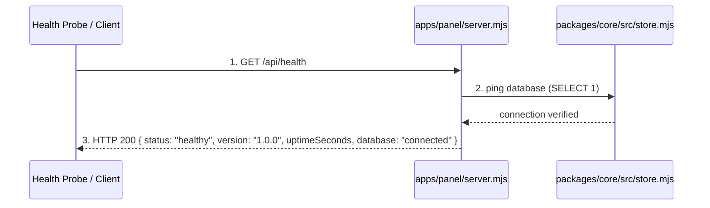

# Add GET /api/health endpoint returning version, uptime, and database status

**Approved**: 2026-11-09 - user: "Add a dedicated healthcheck route GET /api/health to apps/panel/server.mjs. It should return status 200 with JSON: { status: \"healthy\", version: \"1.0.0\", uptimeSeconds: number, database: \"connected\" } and unit test in panel server tests."

## Problem

In the local Control Panel server (`apps/panel/server.mjs`), external monitoring, process supervisors, container runtimes, and healthcheck probes cannot inspect server responsiveness and SQLite database availability without requesting the full `/api/dashboard` payload (which scans all workflows, 23 locked skills, specialist agents catalog, brain markdown docs, deployment history, and telemetry aggregates) or requesting static UI bundles. There is no lightweight, low-overhead endpoint to verify that the HTTP listener is operational, the process is responsive, and the SQLite database is open and reachable.

When this ships, clients, monitoring checks, and test harnesses can issue a lightweight `GET /api/health` request to receive HTTP 200 with `{ status: "healthy", version: "1.0.0", uptimeSeconds: number, database: "connected" }` in milliseconds without disk-heavy scans or reading the entire factory knowledge base.

## Shape

This feature reuses the existing `node:http` routing in `apps/panel/server.mjs` and the active `FactoryStore` SQLite connection in `packages/core/src/store.mjs` without introducing any external dependencies. The healthcheck evaluation rules run in `apps/panel/server.mjs` and are covered by automated unit tests in `apps/panel/__test__/control-panel.test.mjs`.

1. `GET /api/health` request -> `apps/panel/server.mjs` (exists) - handles request, calculates process uptime in seconds, and invokes database ping
2. `apps/panel/server.mjs` (exists) -> `packages/core/src/store.mjs` (exists) - verifies database connectivity via active ping query
3. out: HTTP 200 with JSON `{ status: "healthy", version: "1.0.0", uptimeSeconds: number, database: "connected" }`

**Changes underneath**

| Front | What changes |
| --- | --- |
| domain | Adds dedicated `GET /api/health` route in `apps/panel/server.mjs` |
| stored data | nothing to migrate - read only ping |
| readers | External healthcheck probes, CI/CD runners, process supervisors, and `apps/panel/__test__/control-panel.test.mjs` |

Data: none - healthcheck endpoint inspects process uptime and executes read-only database ping

## Surface

| Route | In | Out | Status | Who |
| --- | --- | --- | --- | --- |
| `GET /api/health` | none | `{ status, version, uptimeSeconds, database }` | `200` | anyone |

## Landing

| One-way door | Literal shape | Alternative rejected |
| --- | --- | --- |
| Healthcheck contract response | `GET /api/health` returning JSON `{ status: "healthy", version: "1.0.0", uptimeSeconds: number, database: "connected" }` | Returning plain text `"OK"` or including heavy telemetry metrics — rejected because the ticket requires JSON contract with version, uptime, and database status |

- Nothing else in this change is hard to reverse

## Criteria

### S1: Control Panel Healthcheck Endpoint (P1)

Expose dedicated healthcheck endpoint returning uptime, version, and database connectivity.

**Acceptance Criteria**

1. WHEN `GET /api/health` is requested from `apps/panel/server.mjs` THEN the server SHALL return status `200` with Content-Type `application/json` and JSON payload containing `status: "healthy"`, `version: "1.0.0"`, `uptimeSeconds` as a positive number, and `database: "connected"`.
2. IF the database connection query fails or is inaccessible THEN the server SHALL return status `503` with JSON payload containing `status: "unhealthy"` and `database: "disconnected"`.
   - database connected → `200` with `status: "healthy"` and `database: "connected"`; database ping error → `503` with `status: "unhealthy"` and `database: "disconnected"`

## Out of scope

| Excluded | Why |
| --- | --- |
| External metrics collection (Prometheus / OpenTelemetry) | Simple JSON health endpoint fulfills the ticket requirements without adding runtime dependencies |
| Authentication or API keys for health endpoint | Health probes must run anonymously (`Who: anyone`) for local monitoring and load balancers |

## Assumptions

| Assumption | Chosen default | Rationale | Confirmed? |
| --- | --- | --- | --- |
| Version source | Fixed `"1.0.0"` matching `package.json` | Explicit requirement in ticket description | y |
| Uptime calculation | Process uptime in seconds (`Math.floor(process.uptime())`) | Standard Node.js process uptime in seconds | y |
| Database ping query | Query `SELECT 1` against SQLite store | Non-intrusive query to verify connection is active | y |

**Open questions:** none - all resolved or logged above.

## Differences from the source

None - the product matches the source

## Sources

- Linear Ticket Linear-BRE-22 - binding - Defines requirements for `GET /api/health` returning version, uptime, and database status
