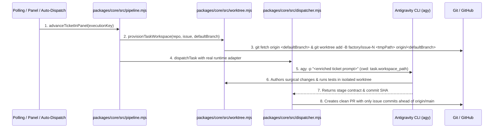
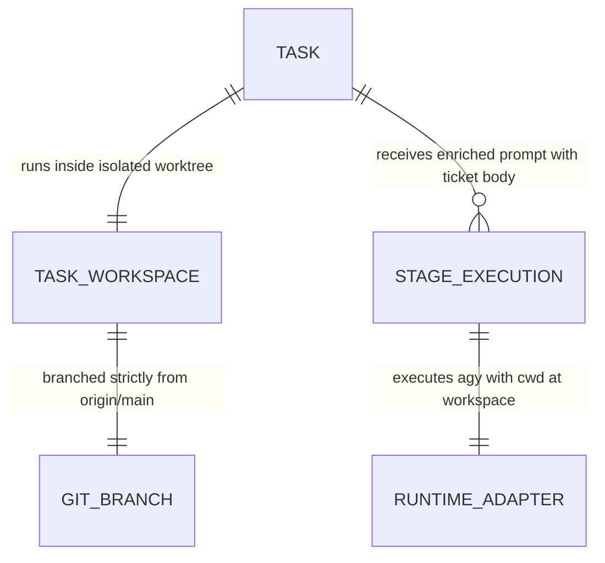

# Clean Worktree from Latest Main and Real Agent Task Execution plan

**Approved**: 2026-11-08 - user: "1 mantemos antigravity 2. sim, devemos fechar e voltar as tarefas para onde deveriam estar, colocar comentarios nas tarefas para atualizar elas do erro que tivemos 3. crie automaticamente, mas crie tickets que facam realmente sentido para o agente agir"

## Problem

In the existing Agentic Factory:
1. When a task workspace is provisioned (`provisionTaskWorkspace` in `packages/core/src/worktree.mjs`), `git worktree add -B <branch> <path>` is executed without fetching `origin/<defaultBranch>` or supplying a clean commit base (`<commit-ish>`). As a result, new task worktrees inherit whatever branch or unmerged commits the root repository checkout happens to be on, generating Pull Requests contaminated with dozens of unrelated commits and files.
2. Concurrent agent execution risks collisions unless each task runs in an isolated, unique temporary directory worktree rooted on clean `origin/<defaultBranch>` and is safely cleaned up upon completion.
3. In `packages/core/src/pipeline.mjs` (`advanceTicketInPanel`), if `runner` is omitted (which occurs in live auto-dispatching, cron loops, and Control Panel dispatch), the execution silently falls back to `createStageContractRunner`, a test mock that completes every stage in 25ms and fabricates fake approvals rather than executing real AI CLI agents (`agy`).
4. In `packages/core/src/dispatcher.mjs`, the adapter prompt only transmits metadata (`Factory task: ...`) and omits the ticket's title, body, acceptance criteria, reproduction steps, and repo instructions, while running with `cwd: root` instead of `cwd: task.workspace_path`.
5. In the `review` stage, `dispatcher.mjs` pushed branches blindly even when no new commits addressing the ticket had been authored by the agent.

When this ships, the Agentic Factory guarantees:
1. Every task workspace is provisioned as an isolated temporary git worktree explicitly fetched and branched from `origin/<defaultBranch>` (or latest clean remote main), guaranteeing zero commit contamination from local dirty checkouts.
2. Production task dispatching routes exclusively to real runtime adapters (`agy` with Antigravity CLI as configured in `factory.yaml`), never falling back silently to fake test mock runners unless explicitly configured for hermetic unit testing.
3. Every agent stage invocation receives the full ticket context (title, body, acceptance criteria, reproduction steps, repository constitution, and explicit instructions to resolve only that ticket in its isolated worktree) and executes strictly within `cwd: task.workspace_path`.
4. Pull Requests are only opened when the task branch contains verifiable commits ahead of `origin/<defaultBranch>`.
5. All 5 ticket workflows (`bug`, `feature`, `investigation`, `discovery`, `chore`) are validated end-to-end with realistic tickets and verified using independent verification.

## Shape

This feature updates `packages/core/src/worktree.mjs`, `packages/core/src/pipeline.mjs`, and `packages/core/src/dispatcher.mjs`.

1. Clean remote git worktree provisioning with explicit `origin/<defaultBranch>` base and temporary paths -> `packages/core/src/worktree.mjs` (exists) (door 1).
2. Elimination of silent test-mock fallback and full ticket context prompt enrichment with worktree `cwd` isolation -> `packages/core/src/pipeline.mjs` (exists) & `packages/core/src/dispatcher.mjs` (exists) (door 2).
3. Deliverable validation requiring dedicated commits ahead of `origin/<defaultBranch>` before PR creation -> `packages/core/src/dispatcher.mjs` (exists) (door 3).

**Changes underneath**

| Front | What changes |
| --- | --- |
| worktree provisioning | `packages/core/src/worktree.mjs` executes `git fetch origin <defaultBranch>` and `git worktree add --force -B <branch> <path> origin/<defaultBranch>` |
| prompt & execution context | `packages/core/src/dispatcher.mjs` compiles full ticket context (title, body, criteria) into prompt and sets `cwd: task.workspace_path` |
| production runner dispatch | `packages/core/src/pipeline.mjs` removes silent mock fallback, executing real runtime adapter when `runner` is null |
| deliverable gate | `packages/core/src/dispatcher.mjs` verifies dedicated commits ahead of `origin/<defaultBranch>` before creating a PR |

New: strict `origin/<defaultBranch>` worktree base, enriched prompt context, and real CLI adapter execution in worktree cwd.

## Surface

| Route | In | Out | Status | Who |
| --- | --- | --- | --- | --- |
| `POST /api/tickets/:key/dispatch` | `{ executionKey }` | JSON `{ ok, status, stage, task }` | `200`, `404` | anyone |
| `POST /api/tickets/intake` | `{ issue_number, repo, title, body, type, labels }` | JSON `{ ok, executionKey, classifiedType, initialStage, task }` | `201`, `400`, `409` | anyone |

## Landing

| One-way door | Literal shape | Alternative rejected |
| --- | --- | --- |
| Door 1: Hermetic worktrees branched from `origin/<defaultBranch>` | `git fetch origin <defaultBranch>` followed by `git worktree add --force -B <branch> <workspacePath> origin/<defaultBranch>` in `packages/core/src/worktree.mjs` | Branching from local `HEAD` — rejected because local checkouts may be on unrelated feature branches with dirty commits |
| Door 2: Full ticket context injection and worktree CWD isolation | Enriched prompt in `packages/core/src/dispatcher.mjs` containing `task.title`, `task.body`, `task.criteria`, and `cwd: task.workspace_path` | Bare prompt with task ID only — rejected because the agent has no information on what to implement or fix |
| Door 3: Explicit test mock runner vs production CLI adapter | In `packages/core/src/pipeline.mjs`, only use mock runners when explicitly injected via `runner`; when `runner` is null, invoke the real runtime adapter (`invokeRuntimeAdapter`) | Defaulting to mock runner in production — rejected because it fakes completion in 25ms without solving the ticket |

- Nothing else in this change is hard to reverse

## Criteria

### S1: Hermetic Worktree Provisioning from Latest Remote Main (P1)

Guarantee that every task workspace is a separate temporary worktree branched cleanly from `origin/<defaultBranch>` without inheriting local unmerged commits.

**Acceptance Criteria**

1. WHEN `provisionTaskWorkspace` is called for any repository THEN the system SHALL execute `git fetch origin <defaultBranch>` and provision the worktree with `git worktree add --force -B <branchName> <workspacePath> origin/<defaultBranch>` (or remote clone targeting `<defaultBranch>`), ensuring the initial commit at `workspacePath` matches `origin/<defaultBranch>`.
   - `git rev-parse HEAD` in new workspace → matches `git rev-parse origin/<defaultBranch>`
2. IF `git fetch` or worktree creation encounters an existing locked directory or branch THEN the system SHALL safely clean up or force-recreate the workspace directory under `runs/workspaces/<repo>-issue-<num>-<timestamp>`.
   - repeated provisioning → unique isolated timestamped folder; exit code `0`

### S2: Real Agent Execution with Enriched Context and Worktree CWD (P1)

Guarantee that task execution invokes the real runtime adapter (`agy`) inside the task's worktree with complete ticket context and criteria.

**Acceptance Criteria**

3. WHEN `dispatchTask` constructs the prompt for any stage (`triage`, `plan`, `checks_and_build`, `verify`, `review`, `investigate`, `discover`) THEN the system SHALL include the ticket title (`task.title`), full description/body (`task.body`), acceptance criteria, and explicit instructions to implement changes exclusively inside `task.workspace_path`.
   - prompt contains → `Title: [Linear-BRE-...]`, `Description: ...`, `Working directory: ...`
4. WHEN `invokeRuntimeAdapter` is executed by `dispatchTask` THEN the command (`agy -p ...`) SHALL be executed with `cwd` set to `task.workspace_path`.
   - adapter invocation options → `cwd === task.workspace_path`
5. WHEN `advanceTicketInPanel` is called in production without an explicit `runner` argument THEN the system SHALL NOT default to `createStageContractRunner` mock, but SHALL dispatch through the configured runtime adapter (`antigravity` / `agy`).
   - `advanceTicketInPanel({ runner: null })` → invokes real adapter instead of 25ms mock

### S3: Commit Validation and Multi-Type Verification (P1)

Guarantee that Pull Requests are only opened for branches with real commits ahead of `origin/<defaultBranch>` and verify the full pipeline for all 5 ticket types (`bug`, `feature`, `investigation`, `discovery`, `chore`).

**Acceptance Criteria**

6. IF a task in stage `review` has no new commits ahead of `origin/<defaultBranch>` in `task.workspace_path` THEN the system SHALL reject Pull Request creation and set `needs_human: 1` with a descriptive message (`no_commits_authored`).
   - 0 commits ahead of origin/main → `prUrl === null`, `needsHuman === true`
7. WHEN test tickets for all 5 ticket types (`bug`, `feature`, `investigation`, `discovery`, `chore`) are processed through the pipeline THEN each workflow SHALL complete its stages, maintain isolated worktrees, and produce concrete deliverables (`pull_request` for code workflows, `research_document` for research workflows).
   - `feature` → PR deliverable; `bug` → PR deliverable; `chore` → PR deliverable; `investigation` → markdown research document; `discovery` → markdown PRD

## Out of scope

| Excluded | Why |
| --- | --- |
| Modifying external Linear GraphQL schema or team permissions | External SaaS third-party contract outside repository control |
| Replacing Git worktrees with Docker containers | Local lightweight OS filesystem isolation is sufficient and faster |

## Assumptions

| Assumption | Chosen default | Rationale | Confirmed? |
| --- | --- | --- | --- |
| Default runtime CLI | `antigravity` (`agy`) | User explicitly confirmed "1 mantemos antigravity" | y |
| Stale PR remediation | Close broken PRs #19-#27 and reset Linear tickets to Todo | User explicitly instructed "2. sim, devemos fechar e voltar as tarefas para onde deveriam estar" | y |
| Test ticket creation | Automatically create realistic tickets for all 5 types | User explicitly instructed "3. crie automaticamente, mas crie tickets que facam realmente sentido" | y |

**Open questions:** none - all resolved or logged above.

## Differences from the source

None - the product matches the source

## Sources

- `AGENTS.md` - binding - specifies short-lived branch rules, worktree isolation, and verification loop
