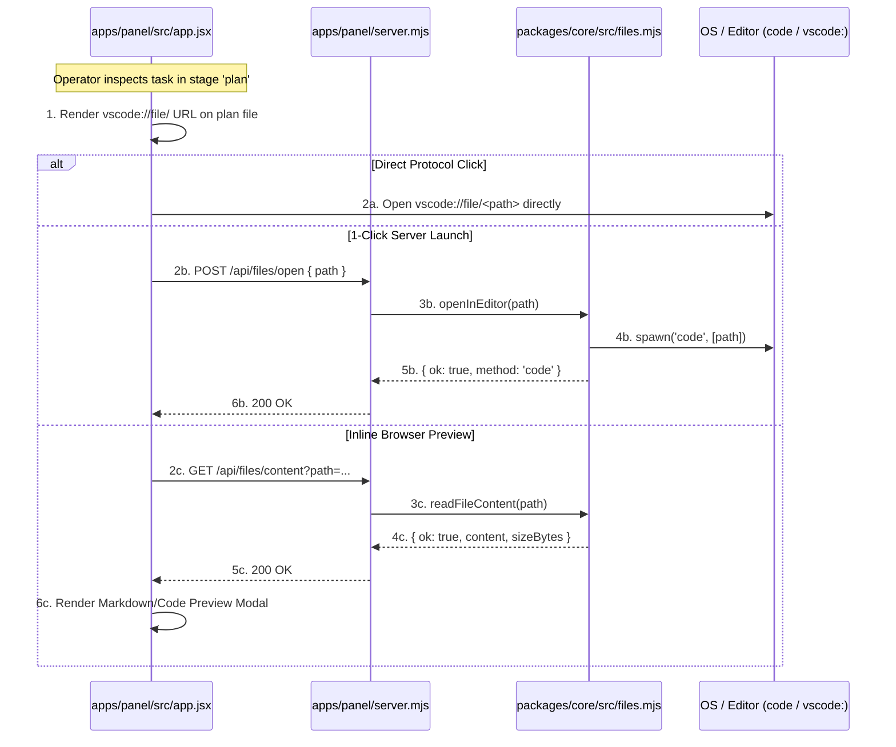
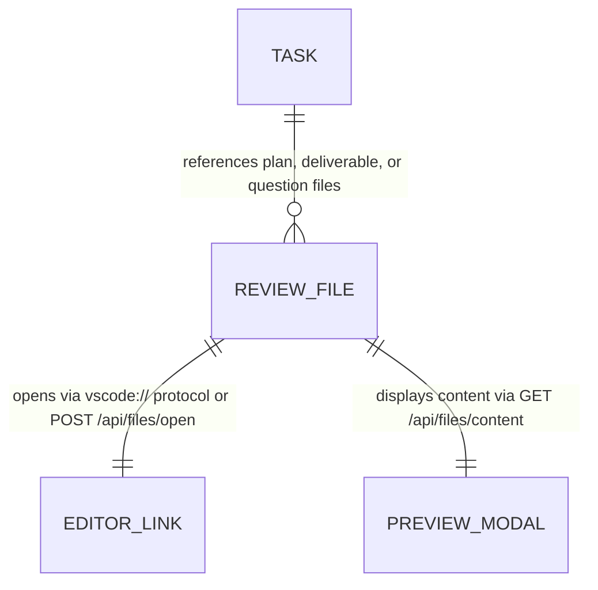

# Clickable File Review and Editor Integration

**Approved**: 2026-11-07 - user: "Outro ponto é, quando a gente tem um plano criado e precisa de mim, ou algo que precisa de mim, e a gente tem um arquivo que eu preciso avaliar, eu preciso que seja clicável e seja direcionado para o arquivo. Por exemplo, abrir no meu VS Code ou no meu Keiro, enfim, abrir o arquivo, eu preciso abrir o arquivo para conseguir ver."

## Problem

In the existing Agentic Factory:
1. When tasks pause for human intervention (such as stage `plan` awaiting plan review, investigation reports, contract evidence reviews, or missing requirements), the operator is presented with plain text in `human_question` or text file paths without clickable hyperlinks.
2. The operator cannot click to open the target plan, spec, or source file directly in their code editor (VS Code, Cursor, Keiro) or default system viewer.
3. The Control Panel lacks an API to securely resolve, inspect, and open task review files, forcing operators to manually navigate nested workspace directories to find the plan or code under review.
4. There is no inline preview capability within the browser to inspect markdown plans or investigation documents without switching away from the Control Panel.

When this ships, the Agentic Factory guarantees:
1. Every task requiring human evaluation (in stage `plan`, with a local deliverable, or citing files in `human_question`) provides canonical clickable editor links (`vscode://file/<path>`).
2. A 1-click **"Open in Editor"** button (`POST /api/files/open`) launches VS Code, Cursor, or the system default editor at the exact file and line number.
3. A 1-click **"Preview Document"** modal (`GET /api/files/content`) renders the plan or document contents directly inside the Control Panel with syntax highlighting and line numbers.
4. If a task has an isolated workspace (`workspace_path`), a 1-click **"Open Workspace"** button allows opening the task folder directly in the editor.

## Shape

This feature updates `packages/core/src/files.mjs` (new), `packages/core/index.mjs`, `apps/panel/server.mjs`, `apps/panel/src/app.jsx`, `apps/panel/__test__/control-panel.test.mjs`, and `apps/panel/e2e/panel.spec.mjs`.

1. Review file resolver & editor launcher -> `packages/core/src/files.mjs` (new) - resolves review files safely and executes editor launch (door 1).
2. Content & open HTTP endpoints -> `apps/panel/server.mjs` (exists) - exposes `POST /api/files/open` and `GET /api/files/content` (door 2).
3. Interactive review cards & inline viewer -> `apps/panel/src/app.jsx` (exists) - displays clickable links, open actions, and preview modal (door 3).

**Changes underneath**

| Front | What changes |
| --- | --- |
| domain | Add `packages/core/src/files.mjs` with `resolveTaskReviewFiles`, `openInEditor`, and `readFileContent` |
| stored data | No database schema change; parses existing `workspace_path`, `deliverable_url`, and `human_question` on tasks |
| UI & API | Add `POST /api/files/open` and `GET /api/files/content` in `server.mjs`; add interactive file badges, Open in Editor button, and Preview Modal in `app.jsx` |
| readers | `apps/panel/server.mjs`, `apps/panel/src/app.jsx`, unit tests, Playwright E2E suite |

New: adds review file resolution, editor launcher integration, and inline file preview modal.

## Surface

| Route | In | Out | Status | Who |
| --- | --- | --- | --- | --- |
| `POST /api/files/open` | `{ path: string, line?: number, executionKey?: string }` | JSON `{ ok, path, method }` | `200`, `400`, `404` | anyone |
| `GET /api/files/content` | `?path=string&executionKey=string` | JSON `{ ok, path, content, sizeBytes, extension }` | `200`, `400`, `404` | anyone |

## Landing

| One-way door | Literal shape | Alternative rejected |
| --- | --- | --- |
| Door 1: Dual Protocol + Server Editor Launch | Render `vscode://file/<path>` link AND provide `POST /api/files/open` server button | Relying solely on `file:///` links — rejected because modern browsers block direct HTTP-to-file:// navigation |
| Door 2: Safe Path Containment | Resolves paths strictly within repo root or task `workspace_path`, preventing path traversal | Arbitrary filesystem access — rejected due to security and directory escape risks |
| Door 3: Integrated Inline Document Viewer | Control Panel provides inline modal preview alongside editor launch | Forcing operator to leave the browser — rejected because operators need quick glance reviews |

## Criteria

### S1: Review File Resolution and Editor Launcher (P1)

Resolve task review files and launch editor via native command or protocol URI.

**Acceptance Criteria**

1. WHEN `resolveTaskReviewFiles` is called for a task in stage `plan` THEN the system SHALL return the resolved plan document path (e.g. `.specs/features/<slug>/plan.md` or task plan file) with both absolute path and `vscode://file/` URI.
2. WHEN `openInEditor` is invoked with a valid file path THEN the system SHALL attempt editor launch using `code` or system file launcher and return `{ ok: true, path, method }`.
3. IF `openInEditor` is invoked with a non-existent file path THEN the function SHALL return `{ ok: false, error: 'File not found' }` with status 404.

### S2: Backend File Open & Content Endpoints (P1)

Provide secure API endpoints to open files in editor and stream file contents for preview.

**Acceptance Criteria**

4. WHEN an operator sends `POST /api/files/open` with a valid file path THEN the server SHALL launch the editor and return HTTP 200 with `{ ok: true, path, method }`.
5. WHEN an operator sends `GET /api/files/content?path=...` for an existing text or markdown file THEN the server SHALL return HTTP 200 with `{ ok: true, content, sizeBytes, extension }`.
6. IF an operator attempts path traversal or requests a non-existent file THEN the server SHALL reject the request with HTTP 400 or 404.

### S3: Control Panel Clickable File Review and Preview Modal (P1)

Surface clickable review links, open actions, and inline document preview in the UI.

**Acceptance Criteria**

7. WHILE a task is in stage `plan` or requires human review on the Waiting Human screen THEN the UI SHALL display a review file card with a clickable `vscode://file/` link, `#open-editor-btn-{issueNumber}`, and `#preview-doc-btn-{issueNumber}`.
8. WHEN an operator clicks `#preview-doc-btn-{issueNumber}` THEN the Control Panel SHALL render an inline modal displaying the file content with close button `#close-preview-modal-btn`.
9. WHEN an operator clicks `#open-editor-btn-{issueNumber}` THEN the Control Panel SHALL trigger `POST /api/files/open` and display confirmation feedback.

## Out of scope

| Excluded | Why |
| --- | --- |
| In-browser full text editing and saving of plan files | Operators review in browser or edit in their dedicated IDE (VS Code, Cursor) |
| Binary image or PDF rendering | Review focus is spec plans, code changes, and markdown investigation docs |

## Assumptions

| Assumption | Chosen default | Rationale | Confirmed? |
| --- | --- | --- | --- |
| Editor Choice | VS Code / Cursor / system default | User requested VS Code or Keiro/Cursor | y |
| Direct Protocol Support | `vscode://file/<absPath>` | Universal cross-platform editor URI standard | y |
| Path Containment | Repository root or task workspace | Protects against arbitrary file disclosure | y |

**Open questions:** none - all resolved or logged above.

## Differences from the source

None - the product matches the source

## Sources

- User request: "Outro ponto é, quando a gente tem um plano criado e precisa de mim, ou algo que precisa de mim, e a gente tem um arquivo que eu preciso avaliar, eu preciso que seja clicável e seja direcionado para o arquivo. Por exemplo, abrir no meu VS Code ou no meu Keiro, enfim, abrir o arquivo, eu preciso abrir o arquivo para conseguir ver."
