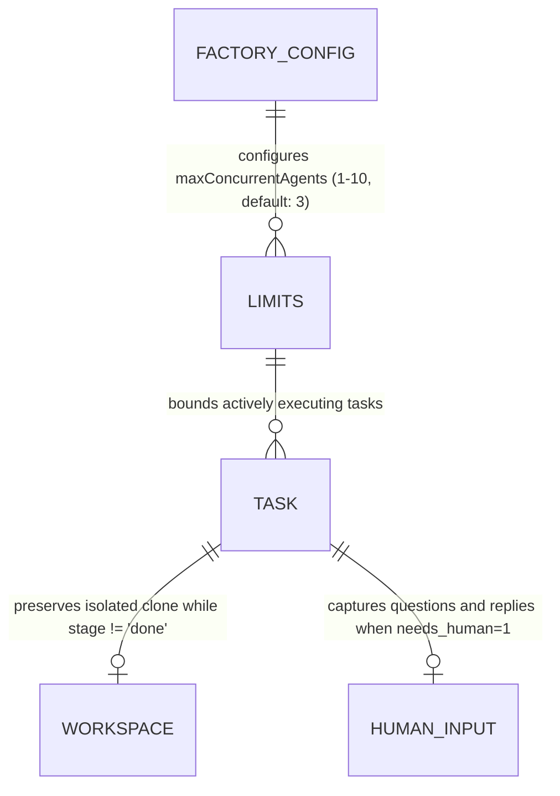

# Concurrency Scheduler Lifecycle and Human Input

**Approved**: 2026-11-07 - user: "Quando a tarefa está num estado que a gente pode pegar, ele deve começar a pegar de acordo com o cron que a gente tem. E enquanto tiver uma tarefa que está sendo desenvolvida, ela ainda não terminou, a gente não pode passar para pegar mais do que o máximo que a gente setou de agentes simultaneos. Além disso, a tarefa só termina quando a pessoa mergiar o PR, ou então ser possível colocar o arquivo no ticket e o agente entender que realmente está fechado o ticket. Mas, tendo em vista que o agente parou de executar, tendo em vista que ele já criou uma PR ou algo do tipo, ele já pode começar a pegar outros tickets para fazer porque ele não está mais ativo. Só não precisa remover o repositório temporário que ele criou para esse ticket, enquanto o ticket não foi terminado, mergeado, porque ainda pode ter problemas na PR, a pessoa pode pedir para ser revisada e tal. Não sei também se o ordem que você está colocando de estar sem progresso faz sentido. Porque como a gente tem o máximo de agentes possíveis para pegar tarefas, pode ser que eles não consigam pegar todas de uma vez só e fique com tarefas com um tempo maior ali. Um outro ponto é, se o agente achar que ele não tem tudo para conseguir terminar a tarefa que precisa de um humano, ele deve levantar a mão e pedir ajuda. Então a gente deve ter uma tela ali com agentes que estão esperando o humano para falar algo. Mas só quando ele não tem tudo bem definido. E ele não conseguir se virar sozinho. Ou seja, estiver faltando alguma coisa que deveria estar já no ticket principal."

## Problem

In the existing Agentic Factory:
1. Concurrency limits were previously bounded by total unfinished tasks (`stage != 'done' AND stage != 'aborted'`). This conflated tasks actively executing in an agent runtime with tasks that have already finished agent work and are paused waiting for PR review/merge or external human actions. As a result, when tasks created PRs and awaited human merge, the factory was blocked from picking up new tickets even though no agent was actively executing.
2. The cron polling scheduler (`createPollingScheduler`) polls external trackers (GitHub, Linear, Jira, Asana) and places newly discovered issues into `triage`, but does not automatically dispatch eligible ready tasks up to the concurrency ceiling. An operator currently has to click "Run Workflow" manually for every task.
3. Stalled task alarms flag any task idle in SQLite past the threshold, including queued backlog tickets waiting in `triage` due to concurrency limits. This produces false-positive alarms for tasks legitimately queued behind active agents.
4. When an agent determines that requirements are underspecified, missing, or ambiguous in the source ticket, it sets `needs_human: true`. However, the UI treats this solely as a generic 1-click approval button rather than providing an interactive clarification screen where the operator can read the specific question, type an explanatory response, and resume the agent with the required context.
5. Workspaces for tasks in `merge` stage must remain preserved until the PR is merged or closed, because review feedback may require iterative amendments on the task branch.

When this ships, the Agentic Factory guarantees:
1. **Executing Agents Concurrency Separation**:
   - `countExecutingAgents()` counts only tasks actively running in an agent runtime (`stage != 'done' AND stage != 'aborted' AND needs_human = 0 AND stage != 'merge'`).
   - When a task completes PR creation and transitions to `merge`, or pauses with `needs_human: 1`, its execution slot is immediately released so the factory can pick up new tickets.
   - The task remains open and its isolated workspace directory (`workspace_path`) is preserved until the PR is merged and the ticket reaches `done`.
2. **Cron-Driven Auto-Dispatch**:
   - On each periodic cron tick, after tracker sync, the scheduler inspects eligible tasks in `triage` and automatically dispatches them up to `maxConcurrentAgents - countExecutingAgents()`.
3. **Refined Stalled Task Alarms**:
   - Backlog tasks waiting in `triage` due to concurrency limits do not trigger stalled alarms; alarms only monitor actively executing tasks or blocked human gates exceeding the threshold.
4. **Interactive Human Clarification Screen**:
   - A dedicated "Agents Waiting for Human Input & Clarification" view in the Control Panel highlights agents blocked by missing or underspecified requirements. Operators can inspect the agent's question, type answers/clarifications in `#human-reply-input-{issueNumber}`, and click `#human-reply-btn-{issueNumber}` ("Send Reply & Resume Agent") to resume execution.

## Shape

This feature updates `packages/core/src/store.mjs`, `packages/core/src/guards.mjs`, `packages/core/src/projects.mjs`, `packages/core/src/pipeline.mjs`, `apps/panel/server.mjs`, `apps/panel/src/app.jsx`, `apps/panel/__test__/control-panel.test.mjs`, and `apps/panel/e2e/panel.spec.mjs`.

1. Operator configures cron scheduler & concurrency ceiling -> `apps/panel/src/app.jsx` (exists) -> `apps/panel/server.mjs` (exists) - triggers periodic sync and auto-dispatch
2. Cron scheduler auto-dispatches queued tasks -> `packages/core/src/projects.mjs` (exists) & `packages/core/src/pipeline.mjs` (exists) - calculates available executing slots (`maxConcurrentAgents - countExecutingAgents()`) and advances triage tasks (door 1)
3. Store distinguishes executing agents from waiting tasks -> `packages/core/src/store.mjs` (exists) - excludes `merge` and `needs_human` from executing agent count, preserves workspaces (door 2)
4. Stalled alarms exclude queued triage tasks -> `packages/core/src/store.mjs` (exists) - prevents false alarms for tasks waiting in backlog queue
5. Human clarification interface -> `apps/panel/src/app.jsx` (exists) & `apps/panel/server.mjs` (exists) - operators review questions, type answers, and resume blocked agents (door 3)

```mermaid
sequenceDiagram
    participant Cron as packages/core/src/projects.mjs
    participant Pipe as packages/core/src/pipeline.mjs
    participant Store as packages/core/src/store.mjs
    participant UI as apps/panel/src/app.jsx
    participant Srv as apps/panel/server.mjs

    Note over Cron: 1. Cron cycle triggers
    Cron->>Store: 2. countExecutingAgents()
    Store-->>Cron: 3. Executing agents count (X)
    Cron->>Pipe: 4. Auto-dispatch queued triage tasks (up to limit - X)
    Pipe->>Store: 5. Agent runs task -> PR created -> stage='merge' (needs_human=1)
    Note over Store: 6. Slot freed! countExecutingAgents decremented; workspace kept intact
    UI->>Srv: 7. Operator types clarification in #human-reply-input and clicks Send
    Srv->>Store: 8. POST /api/tasks/:key/approve with { words: reply }
    Store->>Pipe: 9. needs_human cleared, task resumes with human context
```

**Changes underneath**

| Front | What changes |
| --- | --- |
| domain | add `countExecutingAgents()` query separating active execution from awaiting-merge / awaiting-human states, add auto-dispatching logic to periodic scheduler |
| stored data | `tasks` table persists `human_question`, `workspace_path`, `deliverable_url`, updates stalled query to filter out queued triage tasks |
| readers | `apps/panel/server.mjs`, `apps/panel/src/app.jsx`, `packages/core/src/projects.mjs`, `packages/core/src/store.mjs`, Playwright E2E suite |



New: adds executing agent concurrency separation, cron-driven auto-dispatch of queued tasks, and interactive human clarification screen.

## Surface

| Route | In | Out | Status | Who |
| --- | --- | --- | --- | --- | --- |
| `POST /api/scheduler` | `{ enabled: boolean, intervalSeconds: number, autoDispatch: boolean, runImmediately: boolean }` | JSON `{ ok, scheduler, syncReport, autoDispatchedCount }` | `200`, `400` | anyone |
| `POST /api/tasks/:key/approve` | `{ approver: string, words: string }` | JSON `{ ok, task }` | `200`, `400`, `404` | anyone |
| `GET /api/dashboard` | `{}` | JSON with `activeTasksCount`, `executingAgentsCount`, `needsHuman` list with questions | `200` | anyone |
| `POST /api/tickets/:key/dispatch` | `{ approveCurrentStage: boolean, words: string, deliverable: object }` | JSON `{ ok, stage, task }` | `200`, `404`, `422` | anyone |

## Landing

| One-way door | Literal shape | Alternative rejected |
| --- | --- | --- |
| Door 1: Executing Agents vs Waiting Tasks Concurrency Model | `countExecutingAgents()` evaluates tasks where `stage != 'done' AND stage != 'aborted' AND needs_human = 0 AND stage != 'merge'`, freeing execution slots when PR is open or human is needed | Blocking all intake/dispatch whenever total open tasks reach limit — rejected because agents in review/merge are idle and should not starve factory throughput |
| Door 2: Cron-Driven Auto-Dispatch of Ready Tasks | `syncMonitoredProjectsIssues` or scheduler `runOnce` dispatches up to `maxConcurrentAgents - countExecutingAgents()` tasks in `triage`, transitioning them to active workflows | Pure manual dispatch where every polled task remains stalled in triage until operator clicks button — rejected because automated factory should progress autonomously |
| Door 3: Interactive Human Clarification Reply & Needs-Human Screen | Dedicated UI section rendering `#human-reply-input-{issueNumber}` and `#human-reply-btn-{issueNumber}` passing clarification text to `POST /api/tasks/:key/approve` | Silent failure, arbitrary hallucinated assumptions, or uninformative 1-click button with no text reply capability — rejected to ensure agents get required requirements |

## Criteria

### S1: Executing Agents Concurrency Model and Workspace Preservation (P1)

Differentiate actively executing agents from awaiting-merge / awaiting-human tasks, preserving isolated workspaces while tickets are not done.

**Acceptance Criteria**

1. WHILE a task has created a pull request and is awaiting human review or merge in stage `merge` THEN the system SHALL consider the agent idle and release its execution slot in `countExecutingAgents()` while keeping the task active.
2. WHILE a task is paused awaiting human input with `needs_human: 1` THEN the system SHALL release its execution slot in `countExecutingAgents()`, allowing another queued task to be executed.
3. WHILE a task remains unfinished with stage not equal to `done` and not equal to `aborted` THEN the system SHALL preserve its isolated workspace directory (`workspace_path`) on disk without deleting it.
4. WHEN ticket intake or dispatch evaluates agent execution limits THEN `evaluateIntakeGuards` SHALL compare `countExecutingAgents()` against `maxConcurrentAgents` to determine whether an agent slot is available.
5. WHILE tasks are queued in stage `triage` without an active executing agent THEN `getStalledTasks()` SHALL NOT flag the queued task as stalled due to concurrency limits.

### S2: Cron-Driven Auto-Dispatch of Queued Tasks (P1)

Automatically pick up and dispatch queued triage tasks on periodic cron ticks up to the concurrency ceiling.

**Acceptance Criteria**

6. WHEN the periodic polling scheduler executes a sync cycle THEN the system SHALL determine available executing agent capacity (`maxConcurrentAgents - countExecutingAgents()`) and automatically dispatch eligible tasks from `triage` up to that capacity.
7. IF `countExecutingAgents()` equals or exceeds `maxConcurrentAgents` THEN the scheduler SHALL leave remaining tasks in `triage` queue without dispatching until an executing agent slot becomes available.
8. WHEN `POST /api/scheduler` is invoked with `runImmediately: true` THEN the server SHALL execute the polling sync and auto-dispatch eligible triage tasks, returning the auto-dispatched count in the JSON response.

### S3: Interactive Human Clarification Screen (P1)

Provide a dedicated Control Panel screen for agents waiting for human clarification, with interactive text reply and resume capabilities.

**Acceptance Criteria**

9. WHEN a task has `needs_human: 1` and a non-empty `human_question` THEN the Control Panel UI SHALL display the task in the dedicated "Agents Waiting for Human Input & Clarification" section with the agent's blocker description.
10. WHEN an operator enters clarification text into `#human-reply-input-{issueNumber}` and clicks `#human-reply-btn-{issueNumber}` THEN the UI SHALL submit `POST /api/tasks/:key/approve` with the reply text, clear `needs_human`, and resume task execution.
11. WHEN an operator views the Control Panel navigation bar THEN the "Board & Needs Human" tab badge and header badge SHALL accurately reflect the number of agents currently blocked awaiting human input.

## Out of scope

| Excluded | Why |
| --- | --- |
| LLM-based autonomous conversational chat widget in UI | Structured question and reply text submission via existing approval API meets human-in-the-loop requirement cleanly |
| Automatic git worktree garbage collection daemon | Preserving workspaces until PR merge and manual cleanup prevents accidental loss of uncommitted work |

## Assumptions

| Assumption | Chosen default | Rationale | Confirmed? |
| --- | --- | --- | --- |
| Executing Agent Definition | `stage != 'done' AND stage != 'aborted' AND needs_human = 0 AND stage != 'merge'` | Specified by user: when an agent created a PR or stopped executing, it is no longer active and slot is freed | y |
| Auto-Dispatch Priority | First-in, first-out (FIFO by `created_at` ASC) | Fair ordering for queued triage tasks | y |
| Stalled Triage Exclusion | Backlog triage tasks excluded from stall alarms | Specified by user: queued tasks waiting for agent slots should not trigger false alarms | y |
| Interactive Human Input Placement | Dedicated section in "Board & Needs Human" tab with text input and submit button | Recommended option chosen by user in consultation | y |

**Open questions:** none - all resolved or logged above.

## Differences from the source

None - the product matches the source

## Sources

- User request: "Quando a tarefa está num estado que a gente pode pegar, ele deve começar a pegar de acordo com o cron que a gente tem. E enquanto tiver uma tarefa que está sendo desenvolvida, ela ainda não terminou, a gente não pode passar para pegar mais do que o máximo que a gente setou de agentes simultaneos. Além disso, a tarefa só termina quando a pessoa mergiar o PR, ou então ser possível colocar o arquivo no ticket e o agente entender que realmente está fechado o ticket. Mas, tendo em vista que o agente parou de executar, tendo em vista que ele já criou uma PR ou algo do tipo, ele já pode começar a pegar outros tickets para fazer porque ele não está mais ativo. Só não precisa remover o repositório temporário que ele criou para esse ticket, enquanto o ticket não foi terminado, mergeado, porque ainda pode ter problemas na PR, a pessoa pode pedir para ser revisada e tal. Não sei também se o ordem que você está colocando de estar sem progresso faz sentido. Porque como a gente tem o máximo de agentes possíveis para pegar tarefas, pode ser que eles não consigam pegar todas de uma vez só e fique com tarefas com um tempo maior ali. Um outro ponto é, se o agente achar que ele não tem tudo para conseguir terminar a tarefa que precisa de um humano, ele deve levantar a mão e pedir ajuda. Então a gente deve ter uma tela ali com agentes que estão esperando o humano para falar algo. Mas só quando ele não tem tudo bem definido. E ele não conseguir se virar sozinho. Ou seja, estiver faltando alguma coisa que deveria estar já no ticket principal."
