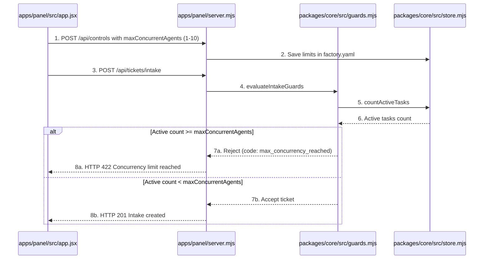
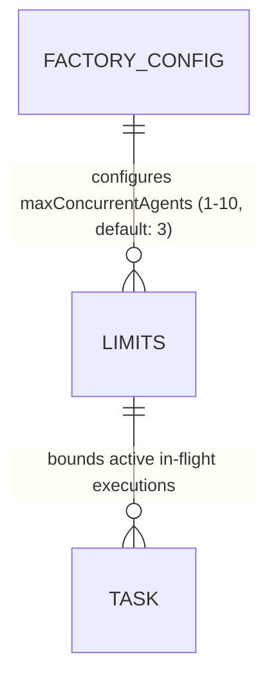

# Max Concurrent Running Agents Limit and Control Panel Settings

**Approved**: 2026-11-07 - user: "devemos setar um maximo de agentes rodando ao mesmo tempo, nao sei se temos isso no nosso painel de controle ainda, deve ser no maximo 3 como default, mas pode ser setado ate 10"

## Problem

In the existing Agentic Factory:
1. The factory has hourly rate limits (`maxTasksPerHour`) and financial caps (`dailyBudgetUsd`), but does not enforce a concurrency ceiling on simultaneous running agents. If multiple tickets are intaked or triggered at once across monitored repositories, the factory could spawn unbounded parallel agent executions, overwhelming system memory, API rate limits, or operator cognitive bandwidth.
2. The Control Panel UI lacks an input to configure maximum concurrent running agents, and `factory.yaml` lacks a default concurrency limit.
3. The intake and dispatch guards do not check the count of active in-flight tasks against a configured concurrency threshold.

When this ships, the Agentic Factory guarantees:
1. **Configurable Concurrency Ceiling**:
   - `factory.yaml` includes `factory.limits.maxConcurrentAgents` defaulting to `3` (valid range: 1 to 10).
2. **Deterministic Concurrency Intake & Dispatch Guard**:
   - `evaluateIntakeGuards` evaluates active in-flight tasks (`stage != 'done'` and `stage != 'aborted'`) against `maxConcurrentAgents`. When active tasks reach or exceed the limit, intake/dispatch is rejected with `code: 'max_concurrency_reached'` and descriptive error text.
3. **AWS Cloudscape Control Panel Management**:
   - Operational Controls in the Control Panel UI provides an input (`#ctrl-concurrent`, min: 1, max: 10, default: 3) allowing operators to inspect and persist `maxConcurrentAgents` to `factory.yaml` via `POST /api/controls`.
   - The Overview KPI card surfaces active running agents against the concurrency limit (e.g. `Active Agents: X / Y`).
   - `POST /api/controls` validates that `maxConcurrentAgents` is an integer between 1 and 10, returning HTTP 400 for out-of-bounds or non-integer values.

## Shape

This feature updates `packages/core/src/config.mjs`, `packages/core/src/guards.mjs`, `packages/core/src/store.mjs`, `factory.yaml`, `apps/panel/server.mjs`, `apps/panel/src/app.jsx`, and tests in `apps/panel/__test__/control-panel.test.mjs` and `apps/panel/e2e/panel.spec.mjs`.

1. Operator configures concurrency limit in Control Panel -> `apps/panel/src/app.jsx` (exists) -> `apps/panel/server.mjs` (exists) - sets `maxConcurrentAgents` (1-10, default 3) (door 1)
2. Server validates and persists limits -> `apps/panel/server.mjs` (exists) & `packages/core/src/config.mjs` (exists) - persists to `factory.yaml`, returns 400 for invalid range (< 1 or > 10)
3. Guard enforces concurrency -> `packages/core/src/guards.mjs` (exists) & `packages/core/src/store.mjs` (exists) - counts active tasks, rejects intake/dispatch when count reaches limit with `max_concurrency_reached` (door 2)
4. UI displays active concurrency telemetry -> `apps/panel/src/app.jsx` (exists) - shows active agent count and concurrency limit badge

**Changes underneath**

| Front | What changes |
| --- | --- |
| domain | add concurrency guard rule to `evaluateIntakeGuards` and range validation (1-10, default 3) |
| stored data | adds `maxConcurrentAgents` to `factory.yaml` under `factory.limits`, adds `countActiveTasks()` in SQLite store |
| readers | `apps/panel/server.mjs`, `apps/panel/src/app.jsx`, `packages/core/src/config.mjs`, and Playwright E2E suite |

New: adds maxConcurrentAgents limit configuration and active task concurrency enforcement.

## Surface

| Route | In | Out | Status | Who |
| --- | --- | --- | --- | --- |
| `POST /api/controls` | `{ maxConcurrentAgents: number, ... }` | JSON `{ ok, factoryConfig }` | `200`, `400` | anyone |
| `POST /api/tickets/intake` | `{ issue_number, repo, title, ... }` | JSON `{ ok, status, code, executionKey }` | `201`, `400`, `409`, `422` | anyone |
| `GET /api/dashboard` | `{}` | JSON with `activeTasksCount`, `factoryConfig.factory.limits.maxConcurrentAgents` | `200` | anyone |

## Landing

| One-way door | Literal shape | Alternative rejected |
| --- | --- | --- |
| Door 1: Concurrency Range Ceiling (1 to 10, default 3) | `maxConcurrentAgents` validated as an integer `1 <= n <= 10` in `factory.yaml` and `POST /api/controls`, defaulting to 3 | Unbounded concurrency or arbitrary non-integer values — rejected to prevent out-of-memory crashes and runaway API spend |
| Door 2: Deterministic Intake & Dispatch Concurrency Guard | `countActiveTasks()` in `store.mjs` checks tasks where `stage != 'done' AND stage != 'aborted'`, rejecting intake with `max_concurrency_reached` when limit is reached | Dropping tickets silently or queue starvation without status feedback — rejected to provide clear operational feedback |

## Criteria

### S1: Max Concurrent Running Agents Ceiling (P1)

Enforce a configurable limit on concurrent active agents (1 to 10, default 3) with full Control Panel management.

**Acceptance Criteria**

1. WHERE `maxConcurrentAgents` is not explicitly set in `factory.yaml` THEN the system SHALL default the maximum concurrent running agents limit to `3`.
2. WHEN `POST /api/controls` receives `maxConcurrentAgents` between `1` and `10` THEN the server SHALL persist the value to `factory.yaml` and return HTTP `200`.
3. IF `POST /api/controls` receives `maxConcurrentAgents` less than `1`, greater than `10`, or not an integer THEN the server SHALL reject the request with HTTP `400` and an explicit validation error message.
4. WHEN ticket intake or dispatch is evaluated and active tasks (`stage != 'done'` and `stage != 'aborted'`) equal or exceed `maxConcurrentAgents` THEN `evaluateIntakeGuards` SHALL reject the operation with code `max_concurrency_reached` and descriptive reason.
5. WHEN the Control Panel is viewed in the browser THEN the authentic AWS Cloudscape UI SHALL provide an input `#ctrl-concurrent` to inspect and modify `maxConcurrentAgents`, display active running agents in the Overview KPIs, and save controls successfully.

## Out of scope

| Excluded | Why |
| --- | --- |
| Dynamic autoscaling of cloud compute worker VMs | Single-node factory model with configurable local concurrency ceiling |
| Per-project concurrency partitioning | Global factory concurrency cap meets operator requirement cleanly |

## Assumptions

| Assumption | Chosen default | Rationale | Confirmed? |
| --- | --- | --- | --- |
| Concurrency Default | 3 concurrent agents | Specified by user ("deve ser no maximo 3 como default") | y |
| Concurrency Upper Bound | 10 concurrent agents | Specified by user ("mas pode ser setado ate 10") | y |
| Concurrency Lower Bound | 1 concurrent agent | Sensible minimum for running software factory | y |

**Open questions:** none - all resolved or logged above.

## Differences from the source

None - the product matches the source

## Sources

- User request: "devemos setar um maximo de agentes rodando ao mesmo tempo, nao sei se temos isso no nosso painel de controle ainda, deve ser no maximo 3 como default, mas pode ser setado ate 10"
