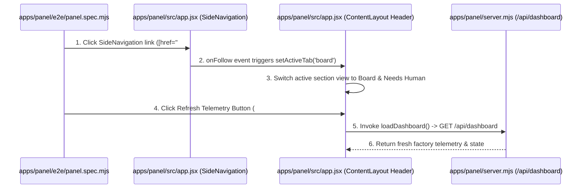
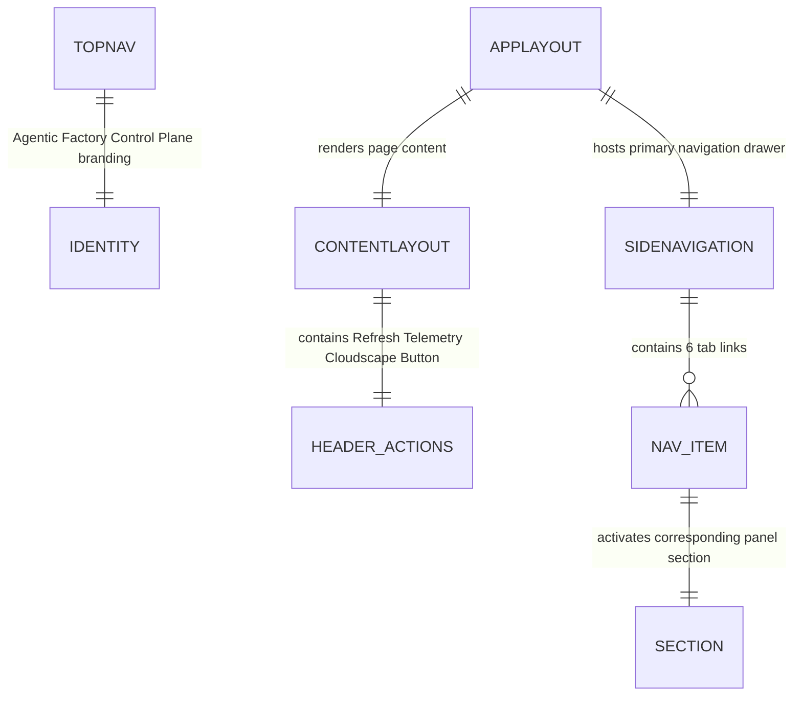

# Consolidated SideNavigation and Removal of Redundant Top Tab Bar

**Approved**: 2026-11-08 - user: "o nome nao deveria ser esse de AWS Cloudscape, Deveria ser Agentic Factory Control Plane. Essa parte tambem nao sei se faz sentido e poderiamos remover, talvez a parte de refresh nao, mas talvez colocar o refresh como um botao e nao na parte de cima da pagina... Adicione isso no plano"

## Problem

The Control Panel currently suffers from duplicate navigation bars, redundant status pills in the top header, and inaccurate branding:
1. A horizontal quick-tab bar (`#tabs` / `data-testid="cloudscape-tab-bar"`) containing 6 tab buttons and an unstyled "Refresh Telemetry" button duplicates the authentic AWS Cloudscape `SideNavigation` left drawer component (`.awsui-side-navigation`).
2. The `TopNavigation` header currently displays placeholder branding (`AWS Cloudscape — Agentic Factory Console`) and redundant utility buttons (`AUTONOMY: GATED`, `26 STALLED`) that clutter the top bar, despite these metrics already being prominently shown in the page header badges, stalled alarm banner, and `SideNavigation` counters.
3. The "Refresh Telemetry" trigger is currently split between an unstyled button in `#tabs` and a text link in `TopNavigation.utilities`, rather than standard AWS Cloudscape button controls.

When this ships:
1. The redundant horizontal `#tabs` button bar is completely removed from `apps/panel/src/app.jsx`.
2. The AWS Cloudscape `SideNavigation` component serves as the single, authoritative navigation drawer for all panel tabs.
3. The `TopNavigation` identity is rebranded to `Agentic Factory Control Plane` (with `Agentic Factory Logo` alt text), and the redundant utility pills (`AUTONOMY`, `STALLED`) are removed from `TopNavigation.utilities`.
4. The "Refresh Telemetry" control is placed cleanly in the `ContentLayout` `Header` `actions` slot as an AWS Cloudscape `Button` (`id="refresh-telemetry-btn"`, `iconName="refresh"`, `data-testid="refresh-telemetry-btn"`), invoking `loadDashboard()`.
5. All Playwright E2E suites (`apps/panel/e2e/panel.spec.mjs`) navigate exclusively through `SideNavigation` (`.awsui-side-navigation` / `getByRole('link', ...)`), while verifying the rebranded title and the header Refresh button.

## Shape

This feature modifies `apps/panel/src/app.jsx` to rebrand `TopNavigation`, strip the `#tabs` container and top utility clutter, place the `Refresh Telemetry` button into `ContentLayout.header.actions`, compiles the bundle via `scripts/build-panel.mjs`, and migrates all tab navigation selectors in `apps/panel/e2e/panel.spec.mjs`.

1. Operator views Control Panel -> `apps/panel/src/app.jsx` (exists) - renders `TopNavigation` titled "Agentic Factory Control Plane" without cluttered utility pills, and single primary navigation in `AppLayout` with Cloudscape `SideNavigation` (door 1)
2. Operator clicks sidebar tab link (e.g. `Board & Needs Human`) -> `apps/panel/src/app.jsx` (exists) - activates target tab content and updates `activeHref` in `SideNavigation` (door 1)
3. Operator clicks "Refresh Telemetry" button in page Header -> `apps/panel/src/app.jsx` (exists) - invokes `loadDashboard()` to refresh factory metrics and status (door 1)
4. `apps/panel/e2e/panel.spec.mjs` (exists) -> `apps/panel/src/app.jsx` (exists) - exercises all 6 tabs and full workflow journeys using `SideNavigation` selectors with zero `#tabs` dependencies (door 1)

**Changes underneath**

| Front | What changes |
| --- | --- |
| domain | renames top title to "Agentic Factory Control Plane", removes `#tabs` quick-bar and top utility pills from `apps/panel/src/app.jsx`, moves Refresh button into `ContentLayout` header `actions`, and standardizes `SideNavigation` as single primary drawer |
| stored data | none - purely UI navigation layout, branding, and Playwright selector refactor |
| readers | `apps/panel/src/app.jsx`, `apps/panel/public/bundle.js`, `apps/panel/public/index.html`, and `apps/panel/e2e/panel.spec.mjs` |

New: nothing stored - uses existing React tab state and Cloudscape `AppLayout`.

## Surface

| Route | In | Out | Status | Who |
| --- | --- | --- | --- | --- |
| `GET /` | - | HTML + `/bundle.js` with single `SideNavigation`, rebranded `TopNavigation`, header Refresh button, and no `#tabs` | `200` | anyone |
| `GET /api/dashboard` | - | JSON `{ factoryConfig, status, ... }` triggered by header refresh button | `200` | anyone |

## Landing

| One-way door | Literal shape | Alternative rejected |
| --- | --- | --- |
| Door 1: Single SideNavigation Drawer & Clean Header Refresh | `apps/panel/src/app.jsx` updating `TopNavigation.identity.title` to 'Agentic Factory Control Plane', removing `#tabs` entirely, clearing top utility pills, and adding `Refresh Telemetry` Cloudscape `Button` to `ContentLayout.header.actions` | Keeping horizontal top tabs or retaining cluttered utility pills in TopNavigation — rejected because user explicitly requested removing duplicate top buttons and keeping only the sidebar with refresh as a button in content |

- Nothing else in this change is hard to reverse.

## Criteria

### S1: Consolidated SideNavigation, Clean Header & Playwright E2E Migration (P1)

Rebrand TopNavigation, eliminate redundant top bar `#tabs` and utility pills, add Cloudscape Refresh Telemetry button in ContentLayout header, and migrate all Playwright E2E test suites to navigate via sidebar links.

**Acceptance Criteria**

1. The Control Panel `TopNavigation` SHALL display `Agentic Factory Control Plane` as its identity title and SHALL NOT render `AUTONOMY` or `STALLED` utility pills in the top bar.
2. The Control Panel SHALL NOT render `#tabs` or `[data-testid="cloudscape-tab-bar"]` anywhere in the DOM.
3. WHEN an operator views the Control Panel THEN the AWS Cloudscape `SideNavigation` SHALL display all 6 core navigation items (`Overview & Telemetry`, `Board & Needs Human`, `Workflows (Factory as Code)`, `Runtimes, Router & Circuit Breaker`, `Agents & Locked Skills (23)`, `Controls, Deploy & Brain`).
4. WHEN an operator clicks any tab link in `SideNavigation` THEN the Control Panel SHALL switch the active view to that section and set the active highlight (`activeHref`) on that item.
5. The `ContentLayout` `Header` SHALL contain an authentic AWS Cloudscape `Button` (`id="refresh-telemetry-btn"`, `iconName="refresh"`) labeled `Refresh Telemetry` which triggers `loadDashboard()`, querying `/api/dashboard` and updating displayed telemetry.
6. WHEN the Playwright E2E test suite (`apps/panel/e2e/panel.spec.mjs`) executes THEN all 11 test suites SHALL navigate tabs exclusively through `SideNavigation` (`.awsui-side-navigation a[href="#..."]` or `getByRole('link', { name: ... })`) and pass 100% green without referencing `#tabs`.

## Out of scope

| Excluded | Why |
| --- | --- |
| Kanban card modifications (workspace link popovers, editor buttons) | User confirmed focus is exclusively on navigation consolidation and header cleanup for this ticket |
| Backend API endpoint changes | All existing backend APIs (`/api/dashboard`, `/api/tickets`, etc.) remain identical |

## Assumptions

| Assumption | Chosen default | Rationale | Confirmed? |
| --- | --- | --- | --- |
| Refresh Telemetry location | Placed in `ContentLayout` `Header` `actions` as an AWS Cloudscape `Button` with `iconName="refresh"` | User explicitly selected: "Apenas no cabeçalho da página de conteúdo" | y |
| TopNavigation utilities removal | Empty utilities list (`utilities={[]}`) in `TopNavigation` | User explicitly chose: "Remover completamente as pílulas 'AUTONOMY' e 'STALLED' do TopNavigation" | y |
| Brand naming | TopNavigation identity title set to `Agentic Factory Control Plane` | User explicitly requested: "o nome nao deveria ser esse de AWS Cloudscape, Deveria ser Agentic Factory Control Plane" | y |
| Playwright E2E navigation selectors | Use accessible `.awsui-side-navigation a[href="#${tab.id}"]` or role links | User chose: "Migrar todos os testes E2E do Playwright para navegar exclusivamente pelo SideNavigation" | y |

**Open questions:** none - all requirements and decisions clarified and logged.

## Differences from the source

None - the product conforms to the confirmed user requirements and AWS Cloudscape specifications.

## Sources

- User request: "o nome nao deveria ser esse de AWS Cloudscape, Deveria ser Agentic Factory Control Plane. Essa parte tambem nao sei se faz sentido e poderiamos remover, talvez a parte de refresh nao, mas talvez colocar o refresh como um botao e nao na parte de cima da pagina... Adicione isso no plano"
- Decision log: `.specs/STATE.md` (AD-003)

