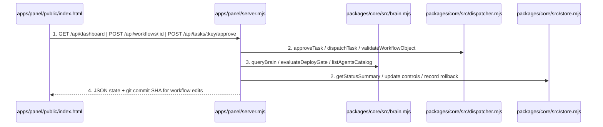
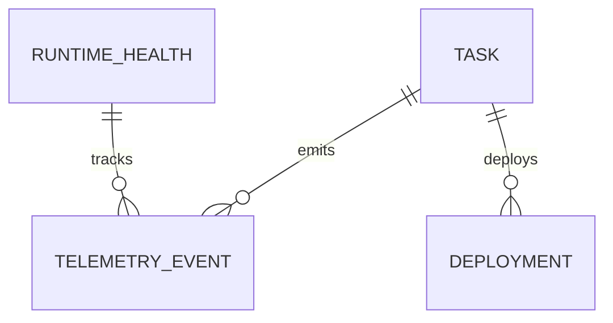

# Factory Brain, Control Panel, Workflows Control, and Autonomous Daemon

**Approved**: 2026-11-07 - user: "podemos seguir todas as fases de maneira autonoma"

## Problem

The factory can validate configs, enforce contracts/guards, and dispatch tasks across Antigravity, Claude Code, and Codex via CLI, but it lacks the long-term memory layer (`brain/`), the specialist agent catalog (`agents/`), the post-deploy measurement/rollback gate, the `auto-low` autonomous merge mode, and the local web Control Panel (`apps/panel`) to inspect telemetry, approve gates with one click, and edit workflows as code with git commits.

When this ships, the factory provides a persistent `brain/` knowledge and lessons store, an `agents/` catalog for all 7 specialist roles, Investigation/Discovery follow-up ticket creation, post-deploy measurement with automatic rollback to last good commit, `auto-low` autonomy for low-impact tasks, and a local HTTP Control Panel (`apps/panel/server.mjs` + `apps/panel/public/index.html`) exposing all telemetry metrics, Kanban board, 1-click gate approvals, Sentry production loop-back to `triage`, kill-switch/budget controls, and workflow-as-code editing backed by git commits.

## Shape

This feature adds `packages/core/src/brain.mjs` (long-term memory + follow-up ticket generator + deploy/rollback gate) and `apps/panel/server.mjs` + `apps/panel/public/index.html` (Node 24 `node:http` server + rich dashboard UI with zero external runtime dependencies). Every API route, brain lookup, deploy rollback, and workflow-as-code git commit is exercised by automated integration tests in `apps/panel/__test__/control-panel.test.mjs`.

1. HTTP request or UI action -> `apps/panel/server.mjs` (new) - serves the Control Panel UI and JSON API endpoints (door 1)
2. `apps/panel/server.mjs` (new) -> `packages/core/src/dispatcher.mjs` (exists) & `packages/core/src/store.mjs` (exists) - reads telemetry/board/workflows, approves human gates with 1 click, reopens production alerts into `triage`, toggles kill switch/budgets/circuit breakers, and validates + writes workflow YAML changes with a git commit (door 2)
3. `packages/core/src/brain.mjs` (new) - indexes `brain/` markdown documents, `.specs/STATE.md` decisions, `.specs/LESSONS.md`, and `agents/*.yaml` catalog (door 3), generates follow-up issues from `investigation-report` contracts, evaluates `auto-low` merge eligibility, and records deploy hashes / triggers rollback on post-deploy metric violations
4. out: HTTP JSON responses and interactive Control Panel HTML dashboard

**Changes underneath**

| Front | What changes |
| --- | --- |
| domain | adds `brain/`, `agents/`, `packages/core/src/brain.mjs`, and `apps/panel/` (`server.mjs` + `public/index.html`) |
| stored data | adds `deployments` table in SQLite (`packages/core/src/store.mjs`) to track deployed commit hash, `last_good_sha`, metric checks, and rollbacks |
| readers | `apps/panel/server.mjs`, `apps/panel/public/index.html`, and `packages/core/cli.mjs` (`panel` subcommand) |

New: `DEPLOYMENT` in SQLite. One-way constraints: `id` primary key on `DEPLOYMENT` (door 1).

## Surface

| Route | In | Out | Status | Who |
| --- | --- | --- | --- | --- |
| `GET /api/dashboard` | query params (none) | JSON `{ status, factoryConfig, workflows, skills, agents, brain, runtimeHealth, deployments }` | `200` | anyone |
| `POST /api/tasks/:key/approve` | `{ approver, words, resume }` | JSON `{ ok, task }` | `200`, `404` | anyone |
| `POST /api/alerts/production` | `{ executionKey, source, message }` | JSON `{ ok, task }` (reopens task in `triage`) | `200`, `400`, `404` | anyone |
| `POST /api/workflows/:id` | `{ workflow, commitMessage }` | JSON `{ ok, workflow, committed, commitSha }` | `200`, `400`, `422` | anyone |
| `POST /api/controls` | `{ killSwitch, maxTasksPerHour, dailyBudgetUsd, autonomy, resetRuntime }` | JSON `{ ok, factoryConfig, runtimeHealth }` | `200`, `400` | anyone |
| `POST /api/deploy/verify` | `{ executionKey, commitSha, errorRate, maxErrorRate }` | JSON `{ ok, status, rolledBack, revertedToSha }` | `200`, `400` | anyone |

## Landing

| One-way door | Literal shape | Alternative rejected |
| --- | --- | --- |
| Door 1: Control Panel HTTP API & `deployments` table | Node `node:http` server in `apps/panel/server.mjs` backed by `deployments(id INTEGER PRIMARY KEY AUTOINCREMENT, execution_key TEXT, commit_sha TEXT, status TEXT, last_good_sha TEXT, violation_reason TEXT, created_at TEXT)` | Heavy external backend frameworks (Express/Fastify/Next) — rejected to keep zero external runtime dependencies and instant local startup |
| Door 2: Workflow-as-Code persistence | `POST /api/workflows/:id` validates the submitted workflow against `validateWorkflowObject` + `skills.lock.json`, writes `workflows/<id>.yaml`, and optionally creates a git commit (`chore(workflows): update <id> workflow`) | Storing workflow edits only in SQLite — rejected because Live 02 ("fábrica como código") requires workflow rules to live in versioned files |
| Door 3: Brain & Agent Catalog layout | `brain/context.md`, `brain/glossary.md`, `.specs/STATE.md`, `.specs/LESSONS.md`, and `agents/<role>.json` (`triager`, `planner`, `builder`, `verifier`, `judge`, `investigator`, `ops`) | Unstructured prompt snippets hardcoded in JS — rejected so humans and agents share one auditable brain and specialist catalog |

- Nothing else in this change is hard to reverse

## Criteria

### S1: Brain, Specialist Agents, Control Panel API/UI, Workflow Editor, and Deploy Rollback (P1)

Deliver the Brain + specialist catalog, Investigation follow-up generator, `auto-low` merge rule, post-deploy measurement/rollback gate, and the local Control Panel server and dashboard.

**Acceptance Criteria**

1. WHEN `GET /api/dashboard` is requested from `apps/panel/server.mjs` THEN it SHALL return `200` with JSON containing `status` (tasks, `byStage`, `byType`, `tokens`, `totalCostUsd`, `reviewMetrics`, `needsHuman`), `factoryConfig`, all 5 `workflows`, all 23 locked `skills`, the 7 specialist `agents` (`triager`, `planner`, `builder`, `verifier`, `judge`, `investigator`, `ops`), `brain` entries (context, decisions, lessons), `runtimeHealth`, and `deployments`.
2. WHEN `POST /api/tasks/:key/approve` is called for a task paused with `needs_human: 1` THEN the server SHALL return `200`, clear `needs_human` to `0`, record a `human_approved` telemetry event, and return `404` if the task key does not exist.
   - existing paused task → `200` with `needs_human: 0`; unknown task key → `404`
3. WHEN `POST /api/alerts/production` receives a production incident (e.g. from Sentry) for an existing task THEN it SHALL return `200`, move the task back to `stage: "triage"`, and record a `production_alert_reopened` telemetry event; IF `executionKey` or `message` is missing THEN it SHALL return `400`.
   - valid Sentry alert on `#1` → `200` and `stage: "triage"`; missing `message` → `400`; unknown task → `404`
4. WHEN `POST /api/workflows/:id` submits an updated workflow definition THEN the server SHALL validate it against `validateWorkflowObject` and `skills.lock.json`, returning `422` if a skill is unlocked or a required field is missing, `400` on malformed payload, or `200` after persisting the workflow file (and recording a git commit when `commit: true`).
   - valid workflow update → `200` and persists the workflow definition; workflow referencing `"unlocked-skill"` → `422` without modifying the file; missing `workflow` object → `400`
5. WHEN `POST /api/controls` updates operational controls (`killSwitch`, `maxTasksPerHour`, `dailyBudgetUsd`, `autonomy`, or `resetRuntime`) THEN it SHALL persist the updated values to `factory.yaml` / `runtime_health` and return `200` with the new state, or `400` if numeric limits are negative/invalid.
   - `{ killSwitch: true, dailyBudgetUsd: 50 }` → `200` and persists in `factory.yaml`; `{ dailyBudgetUsd: -5 }` → `400`
6. WHEN `POST /api/deploy/verify` evaluates post-deploy metrics (`errorRate` vs `maxErrorRate`) THEN it SHALL save `commitSha` as `last_good_sha` (`status: "healthy"`) when `errorRate <= maxErrorRate`, and IF `errorRate > maxErrorRate` THEN it SHALL trigger an automatic rollback to the previous `last_good_sha` (`status: "rolled_back"`, `rolledBack: true`) and record a `deploy_rollback` telemetry event.
   - `errorRate: 0.2 <= maxErrorRate: 1.0` on `"sha1111"` → `200` `rolledBack: false`, `last_good_sha: "sha1111"`; subsequent deploy `"sha2222"` with `errorRate: 4.5 > 1.0` → `200` `rolledBack: true`, `revertedToSha: "sha1111"`; missing `commitSha` → `400`
7. WHEN `queryBrain` searches the factory's `brain/` and `.specs/STATE.md` / `.specs/LESSONS.md` knowledge base, or `extractFollowUpTickets` processes a validated `investigation-report` contract, or `canAutoMergeTask` evaluates a task under `autonomy: "auto-low"` THEN it SHALL return matching brain entries, structured follow-up ticket payloads, and `true` only when `impact == "low"` and the `review` verdict is `"APPROVE"` at matching `HEAD`.
   - `impact: "low"` + `APPROVE` + matching SHA under `auto-low` → `canAutoMergeTask: true`; `impact: "high"` under `auto-low` → `false`

## Out of scope

| Excluded | Why |
| --- | --- |
| Cloud hosting / multi-tenant auth | The factory is designed for a solo operator running locally (`AD-001` / `docs/plan.md`) |

## Assumptions

| Assumption | Chosen default | Rationale | Confirmed? |
| --- | --- | --- | --- |
| Control Panel UI architecture | Single-page HTML/CSS/JS dashboard (`apps/panel/public/index.html`) served by `apps/panel/server.mjs` (`node:http`) | Zero external npm dependencies, instant startup via `node packages/core/cli.mjs panel`, and full coverage of Overview, Board, Ticket Detail, Workflows, Controls, Runtimes, Skills, Agents, Integrations, Deploy, and Brain | y |

**Open questions:** none - all resolved or logged above.

## Differences from the source

None - the product matches the source

## Sources

- `docs/plan.md` (Phases 4, 5, 6, 7: Painel v1/v2, Investigation/Discovery, Brain, Controles, Workflows como código, `auto-low`) - binding - defines all Control Panel screens, metrics, and actions
- Live 02 PDF & Transcript (William's Lode demo + Felipe's post-deploy measurement and rollback to last good commit) - binding - defines 1-click gate approval, Sentry loop-back to triage, and deploy rollback
