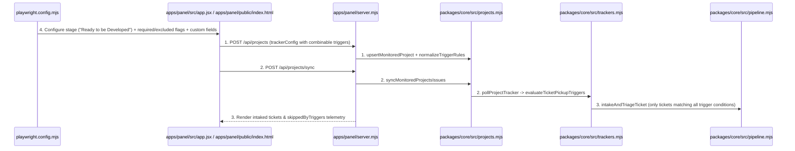
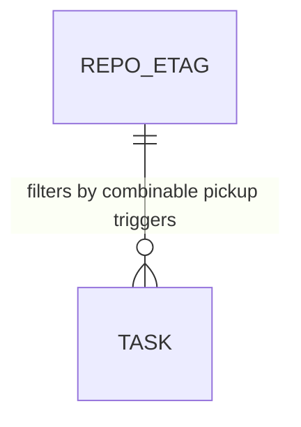

# Combinable Ticket Pickup Triggers for Jira, Asana, and GitHub

**Approved**: 2026-11-07 - user: "Tanto pro Azana quanto no Jira, a gente deve poder escolher um quando a gente deve pegar a eixo ou não. Ou seja, deve ter uma etapa, por exemplo, ready to be developed ou algo do tipo, que a pessoa pode escolher. E ela pode escolher inclusive uma combinação disso, como por exemplo outras flags. Isso deve ser setado ali pela forma que a gente seta a customização. Então ela deve poder escolher quais são os gatilhos para conseguir poder pegar a feature, no caso o ticket ou não."

## Problem

While the factory can filter Jira and Asana tickets by a single status string, teams in Jira and Asana frequently gate autonomous execution on a **combination of triggers** — for example, requiring the ticket to be in stage `"Ready to be Developed"` **AND** carry specific flags/labels/tags (such as `"agent-ready"`), **AND** match custom field flags (such as `AI_Allowed=true` or `Priority=High`), **AND** not carry blocker flags (such as `"blocked"` or `"manual-only"`), **AND** optionally match an assignee condition (such as `"unassigned"`).

When this ships, operators can configure combinable pickup triggers (`statuses`, `requiredLabels`, `excludedLabels`, `requiredCustomFields`, and `assigneeFilter`) for Jira, Asana, and GitHub in the AWS Cloudscape Control Panel and `POST /api/projects`, and the tracker adapter deterministically evaluates all trigger rules (`evaluateTicketPickupTriggers`) before picking up any ticket.

## Shape

This feature adds `normalizeTriggerRules` and `evaluateTicketPickupTriggers` to `packages/core/src/trackers.mjs`, extends `upsertMonitoredProject` and `syncMonitoredProjectsIssues` in `packages/core/src/projects.mjs` to persist and report combinable trigger rules (`skippedByTriggers`), and updates `apps/panel/src/app.jsx` to provide pickup trigger customization inputs and trigger badges in the AWS Cloudscape Control Panel.

1. Operator configures trigger rules in UI or API -> `apps/panel/server.mjs` (exists) & `packages/core/src/projects.mjs` (exists) - validates and persists `trackerConfig` with combinable triggers (`statuses`, `statusFilter`, `requiredLabels`, `excludedLabels`, `requiredCustomFields`, `assigneeFilter`) in `factory.yaml` (door 1, door 2)
2. `packages/core/src/projects.mjs` (exists) -> `packages/core/src/trackers.mjs` (exists) - polls Jira, Asana, or GitHub and runs `evaluateTicketPickupTriggers` against every candidate ticket (door 1)
3. `packages/core/src/trackers.mjs` (exists) -> `packages/core/src/pipeline.mjs` (exists) - intakes only tickets that satisfy every configured trigger (stage + required flags/labels + custom fields + no excluded blocker flags + assignee rule) and records `skippedByTriggers` for rejected tickets
4. `playwright.config.mjs` (exists) -> `apps/panel/src/app.jsx` (exists) & `apps/panel/public/index.html` (exists) - verifies in Chromium that the operator can set a combination of stage (`"Ready to be Developed"`), required flags (`"agent-ready"`), excluded flags (`"blocked"`), and custom fields (`"AI_Allowed=true"`) for Jira and Asana, picking up only tickets that match the full combination (door 2)

**Changes underneath**

| Front | What changes |
| --- | --- |
| domain | adds `normalizeTriggerRules` and `evaluateTicketPickupTriggers` in `packages/core/src/trackers.mjs` and updates `packages/core/src/projects.mjs` and `apps/panel/src/app.jsx` |
| stored data | uses existing `tasks` and `repo_etags` tables in SQLite (`packages/core/src/store.mjs`) |
| readers | `apps/panel/server.mjs`, `apps/panel/src/app.jsx`, and `apps/panel/e2e/panel.spec.mjs` |

New: nothing - read only on schema structure (uses existing `REPO_ETAG` and `TASK` tables).

## Surface

| Route | In | Out | Status | Who |
| --- | --- | --- | --- | --- |
| `POST /api/projects` | `{ repo, provider, defaultBranch, trackerConfig: { statusFilter, statuses, requiredLabels, excludedLabels, requiredCustomFields, assigneeFilter } }` | JSON `{ ok, project, projects }` | `200`, `201`, `400` | anyone |
| `POST /api/projects/sync` | `{}` | JSON `{ ok, polledRepos, newTasksCount, skippedByTriggersCount, results }` | `200` | anyone |

## Landing

| One-way door | Literal shape | Alternative rejected |
| --- | --- | --- |
| Door 1: Combinable pickup trigger evaluator (`evaluateTicketPickupTriggers`) | `trackerConfig` supporting `statuses` (or comma-separated `statusFilter`), `requiredLabels` (all must match), `excludedLabels` (none may match), `requiredCustomFields` (`key=value` map), and `assigneeFilter` (`any` / `unassigned` / handle) across Jira, Asana, and GitHub | Single status string only — rejected because operators need to combine stage (`"Ready to be Developed"`) with flags/tags/custom fields before allowing an agent to pick up a ticket |
| Door 2: Cloudscape Pickup Trigger Customization UI | Form fields `#proj-status-filter-input`, `#proj-required-labels-input`, `#proj-excluded-labels-input`, `#proj-custom-fields-input`, and `#proj-assignee-filter-input` in `apps/panel/src/app.jsx` | Editing raw JSON in `factory.yaml` by hand — rejected because the user asked to set the trigger combination directly in the customization UI |

- Nothing else in this change is hard to reverse

## Criteria

### S1: Combinable Pickup Triggers for Jira, Asana, and GitHub in Core & Cloudscape UI (P1)

Deliver the combinable trigger rule engine (`evaluateTicketPickupTriggers`) and the AWS Cloudscape customization UI verified by unit and Playwright E2E tests.

**Acceptance Criteria**

1. WHEN a Jira, Asana, or GitHub project is configured with combinable pickup triggers (`statuses` / `statusFilter`, `requiredLabels`, `excludedLabels`, `requiredCustomFields`, `assigneeFilter`) and synced via `POST /api/projects/sync` THEN `evaluateTicketPickupTriggers` SHALL pick up ONLY tickets that simultaneously match an allowed stage/section (e.g. `"Ready to be Developed"`), contain all `requiredLabels` (e.g. `"agent-ready"`), contain none of `excludedLabels` (e.g. `"blocked"`), match all `requiredCustomFields` (e.g. `{ AI_Allowed: "true" }`), and satisfy `assigneeFilter`, while counting rejected tickets in `skippedByTriggersCount`.
   - Jira ticket in `"Ready to be Developed"` with label `"agent-ready"` + custom field `AI_Allowed: "true"` + unassigned → picked up (`eligible: true`); Jira ticket in `"Ready to be Developed"` with `"agent-ready"` AND blocker flag `"blocked"` → skipped (`eligible: false`); Asana task in section `"Ready to be Developed"` missing tag `"agent-ready"` or with `AI_Allowed: "false"` → skipped (`eligible: false`)
2. WHEN the operator customizes a Jira or Asana project in the AWS Cloudscape Control Panel (`Board & Needs Human`) with a trigger stage (`"Ready to be Developed"`), required flags (`"agent-ready"`), excluded flags (`"blocked"`), and custom field conditions (`"AI_Allowed=true"`) and triggers a sync THEN the UI SHALL display the active trigger combination on the monitored project row and intake only the tickets that satisfy all configured triggers onto the Kanban board.

## Out of scope

| Excluded | Why |
| --- | --- |
| Arbitrary JavaScript eval expressions in trigger rules | Declarative combinable rules (`statuses` + `requiredLabels` + `excludedLabels` + `requiredCustomFields` + `assigneeFilter`) are deterministic, safe, and serializable in `factory.yaml` |

## Assumptions

| Assumption | Chosen default | Rationale | Confirmed? |
| --- | --- | --- | --- |
| Multi-value input format in UI | Comma-separated values for stages (`Ready to be Developed, Ready for Agent`), required/excluded flags (`agent-ready, approved`), and `key=value` pairs for custom fields (`AI_Allowed=true, Track=Fast`) | Fast to type in the Cloudscape form and parsed deterministically into arrays/objects by `normalizeTriggerRules` | y |

**Open questions:** none - all resolved or logged above.

## Differences from the source

None - the product matches the source

## Sources

- `AGENTS.md` & `docs/plan.md` - binding - defines multi-project polling and deterministic intake guards
