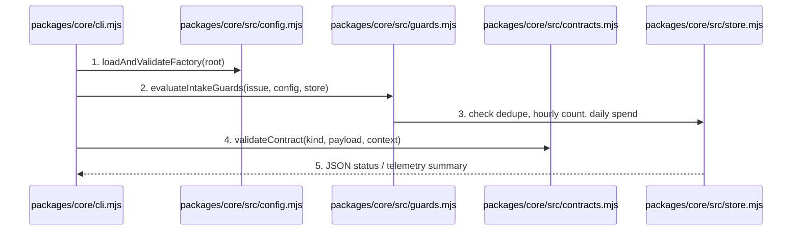
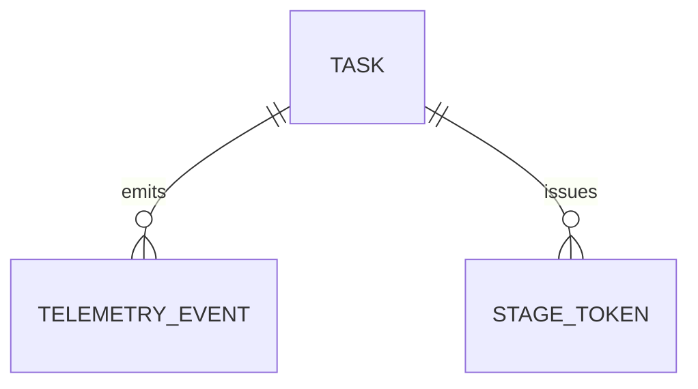
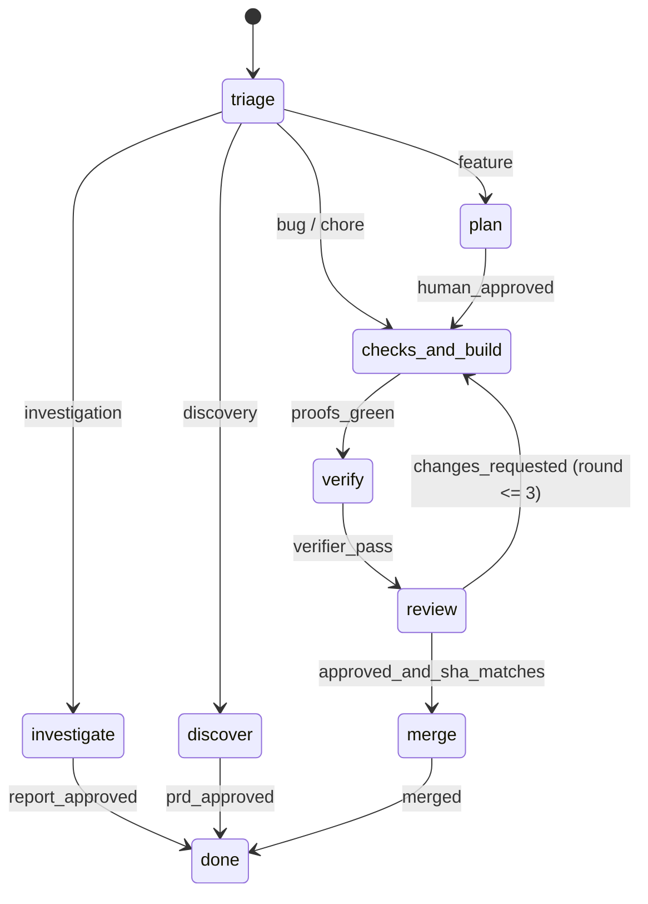

# Factory Core: Configuration, Workflows, Contracts, Guards, and Store

**Approved**: 2026-11-07 - user: "podemos seguir todas as fases de maneira autonoma"

## Problem

The factory repository has vendored skills and issue templates today, but no deterministic control plane: there is no machine-validated `factory.yaml`, no per-ticket-type workflow definitions (`workflows/*.yaml`), no JSON contract validator for agent outputs, no SQLite state/telemetry store, and no intake guards (kill switch, deduplication, hourly rate limit, daily budget). Without this layer, agents would have to self-orchestrate in prose, which the Live 02 post-mortem showed leads to conflicting PRs and runaway retries.

When this ships, the factory is defined in code (`factory.yaml`, `workflows/*.yaml`, `contracts/*.schema.json`, `config/prices.yaml`), backed by an append-only SQLite telemetry/state database (`node:sqlite`), guarded by deterministic intake checks, and operable via `node packages/core/cli.mjs <validate|intake|status>`.

## Shape

This feature uses Node 24's built-in `node:sqlite` (`DatabaseSync`) and standard library with zero external runtime dependencies. All validation, guard evaluation, pricing calculation, and SQLite persistence run as pure/injectable functions in `packages/core/src/` so unit tests exercise every rule against isolated temporary databases and fixture directories.

1. CLI command (`validate`, `intake`, `status`, `contract-check`) -> `packages/core/cli.mjs` (new) - parses arguments and invokes core modules
2. `packages/core/src/config.mjs` (new) - loads and validates factory config (door 1), workflow configs (door 2), and model pricing against structural and cross-reference rules (every workflow skill must exist in `skills.lock.json`)
3. `packages/core/src/contracts.mjs` (new) - validates agent outputs (`task`, `triage`, `investigation-report`, `review`) against contract schemas (door 3) plus Felipe's 7 semantic rules (non-generic root cause, evidence minimum length, single-use token, commit SHA format, max 3 review rounds)
4. `packages/core/src/guards.mjs` + `packages/core/src/store.mjs` (new) - evaluates intake guards in cheapest-first order (valid type, kill switch off, deduplication by deterministic execution key, hourly rate limit, daily USD budget) and persists tasks, single-use tokens, and append-only telemetry events in SQLite (door 4)
5. out: JSON payload on stdout with exit code `0` on pass, `1` on validation/guard/contract rejection, `2` on CLI usage error

**Changes underneath**

| Front | What changes |
| --- | --- |
| domain | introduces `factory.yaml`, `workflows/*.yaml`, `contracts/*.schema.json`, `config/prices.yaml`, and `packages/core` |
| stored data | creates SQLite tables `tasks`, `stage_tokens`, and `telemetry_events` on demand |
| readers | `packages/core/cli.mjs`, GitHub Actions CI (`.github/workflows/ci.yml`), and future Phase 3–6 modules |

New: `TASK`, `TELEMETRY_EVENT`, `STAGE_TOKEN` in SQLite. One-way constraints: `execution_key` unique on `TASK`, `token_hash` unique on `STAGE_TOKEN` (door 4).

## Surface

None - nothing consumed outside (local CLI and SQLite library; HTTP panel API arrives in Phase 4).

## Landing

| One-way door | Literal shape | Alternative rejected |
| --- | --- | --- |
| Door 1: `factory.yaml` schema | JSON-compatible YAML (`{"schemaVersion":1,"factory":{"name":"agentic-factory","defaultRuntime":"antigravity","autonomy":"gated","killSwitch":false,"limits":{"maxTasksPerHour":10,"maxReviewRounds":3,"dailyBudgetUsd":25,"stageTimeoutMinutes":30},"modelByImpact":{"low":{"runtime":"antigravity","model":"gemini-flash"},"medium":{"runtime":"antigravity","model":"claude-sonnet"},"high":{"runtime":"antigravity","model":"claude-opus"}},"runtimes":{"antigravity":{"enabled":true},"claude-code":{"enabled":true},"codex":{"enabled":true}},"projects":[{"id":"agentic-factory","repo":"brenoacker/agentic-factory","defaultBranch":"main"}]}}`) | Free-form unvalidated config files scattered across scripts — rejected because the panel and CI need a single deterministic schema to read and commit |
| Door 2: `workflows/<type>.yaml` schema | JSON-compatible YAML per ticket type (`feature`, `bug`, `investigation`, `discovery`, `chore`) with `id`, `label`, `autonomy`, `maxReviewRounds`, `stages:[{id, mode, agent, skills, contract, gate, humanApproval, next, onChangesRequested}]` | Hardcoding stage transitions inside TypeScript/JS — rejected because workflow rules must be editable as code and visible/controllable from the panel |
| Door 3: Agent contracts (`contracts/*.schema.json`) | Four strict schemas (`task.schema.json`, `triage.schema.json`, `investigation-report.schema.json`, `review.schema.json`) enforced with deterministic field checks | Accepting unstructured markdown comments from agents — rejected per Live 02 ("Prosa pede. Contrato garante") |
| Door 4: SQLite schema (`node:sqlite`) | `tasks(execution_key TEXT PRIMARY KEY, issue_number INTEGER, repo TEXT, type TEXT, stage TEXT, impact TEXT, runtime TEXT, model TEXT, review_rounds INTEGER, needs_human INTEGER, cost_usd REAL, input_tokens INTEGER, output_tokens INTEGER, cached_tokens INTEGER, created_at TEXT, updated_at TEXT)`, `stage_tokens(token TEXT PRIMARY KEY, execution_key TEXT, stage TEXT, used INTEGER, created_at TEXT)`, `telemetry_events(id INTEGER PRIMARY KEY AUTOINCREMENT, execution_key TEXT, issue_number INTEGER, event_type TEXT, stage TEXT, runtime TEXT, model TEXT, input_tokens INTEGER, output_tokens INTEGER, cached_tokens INTEGER, cost_usd REAL, duration_ms INTEGER, payload_json TEXT, created_at TEXT)` | External Postgres or third-party cloud DB — rejected because the factory runs locally for a solo operator with zero setup |

- Nothing else in this change is hard to reverse

## Criteria

### S1: Factory as Code, Contracts, Guards, and SQLite Store (P1)

Define and validate the factory configuration, all 5 ticket-type workflows, the 4 JSON contracts with valid/invalid fixtures, intake guards, token/cost telemetry store, and CLI commands.

**Acceptance Criteria**

1. WHEN `node packages/core/cli.mjs validate` runs on the repository THEN the system SHALL validate the factory configuration, all 5 workflow definitions (`feature`, `bug`, `investigation`, `discovery`, `chore`), the model pricing table, `skills.lock.json` cross-references, and all contract fixtures, exiting `0` with `"ok":true` and `"workflowsValidated":5`.
2. IF a workflow definition references a skill not present in `skills.lock.json` or misses a required field (`id`, `label`, `stages`) THEN `validate` SHALL exit `1` naming the workflow and offending skill/field.
   - unknown skill `"non-existent-skill"` → exits `1`; valid locked skill `"tlc-spec-lean"` → exits `0`
3. IF an agent submits a `triage` contract where `root_cause` is a generic single word (`"bug"`, `"erro"`, `"fix"`) or shorter than 20 characters, or `evidence` is empty/shorter than 15 characters, or `impact` is outside `["low","medium","high"]` THEN contract validation SHALL reject it with exit `1` and a specific rule code.
   - `root_cause: "bug"` and `evidence: ""` → rejected (`root_cause_too_short` / `generic_root_cause` / `evidence_too_short`); detailed 35-char root cause + 25-char evidence + `impact: "medium"` → accepted
4. IF a `review` contract has `verdict: "APPROVE"` but its `commit_sha` does not match the current branch `head_sha` or `round` exceeds `maxReviewRounds` (3) THEN contract validation SHALL reject it with exit `1` (`commit_sha_mismatch` or `max_review_rounds_exceeded`).
   - `commit_sha: "aaaaaaa"` vs `head_sha: "bbbbbbb"` → rejected (`commit_sha_mismatch`); `round: 4` with `maxReviewRounds: 3` → rejected (`max_review_rounds_exceeded`); matching 7–40 hex SHA at `round: 1` → accepted
5. IF a stage callback reuses a single-use `stage_token` that was already consumed or belongs to another stage THEN the store/callback gate SHALL reject it with code `409` (`token_already_used` or `token_stage_mismatch`) without advancing the task state.
   - first use of token for `triage` → `200` accepted; second replay of same token → `409` `token_already_used`; token for `triage` presented at `review` → `409` `token_stage_mismatch`
6. WHEN `evaluateIntakeGuards` evaluates an incoming issue THEN it SHALL check guards in order: (1) valid ticket type, (2) factory `killSwitch == false`, (3) no active duplicate `execution_key` (`<repo>#<issue_number>`), (4) tasks started in the last 60 minutes `< maxTasksPerHour`, (5) spend in the last 24 hours `< dailyBudgetUsd`, rejecting on the first failing guard with its exact code.
   - `killSwitch: true` → rejected `factory_paused`; duplicate `<repo>#42` → rejected `duplicate_execution`; hourly count at limit → rejected `rate_limit_exceeded`; daily spend at budget → rejected `daily_budget_exceeded`; all clear → accepted with deterministic `execution_key`
7. WHEN `node packages/core/cli.mjs status` runs against a SQLite database containing recorded tasks and telemetry events THEN it SHALL output JSON aggregating task counts by stage/type, total tokens (`input`, `output`, `cached`), total cost in USD computed from the pricing configuration, average review rounds, first-round approval rate, and `needsHuman` queue items.

## Out of scope

| Excluded | Why |
| --- | --- |
| Spawning live CLI sub-processes (`agy`, `claude`, `codex`) and git worktrees | Belongs to Phase 3 (Runtime adapters + 1st autonomous loop) |
| Web UI (Vite/React) for the control panel | Belongs to Phase 4 (Panel v1) and Phase 6 (Panel v2) |

## Assumptions

| Assumption | Chosen default | Rationale | Confirmed? |
| --- | --- | --- | --- |
| YAML format for `factory.yaml`, `workflows/*.yaml`, and `config/prices.yaml` | JSON-compatible YAML subset (valid YAML 1.2 that is also parseable by standard JSON/strict parser with comment stripping) | Keeps zero external npm dependencies in `packages/core` while remaining clean, readable YAML | y |
| Autonomous execution across Phases 2–7 | Proceed directly through Plan → Checks → Build → Verify and push on green verification | User explicitly instructed: "podemos seguir todas as fases de maneira autonoma" (`AD-002`) | y |

**Open questions:** none - all resolved or logged above.

## Differences from the source

None - the product matches the source

## Sources

- `docs/plan.md` (Phase 2: `factory.yaml`, `workflows/`, contratos, `factory validate`, sync de issues → SQLite, guards) - binding - defines Phase 2 scope and architecture
- Live 02 PDF & Transcript (Felipe's 8 steps, 6 intake guards, 7 contract rules, single-use token, SHA-locked review, 3-round cap) - binding - defines deterministic guard and contract rules
