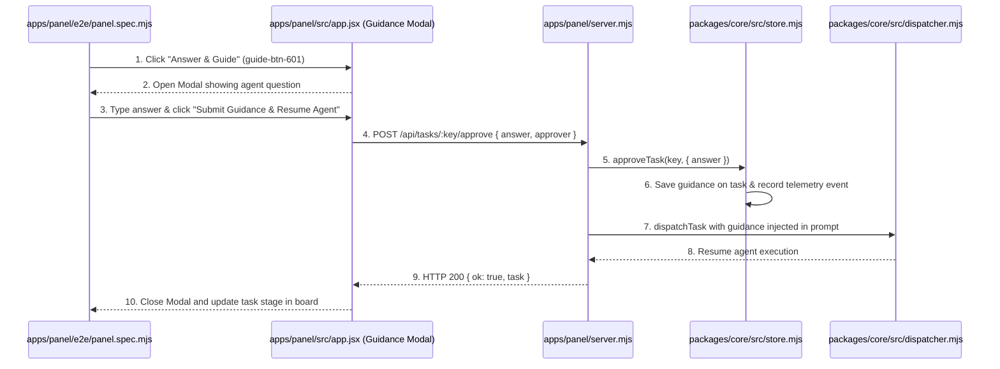
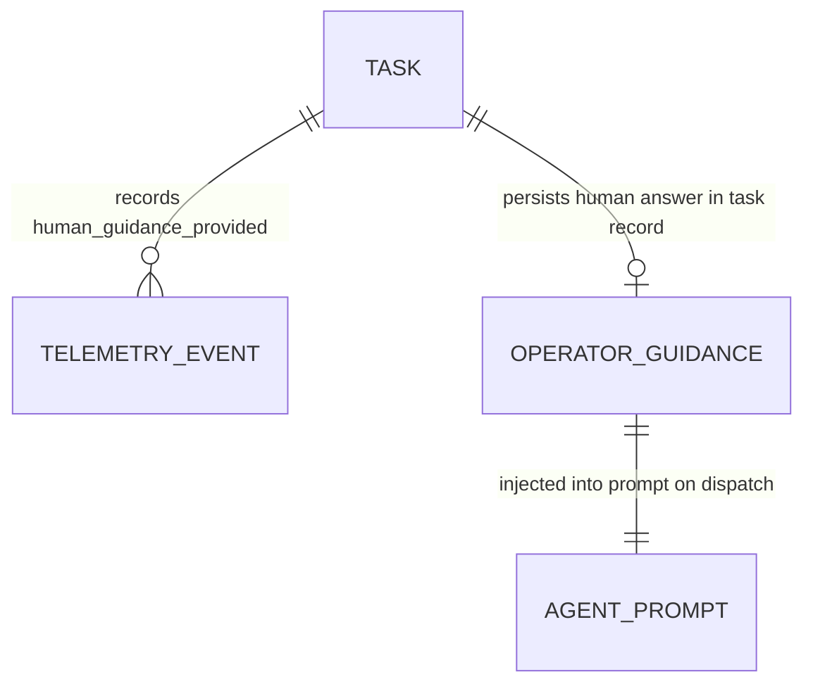

# Interactive Human Guidance Dialog and Resume

**Approved**: 2026-11-09 - user: "quando o agente precisa do humano para responder perguntas, o humano deve ter uma forma de abrir o agente para responder e ele seguir, da forma que esta atualmente acho que nao esta funcionando dessa forma, temos o Needs Human Approval Queue (1-Click Gate Approval) mas acho  que nao serve de nada, se o agente precisa de ajuda humana nao faz sentido ter 1 click approval. use o tlc-spec-lean para criar uma spec para isso"

## Problem

When an autonomous factory agent halts execution with `needs_human: true` (such as when plan confidence is below the configured threshold, when clarification questions are posed, when review rounds hit change requests, or when paused at a human gate), the Control Panel currently provides only a generic "1-Click Approve & Advance" button (`approve-btn-${issue_number}`). This button blindly resumes the pipeline using hardcoded words `"/approve"`, offering the human operator no interface to view the agent's question in detail, type specific guidance or architectural answers, or inject clarifying direction into the agent's context.

As a result, the agent is either resumed without the necessary answers (risking incorrect code changes, hallucinations, or repeated pauses) or operators must manually manipulate files out-of-band to communicate with the agent. The "Needs Human Approval Queue" fails to serve as a genuine human-in-the-loop assistance mechanism because it lacks an interactive communication channel between the operator and the stalled agent.

When this ships:
1. Each blocked task (`needs_human: 1`) on the Kanban Board and in the Needs Human Queue provides a prominent **"Answer & Guide"** action (`data-testid="guide-btn-${issue_number}"`).
2. Clicking "Answer & Guide" opens an interactive AWS Cloudscape `Modal` (`data-testid="guidance-modal"`) displaying the task identifier, title, active stage, and the exact question or blockage reason (`data-testid="guidance-question"`).
3. The modal provides a multi-line input (`data-testid="guidance-answer-input"`) where the operator writes explicit guidance, architectural decisions, or clarifications.
4. Clicking **"Submit Guidance & Resume Agent"** (`data-testid="guidance-submit-btn"`) calls `POST /api/tasks/:key/approve` with `{ answer, approver: "operator" }`, persists the operator guidance into SQLite task context and telemetry, and resumes agent execution with the human answer injected into the stage prompt.
5. Automated Playwright E2E tests in `apps/panel/e2e/panel.spec.mjs` verify opening the guidance modal, submitting guidance, and resuming the blocked agent.

## Shape

This feature adds an interactive guidance modal to `apps/panel/src/app.jsx`, enhances `POST /api/tasks/:key/approve` in `apps/panel/server.mjs` and `packages/core/src/store.mjs` to accept and record operator guidance, enriches prompt generation in `packages/core/src/dispatcher.mjs` with human guidance, builds the panel bundle via `scripts/build-panel.mjs`, and tests the full journey in `apps/panel/e2e/panel.spec.mjs`.

1. Operator clicks "Answer & Guide" on a blocked card -> `apps/panel/src/app.jsx` (exists) - opens Cloudscape guidance modal displaying task question and guidance textarea (door 1)
2. Operator enters answer and clicks "Submit Guidance & Resume Agent" -> `apps/panel/src/app.jsx` (exists) - issues `POST /api/tasks/:key/approve` with answer payload (door 1)
3. HTTP request arrives at server -> `apps/panel/server.mjs` (exists) - validates payload and delegates to store `approveTask` (door 1)
4. Approval and guidance persisted -> `packages/core/src/store.mjs` (exists) - records human guidance in task record and logs telemetry event (door 1)
5. Agent stage dispatched -> `packages/core/src/dispatcher.mjs` (exists) - enriches runtime prompt with operator answer and clears needs_human (door 1)
6. Playwright E2E suite -> `apps/panel/e2e/panel.spec.mjs` (exists) - asserts guidance modal interaction, submission, and agent resumption (door 1)

**Changes underneath**

| Front | What changes |
| --- | --- |
| domain | introduces interactive guidance modal in `apps/panel/src/app.jsx`, enhances `POST /api/tasks/:key/approve` to accept `{ answer }`, and injects operator guidance into agent prompt in `packages/core/src/dispatcher.mjs` |
| stored data | adds `human_guidance` field to `tasks` SQLite table and records `human_guidance_provided` in `telemetry_events` |
| readers | `apps/panel/src/app.jsx`, `apps/panel/server.mjs`, `packages/core/src/store.mjs`, `packages/core/src/dispatcher.mjs`, and `apps/panel/e2e/panel.spec.mjs` |

New: adds `human_guidance` column to `tasks` table storing the operator's textual answer to the agent's question.

## Surface

| Route | In | Out | Status | Who |
| --- | --- | --- | --- | --- |
| `POST /api/tasks/:key/approve` | `{ answer?: string, approver?: string }` | `{ ok: true, task: object }` | `200` | anyone |
| `POST /api/tasks/:key/approve` | invalid / unknown key | `{ ok: false, error: string }` | `404` | anyone |
| `GET /` | - | HTML + `/bundle.js` with Guidance Modal and action buttons | `200` | anyone |

## Landing

| One-way door | Literal shape | Alternative rejected |
| --- | --- | --- |
| Door 1: Interactive Guidance Modal and Prompt Injection | Cloudscape `Modal` in `apps/panel/src/app.jsx` with `data-testid="guidance-modal"`, `data-testid="guidance-answer-input"`, and `data-testid="guidance-submit-btn"`, sending `{ answer }` to `POST /api/tasks/:key/approve`, storing in `tasks.human_guidance`, and prepending `"Human Operator Guidance:\n<answer>"` to agent stage prompt | Retaining blind 1-click approval or requiring operators to edit JSON contract files directly on disk — rejected because the operator explicitly stated that 1-click approval is useless when agents need human answers |

- Nothing else in this change is hard to reverse.

## Criteria

### S1: Interactive Human Guidance Dialog (P1)

Provide an interactive dialog in the Control Panel allowing operators to inspect an agent's question, enter an answer, and resume the agent with guidance injected.

**Acceptance Criteria**

1. WHEN a task has `needs_human: 1` THEN the Control Panel SHALL render an "Answer & Guide" action (`data-testid="guide-btn-${issue_number}"`) on its card and in the Needs Human Queue.
2. WHEN the operator clicks "Answer & Guide" THEN the Control Panel SHALL open a modal dialog (`data-testid="guidance-modal"`) displaying the agent's question (`data-testid="guidance-question"`).
3. The modal dialog SHALL contain a multi-line input (`data-testid="guidance-answer-input"`) and a submit button (`data-testid="guidance-submit-btn"`).
4. WHEN the operator enters guidance text and clicks "Submit Guidance & Resume Agent" THEN the Control Panel SHALL issue `POST /api/tasks/:key/approve` with `{ answer, approver }`.
5. WHERE a task receives operator guidance THEN `packages/core/src/store.mjs` SHALL persist the answer in `human_guidance`, clear `needs_human = 0`, and log a `human_guidance_provided` event in `telemetry_events`.
6. WHEN the agent pipeline resumes execution THEN `packages/core/src/dispatcher.mjs` SHALL inject the operator's guidance text into the prompt context for the subsequent agent stage.
7. The Playwright E2E test suite (`apps/panel/e2e/panel.spec.mjs`) SHALL verify the full guidance flow: opening the modal, asserting the agent's question, typing guidance, submitting, and verifying the task resumes execution.

## Out of scope

| Excluded | Why |
| --- | --- |
| Real-time bi-directional audio/video streaming | Text-based prompt guidance satisfies agent LLM context requirements |
| Arbitrary code execution sandbox inside modal | Code changes remain governed by the agentic pipeline, git worktrees, and verification gates |

## Assumptions

| Assumption | Chosen default | Rationale | Confirmed? |
| --- | --- | --- | --- |
| Guidance Modal Component | AWS Cloudscape `Modal` component | Matches the application design system and provides consistent accessibility | y |
| API Endpoint | Extend `POST /api/tasks/:key/approve` with optional `{ answer, approver }` payload | Preserves existing approval contract while seamlessly handling answers | y |
| Prompt Injection Format | Prepend `Human Operator Guidance / Instructions:\n<answer>` to task dispatch prompt | Ensures the LLM receives the human instruction prominently before execution | y |
| Test Coverage | Add a dedicated Playwright E2E test in `apps/panel/e2e/panel.spec.mjs` | Guarantees visual and functional proof of the guidance journey | y |

Open questions: none - requirements and interactive model confirmed with operator.

## Differences from the source

None - the product matches the source.

## Sources

- User request: non-binding - user: "quando o agente precisa do humano para responder perguntas, o humano deve ter uma forma de abrir o agente para responder e ele seguir, da forma que esta atualmente acho que nao esta funcionando dessa forma, temos o Needs Human Approval Queue (1-Click Gate Approval) mas acho que nao serve de nada, se o agente precisa de ajuda humana nao faz sentido ter 1 click approval. use o tlc-spec-lean para criar uma spec para isso"
- Decision log: `.specs/STATE.md` (AD-005)
