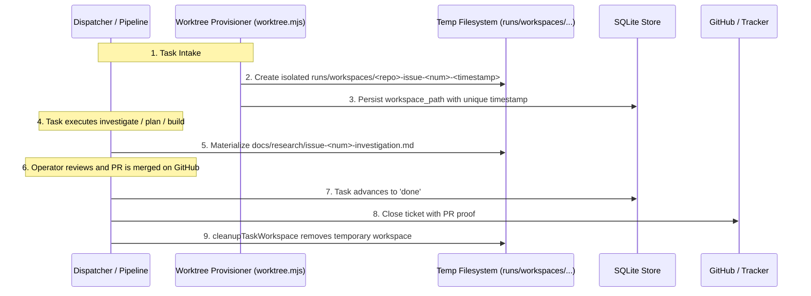
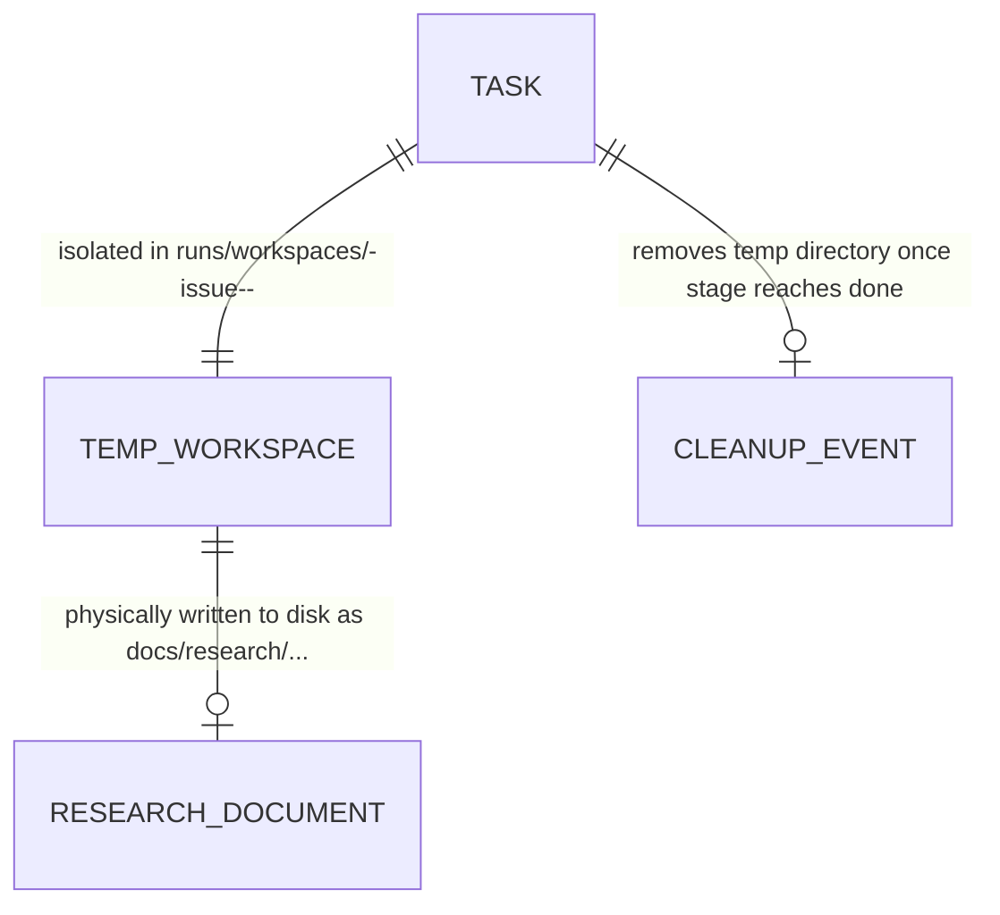

# Isolated Temp Workspaces and Deliverable Materialization plan

**Approved**: 2026-11-07 - user: "sim"

## Problem

In the existing Agentic Factory:
1. `provisionTaskWorkspace` creates task worktrees and clones inside a static `.workspaces/<repo>/issue-<num>` subfolder within the main factory repository (`beautiful-brahmagupta`). This pollutes the factory codebase with third-party repositories, causes Git index locks, and risks state collisions across repeated runs of the same ticket.
2. When investigation or discovery workflows execute (`contracts/investigation-report.schema.json`), `dispatcher.mjs` records metadata (`deliverable_url = "docs/research/issue-<num>-investigation.md"`) in SQLite, but **never writes the physical markdown file to disk in the task workspace**.
3. When operators attempt to view deliverables in the Control Panel, the file resolution logic falls back to the main factory repository (`C:\Users\Admin\Documents\antigravity\beautiful-brahmagupta\docs\research\issue-<num>-investigation.md`), where the file does not exist, creating the impression that files were lost or deleted.
4. Workspaces are never cleaned up upon ticket completion, leaving orphan repositories and stale worktrees occupying disk space permanently.

When this ships, the Agentic Factory guarantees:
1. **Isolated Temp Workspaces with Unique Run Timestamps**:
   - Workspaces are created in dedicated isolated temporary paths (e.g., `runs/workspaces/<repo-slug>-issue-<num>-<timestamp>`).
   - Every ticket run operates in an entirely independent folder, completely separated from the factory repository.
2. **Physical Deliverable Materialization**:
   - When an investigation or discovery workflow completes its contract, `dispatcher.mjs` immediately writes the full formatted Markdown report to `<workspace_path>/docs/research/issue-<num>-investigation.md` (or report.md).
   - The file is physically present on disk with summary, evidence, compared options, and recommendations.
3. **Automated Post-Merge Workspace Cleanup**:
   - When a task reaches `done` (PR verified as merged on GitHub or non-code deliverable approved and closed), the temporary workspace folder is safely deleted (`cleanupTaskWorkspace`).
4. **Existing Backlog Materialization**:
   - Markdown documents are materialized for all existing investigation tasks in the factory store, restoring immediate access to all reports.

## Shape

This feature updates `packages/core/src/worktree.mjs`, `packages/core/src/dispatcher.mjs`, `packages/core/src/pipeline.mjs`, `packages/core/src/projects.mjs`, and `apps/panel/__test__/control-panel.test.mjs`.

1. Unique timestamped temporary workspaces and cleanup routine -> `packages/core/src/worktree.mjs` (door 1).
2. Physical deliverable markdown report generation -> `packages/core/src/dispatcher.mjs` (door 2).
3. Post-merge automated workspace deletion -> `packages/core/src/pipeline.mjs` & `packages/core/src/projects.mjs` (door 3).

**Changes underneath**

| Front | What changes |
| --- | --- |
| workspace domain | `provisionTaskWorkspace` creates timestamped directories in `runs/workspaces/` (or configured temp root); exports `cleanupTaskWorkspace` |
| deliverable domain | `dispatcher.mjs` adds `materializeInvestigationReport` to format and write concrete markdown files on disk |
| lifecycle closing | `advanceTicketInPanel` and `syncMergedPullRequests` invoke `cleanupTaskWorkspace` upon reaching `stage === 'done'` |
| test coverage | Unit tests verify timestamped workspace paths, physical file existence, content rendering, and safe cleanup |

New: provides timestamped isolated workspaces, physical markdown report generation, and post-completion cleanup.

## Surface

| Function / Route | In | Out | Status | Who |
| --- | --- | --- | --- | --- |
| `provisionTaskWorkspace({ repo, issueNumber, timestamp })` | Task identifiers | `{ ok, workspacePath, branchName }` | `200` | factory |
| `cleanupTaskWorkspace(workspacePath)` | File path string | `{ ok, deleted }` | `200` | factory |
| `materializeInvestigationReport({ workspacePath, issueNumber, contractPayload })` | Payload JSON | `{ ok, filePath, bytesWritten }` | `200` | factory |

## Landing

| One-way door | Literal shape | Alternative rejected |
| --- | --- | --- |
| Door 1: Timestamped Isolated Workspaces | Path pattern `runs/workspaces/<safeSlug>-issue-<issueNumber>-<timestamp>` | Placing workspaces in `.workspaces/` inside repo root — rejected because it pollutes factory code and causes collisions |
| Door 2: Physical Deliverable Materialization | Formats and writes `# Investigation Report #${issueNumber}` with Summary, Evidence, and Recommendations to disk | Storing metadata in SQLite without writing files — rejected because files appear lost or non-existent to operators |
| Door 3: Post-Completion Workspace Cleanup | Safely deletes temporary folder (`rmSync(workspacePath, { recursive: true, force: true })`) once `stage === 'done'` | Retaining abandoned clones indefinitely — rejected due to disk exhaustion and stale worktrees |

## Criteria

### S1: Timestamped Temporary Workspaces & Safe Isolation (P1)

Provision isolated workspaces in dedicated directories outside the repository root.

**Acceptance Criteria**

1. WHEN `provisionTaskWorkspace` is invoked for a task THEN the workspace SHALL be created in a timestamped path under `runs/workspaces/<repo>-issue-<num>-<timestamp>` and NOT directly in `.workspaces/`.
2. WHEN `cleanupTaskWorkspace` is invoked for an existing workspace directory THEN the system SHALL remove the directory from disk and return `{ ok: true, deleted: true }`.

### S2: Physical Markdown Deliverable Materialization (P1)

Generate and write concrete markdown reports from structured investigation contracts.

**Acceptance Criteria**

3. WHEN an investigation workflow contract (`investigation-report`) is validated THEN the system SHALL write a formatted Markdown document to `<workspace_path>/docs/research/issue-<num>-investigation.md`.
4. WHEN the materialized investigation document is read from disk THEN it SHALL contain the question, answer summary, evidence items, compared options, and recommendations.

### S3: Lifecycle Cleanup on Ticket Completion (P1)

Delete temporary workspaces when tickets complete.

**Acceptance Criteria**

5. WHEN a task transitions to `stage === 'done'` via PR merge or deliverable approval THEN the system SHALL delete the temporary workspace folder while preserving the task record and deliverable reference in SQLite.

## Out of scope

| Excluded | Why |
| --- | --- |
| Deleting git branches on remote repository | Branch deletion is governed by GitHub/GitLab repository settings |
| Cleaning up unfinished or paused workspaces | Active and paused tasks must retain their workspaces for review |

## Assumptions

| Assumption | Chosen default | Rationale | Confirmed? |
| --- | --- | --- | --- |
| Dedicated Temp Folder | `runs/workspaces/` | Keeps temporary clones isolated from source code while within factory data store | y |
| Physical Markdown | Write markdown directly from contract | Operators need to read the report via editor or preview modal | y |

**Open questions:** none.

## Differences from the source

None - the product matches the source.

## Sources

- User request: "Olhando para as tarefas que estão em andamento, tem várias que estão utilizando um path que não me parece ser uma pasta temporária de um clone do repositório que depois vamos remover após a issue estar fechada ou o PR estar fechado. Aparentemente está colocando na pasta principal, o que pode estar causando a perda desses documentos. Por que a gente não está utilizando uma pasta temporária e criando pastas com nome específico, utilizando, por exemplo, timestamp ou algo do tipo para não ter problema com outros, para evitar esses problemas de perder arquivo? Isso já é uma feature que já devia estar implementada. Vou te mandar agora como exemplo o path de um dos arquivos que sumiram: C:\Users\Admin\Documents\antigravity\beautiful-brahmagupta\docs\research\issue-86-investigation.md"
