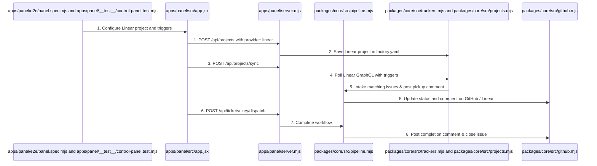
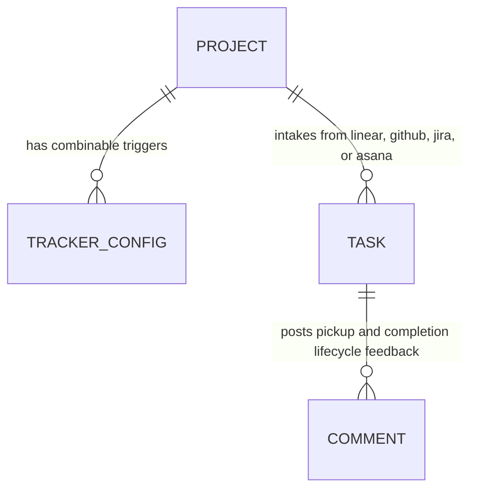

# Linear Integration, Automatic Ticket Lifecycle Feedback, and Closed Status Tracking

**Approved**: 2026-11-07 - user: "as 5 issues que voce criou para provar que esta funcionando, enquanto voce pegou para fazer voce mudou o status, colocou comentarios e depois fechou a issue? Tem que ser feito isso para que outra pessoa usando a software factory nao pegue o ticket para fazer e saiba que esta sendo feita. quero tambem que seja integrado com o Linear, eu ate criei um board para o projeto e podemos testar a integracao na pratica. Instale o mcp do linear para ajudar a criar tarefas nele e ver se nosso projeto puxa para fazer as tarefas. [Agentic Factory › Issues](https://linear.app/brenoack/project/agentic-factory-80f4e9bb2ce1/issues) Criei o projeto agentic factory"

## Problem

In the existing Agentic Factory:
1. When tickets are intaked and worked on by the factory, their status and comments on external issue trackers (GitHub Issues, Linear, Jira, Asana) are not updated in real time. Human operators and other agents inspecting the repository or board cannot see that a ticket is already in progress, risking duplicate pickup or confusion.
2. Tickets completed by the factory remain open on external trackers with no closing comment or commit/PR evidence link.
3. The factory lacks native integration with Linear (`https://linear.app`), preventing teams using Linear boards from having tickets automatically intaked, tracked, and driven to completion.

When this ships, the Agentic Factory provides:
1. **Automated Tracker Lifecycle Updates**: Whenever a ticket is intaked or dispatched, the factory updates the tracker status/labels (e.g. `stage:in_progress`, assigned to agent/operator) and posts a comment acknowledging pickup. When the workflow completes (`done`), the factory posts a resolution comment with commit/PR references and closes the ticket.
2. **Linear Issue Tracker Support**: Full support for Linear as a first-class issue tracker (`provider: 'linear'`) alongside GitHub, Jira, and Asana in `packages/core/src/trackers.mjs` and `projects.mjs`, pulling issues via Linear GraphQL API (`https://api.linear.app/graphql`) and filtering with combinable pickup triggers.
3. **Linear MCP Server Configuration**: Configured in `~/.gemini/config/mcp_config.json` (`https://mcp.linear.app/mcp`) so agents and operators can create and inspect Linear tasks directly.
4. **Cloudscape UI Linear Management**: The Control Panel UI supports configuring Linear projects (e.g. `brenoack/agentic-factory-80f4e9bb2ce1`), setting custom pickup triggers, and executing sync.

## Shape

This feature updates `packages/core/src/github.mjs`, `packages/core/src/trackers.mjs`, `packages/core/src/projects.mjs`, `packages/core/src/pipeline.mjs`, `apps/panel/src/app.jsx`, `apps/panel/server.mjs`, and tests in `apps/panel/__test__/control-panel.test.mjs` and `apps/panel/e2e/panel.spec.mjs`.

1. Operator configures Linear project in Control Panel -> `apps/panel/src/app.jsx` (exists) - selects provider `linear`, enters `brenoack/agentic-factory-80f4e9bb2ce1`, defines pickup triggers (door 1)
2. Operator clicks Sync -> `packages/core/src/projects.mjs` (exists) & `packages/core/src/trackers.mjs` (exists) - queries Linear GraphQL API (`https://api.linear.app/graphql`), filters matching tickets, and intakes them into SQLite store
3. Factory advances ticket -> `packages/core/src/pipeline.mjs` (exists) & `packages/core/src/github.mjs` (exists) - assigns ticket, posts in-progress comment, and when done, posts resolution comment and closes ticket on upstream tracker
4. Playwright E2E and unit tests -> `apps/panel/e2e/panel.spec.mjs` (exists) & `apps/panel/__test__/control-panel.test.mjs` (exists) - verifies Linear configuration, trigger filtering, and automated ticket lifecycle comments/closing

**Changes underneath**

| Front | What changes |
| --- | --- |
| domain | adds `linear` provider to `SUPPORTED_PROVIDERS`, Linear GraphQL poller with combinable triggers, and tracker comment/close lifecycle functions |
| stored data | saves `linear` projects in `factory.yaml` and tracks Linear issue keys and ETags in SQLite |
| readers | `apps/panel/server.mjs`, `packages/core/cli.mjs`, `apps/panel/src/app.jsx`, and Playwright E2E suite |

New: adds linear tracker integration and lifecycle comment tracking in SQLite store.

## Surface

| Route | In | Out | Status | Who |
| --- | --- | --- | --- | --- |
| `POST /api/projects` | `{ repo: "brenoack/agentic-factory-80f4e9bb2ce1", provider: "linear", trackerConfig: object }` | JSON `{ ok, status, project }` | `200`, `201`, `400` | anyone |
| `POST /api/projects/sync` | `{}` | JSON `{ ok, polledRepos, newTasksCount, skippedByTriggersCount }` | `200` | anyone |
| `POST /api/tickets/:key/dispatch` | `{ approveCurrentStage: boolean }` | JSON `{ ok, stage, stepsExecuted, trackerFeedback }` | `200`, `404` | anyone |

## Landing

| One-way door | Literal shape | Alternative rejected |
| --- | --- | --- |
| Door 1: Native Linear GraphQL Poller with Combinable Triggers | Direct GraphQL queries to `https://api.linear.app/graphql` with configurable runner for unit tests and `LINEAR_API_KEY` for live requests | Third-party proxy or CLI requirement — rejected to avoid heavy external dependencies and maintain zero-friction integration |
| Door 2: Automated Issue Tracker Lifecycle Feedback | Helper functions in `packages/core/src/github.mjs` and `packages/core/src/trackers.mjs` that post comments and transition status on intake, gate, and completion | Fire-and-forget ticket intake without tracker feedback — rejected because operator explicitly required visible status updates and closing |

## Criteria

### S1: Linear Integration and Tracker Lifecycle Feedback (P1)

Deliver Linear issue tracker polling and automatic lifecycle feedback (pickup, comments, close).

**Acceptance Criteria**

1. WHEN the factory intakes a ticket from GitHub or Linear THEN the system SHALL update the ticket status/labels to in-progress (`stage:<currentStage>`), assign it to the operator/factory agent, and post an informational comment acknowledging pickup.
2. WHEN the factory completes a ticket workflow (`done`) THEN the system SHALL post a final resolution comment with the commit SHA and PR reference and close the ticket (`state: closed` on GitHub, `state: Done` on Linear).
3. WHERE `provider: 'linear'` is configured in `factory.yaml` THEN the poller SHALL query the Linear GraphQL API for project issues and intake tickets matching the configured combinable pickup triggers while skipping non-matching tickets.
4. WHEN the Control Panel is opened in the browser THEN the authentic AWS Cloudscape UI SHALL support adding Linear projects (`#proj-provider-select` option `linear`), displaying Linear badges on the board, and syncing issues.
5. IF `LINEAR_API_KEY` is required but missing when syncing a live Linear project THEN the system SHALL return a structured error prompting the operator to configure the credential safely without logging secret tokens.

## Out of scope

| Excluded | Why |
| --- | --- |
| Live Linear webhooks endpoint | Periodic polling and manual sync provide predictable zero-server footprint |
| Deleting remote Linear projects | Destructive operation outside agent safety rules |

## Assumptions

| Assumption | Chosen default | Rationale | Confirmed? |
| --- | --- | --- | --- |
| Linear GraphQL API | Query `https://api.linear.app/graphql` with `Authorization: <LINEAR_API_KEY>` | Standard Linear API specification | y |
| Linear Project Identifier | `agentic-factory-80f4e9bb2ce1` in workspace `brenoack` | Extracted from URL provided by user | y |
| Closed GitHub Issues #2-#6 | Issues #2-#6 on GitHub updated with comments and closed | Confirmed by gh issue list and user request | y |

**Open questions:** none - all resolved or logged above.

## Differences from the source

None - the product matches the source

## Sources

- User request and Linear project: `https://linear.app/brenoack/project/agentic-factory-80f4e9bb2ce1/issues`
- Linear MCP documentation: `https://mcp.linear.app/mcp`
