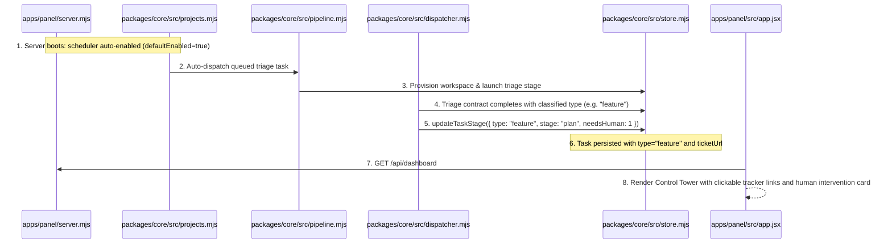
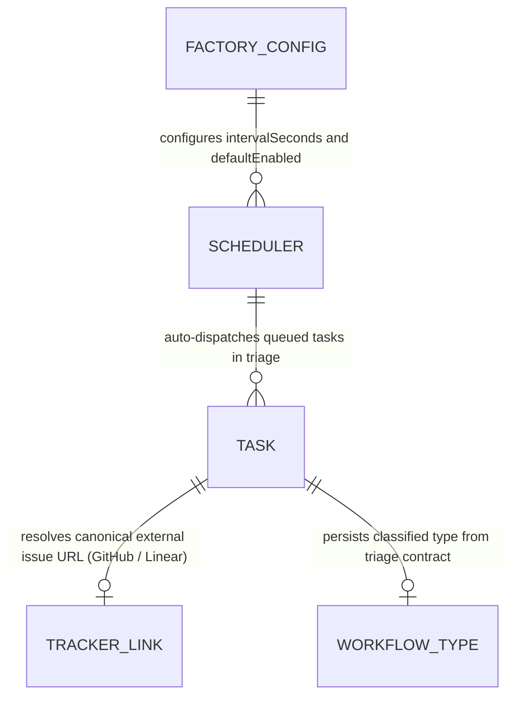

# Live Operations Reorganization and Tracker Links

**Approved**: 2026-11-07 - user: "Sim, pode aplicar. Um ponto que a gente tem que colocar é sempre quando a gente referencia um ticket, deve ser possível a gente clicar e abrir ele. Tanto no Linear quanto no GitHub. A gente deve referenciar para o link desse ticket. Pra ficar mais fácil. Por exemplo, agora tem um ticket que está em Agents Waiting for Human Inputs and Clarification. E eu não sei o que se trata. 3. Proposta de Reorganização do Painel -> aceito sua proposta"

## Problem

In the existing Agentic Factory Control Panel:
1. When tickets are listed in the Kanban board, table views, or in the "Agents Waiting for Human Input & Clarification" view, ticket references are static text (`#99 Title`). Operators cannot click to inspect the original issue or discussion in GitHub or Linear, leaving them blind to the problem context when reviewing plans or providing clarification.
2. The background cron polling scheduler (`createPollingScheduler`) defaults to `enabled: false` upon server startup. As a result, newly intaked tickets remain stuck in `triage` indefinitely unless an operator manually triggers the scheduler endpoint, preventing the factory from automatically provisioning workspaces and launching active workflows.
3. During the `triage` stage, the triager agent inspects the ticket and outputs a contract specifying the exact workflow type (`feature`, `bug`, `investigation`, `discovery`, `chore`). However, the factory store does not persist the classified `type` from the contract into the database or re-route the task into that workflow's stage pipeline.
4. The Control Panel UI is fragmented across technical infrastructure tabs ("Runtime Router & Circuit Breaker", "Operational Controls", "Deploy", "Long-Term Brain") that display abstract telemetry without giving operators high-value, actionable visibility into what is running right now, why decisions were made, and where human intervention is required.

When this ships, the Agentic Factory guarantees:
1. Every ticket reference in the Control Panel (Kanban cards, Waiting Human screen, summary lists) is a direct, clickable hyperlink opening the source issue in GitHub or Linear with `target="_blank"` and `rel="noreferrer"`.
2. The background polling and auto-dispatch scheduler starts enabled by default (`enabled: true`), automatically polling configured repositories and dispatching queued triage tasks up to executing concurrency limits.
3. The triage contract's classified `type` is persisted in SQLite and updates the task's workflow routing and UI type badge immediately upon completion of triage.
4. The Control Panel UI is reorganized into three high-value views:
   - **Control Tower (Live Operations & Interventions)**: Real-time execution slots, backlog queue counter, prioritized human intervention screen with direct issue links, and operational controls.
   - **Board & Timeline (Traceability & Workflows)**: End-to-end Kanban board with clickable tracker links, visual Mermaid workflow editor, and workspace/deliverable traceability.
   - **Health, Costs & Integrations (Background Config)**: Clear human-readable AI provider health, token expenditure, and tracker synchronization status.

## Shape

This feature updates `packages/core/src/store.mjs`, `packages/core/src/dispatcher.mjs`, `packages/core/src/projects.mjs`, `packages/core/src/pipeline.mjs`, `packages/core/src/trackers.mjs`, `apps/panel/server.mjs`, `apps/panel/src/app.jsx`, `apps/panel/__test__/control-panel.test.mjs`, and `apps/panel/e2e/panel.spec.mjs`.

1. Control Panel renders 3 consolidated views -> `apps/panel/src/app.jsx` (exists) - Control Tower, Board & Timeline, and Health & Integrations.
2. Clickable ticket links -> `apps/panel/src/app.jsx` (exists) & `packages/core/src/pipeline.mjs` (exists) - resolves canonical URLs for GitHub and Linear across all cards and intervention views (door 1).
3. Auto-enabled periodic scheduler -> `packages/core/src/projects.mjs` (exists) & `apps/panel/server.mjs` (exists) - starts polling and auto-dispatch loop on boot (door 2).
4. Store and Dispatcher persist triage workflow classification -> `packages/core/src/store.mjs` (exists) & `packages/core/src/dispatcher.mjs` (exists) - updates `tasks.type` and re-routes workflow according to triage contract (door 3).

**Changes underneath**

| Front | What changes |
| --- | --- |
| domain | Scheduler initializes with `defaultEnabled = true`, auto-dispatching queued tasks on server start; dispatcher persists classified `type` from triage contract and re-routes subsequent stages |
| stored data | `tasks` table stores and updates `type`, `ticket_url`, and `provider`; `updateTaskStage` updates `type` in SQLite |
| UI & API | Control Panel consolidates into 3 operator views (Control Tower, Board & Timeline, Health & Integrations); ticket headers in Kanban and Needs Human render clickable anchors to GitHub/Linear |
| readers | `apps/panel/server.mjs`, `apps/panel/src/app.jsx`, `packages/core/src/projects.mjs`, `packages/core/src/store.mjs`, Playwright E2E suite |

New: adds clickable ticket links to external trackers, auto-enabled periodic scheduler loop, persistent triage workflow classification, and a 3-view Control Panel consolidation.

## Surface

| Route | In | Out | Status | Who |
| --- | --- | --- | --- | --- |
| `GET /api/dashboard` | `{}` | JSON with `status`, `scheduler` (enabled=true), `tasks` with `ticket_url` and updated `type` | `200` | anyone |
| `POST /api/scheduler` | `{ enabled: boolean, intervalSeconds: number, autoDispatch: boolean, runImmediately: boolean }` | JSON `{ ok, scheduler, syncReport, autoDispatchedCount }` | `200`, `400` | anyone |
| `POST /api/tasks/:key/approve` | `{ approver: string, words: string }` | JSON `{ ok, task }` | `200`, `400`, `404` | anyone |
| `POST /api/tickets/:key/dispatch` | `{ approveCurrentStage: boolean, words: string, deliverable: object }` | JSON `{ ok, stage, task }` | `200`, `404`, `422` | anyone |

## Landing

| One-way door | Literal shape | Alternative rejected |
| --- | --- | --- |
| Door 1: Canonical External Tracker Hyperlinks | Helper `getTicketUrl(task)` generates canonical URLs for GitHub (`https://github.com/${repo}/issues/${issue_number}`) and Linear (`https://linear.app/issue/${external_id}`), rendered as `<a target="_blank" rel="noreferrer">` | Plain text or internal-only modal — rejected because operators need immediate access to external source tickets and discussions |
| Door 2: Default-On Periodic Scheduler | `createPollingScheduler({ defaultEnabled: true })` starts interval timer and auto-dispatch loop on server startup | Default-off scheduler requiring manual API activation — rejected because factory queues remained deadlocked without operator realizing cron was stopped |
| Door 3: Triage Contract Type Mutation | `store.updateTaskStage(key, { type: cleanPayload.type, ... })` updates task type in SQLite and aligns workflow routing to match triage decision | Ignoring contract type and retaining initial keyword guess — rejected because triager agent deep analysis must define subsequent workflow stages |

## Criteria

### S1: Clickable External Tracker Links (P1)

Provide direct clickable links to GitHub and Linear tickets across all Control Panel surfaces.

**Acceptance Criteria**

1. WHEN an operator views a task card in the Kanban board (`#kanban-board`) THEN the card title SHALL be a clickable hyperlink targeting the ticket on GitHub or Linear with `target="_blank"` and `rel="noreferrer"`.
2. WHEN an operator views a blocked task in the Human Clarification view (`#waiting-human-screen`) THEN the task header SHALL render a clickable hyperlink opening the source issue on GitHub or Linear.
3. WHILE a task has `provider: 'linear'` or an external id format from Linear THEN the system SHALL resolve the ticket URL to `https://linear.app/issue/${external_id}`.
4. WHILE a task has `provider: 'github'` or a repo in `owner/repo` format THEN the system SHALL resolve the ticket URL to `https://github.com/${repo}/issues/${issue_number}`.

### S2: Auto-Enabled Background Scheduler and Triage Classification (P1)

Run background polling and auto-dispatch automatically on server boot, and persist triage workflow classification.

**Acceptance Criteria**

5. WHEN the Control Panel server starts THEN `scheduler.getState().enabled` SHALL be `true` and the background interval timer SHALL be running without requiring an explicit POST to `/api/scheduler`.
6. WHILE eligible tasks are queued in `stage: 'triage'` and active executing agent capacity is available THEN the periodic scheduler SHALL automatically provision isolated workspaces and advance tasks out of `triage`.
7. WHEN the `triage` stage finishes with a contract specifying `type` THEN `store.updateTaskStage` SHALL persist the classified `type` into SQLite and route subsequent stages according to that workflow.

### S3: Reorganized 3-View Operator Control Panel (P1)

Consolidate Control Panel tabs into three clear, actionable operator views.

**Acceptance Criteria**

8. WHEN an operator opens the Control Panel navigation THEN the navigation SHALL provide exactly three primary operator tabs: Control Tower (`#tab-operations`), Board & Timeline (`#tab-board`), and Health & Integrations (`#tab-health`).
9. WHILE viewing the Control Tower view (`#tab-operations`) THEN the page SHALL display real-time executing agent slots, the triage backlog count, the interactive Human Clarification screen, and operational limits.
10. WHILE viewing the Board & Timeline view (`#tab-board`) THEN the page SHALL render the full Kanban board with all workflow stage columns, clickable tracker links, and the visual Mermaid workflow viewer.
11. WHILE viewing the Health & Integrations view (`#tab-health`) THEN the page SHALL present human-readable AI provider health, token expenditure, and tracker synchronization status.

## Out of scope

| Excluded | Why |
| --- | --- |
| Two-way realtime websocket bidirectional ticket sync | Periodic 60s polling with immediate manual sync button meets all operational requirements cleanly |
| Deleting external GitHub / Linear issues from the Control Panel | Factory is non-destructive on external trackers; tickets are closed or labeled rather than deleted |

## Assumptions

| Assumption | Chosen default | Rationale | Confirmed? |
| --- | --- | --- | --- |
| Scheduler Startup State | `enabled = true` on server boot | User requested: tickets should be picked up according to cron automatically | y |
| Clickable Tracker Links | All ticket references render external `<a>` tags with `target="_blank"` | User requested: always clickable to open in Linear or GitHub | y |
| Three-View Consolidation | Control Tower, Board & Timeline, Health & Integrations | Proposed by agent, explicitly accepted by user | y |
| Triage Contract Type Mutation | `contracts/triage.schema.json` `type` overrides initial task type | User requested: tickets triaged should be identified with specific workflow type | y |

**Open questions:** none - all resolved or logged above.

## Differences from the source

None - the product matches the source

## Sources

- User request: "Sim, pode aplicar. Um ponto que a gente tem que colocar é sempre quando a gente referencia um ticket, deve ser possível a gente clicar e abrir ele. Tanto no Linear quanto no GitHub. A gente deve referenciar para o link desse ticket. Pra ficar mais fácil. Por exemplo, agora tem um ticket que está em Agents Waiting for Human Inputs and Clarification. E eu não sei o que se trata. 3. Proposta de Reorganização do Painel -> aceito sua proposta"
