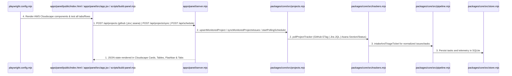
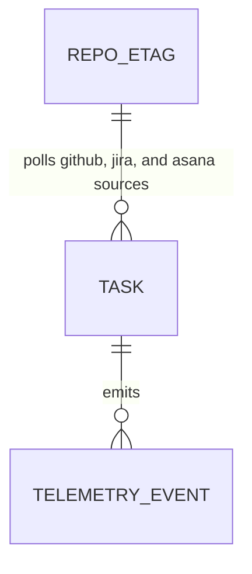

# Multi-Provider Issue Trackers (GitHub, Jira, Asana), Polling Scheduler, and AWS Cloudscape UI

**Approved**: 2026-11-07 - user: "Quero deixar essa ferramenta não muito dependente do GitHub. Que ele funcione com o GitHub, mas que ele também funcione com o Asana e também funcione com o Jira. Analise como podemos fazer isso e deixar bem customizavel para tanto o Asana quanto o Jira para. Além disso, eu quero que a gente mude o design system do front-end do nosso painel para utilizar o Cloudscape da AWS. Ele existe atualmente no GitHub de forma aberta, então a gente pode utilizar os componentes dele, tudo que ele tem. Faça essa mudança no nosso design system de forma completa, sem perder nenhuma funcionalidade. Então, para não causar regressão, utilize o playwright para testar o front-end."

## Problem

The factory currently polls issues only from GitHub repositories and renders the Control Panel with custom hand-written CSS rather than an enterprise component library. Operators who manage work in Jira or Asana cannot automatically poll tickets in a specific status (such as `"Ready for Agent"` or `"To Do"`), and the frontend does not yet use the open-source AWS Cloudscape Design System (`@cloudscape-design/components` + `@cloudscape-design/global-styles`).

When this ships, the factory provides a pluggable tracker adapter layer (`packages/core/src/trackers.mjs`) supporting **GitHub Issues**, **Jira** (customizable `baseUrl`, `projectKey`, `statusFilter`, and `jql`), and **Asana** (customizable `projectGid`, `workspaceGid`, and `statusFilter` / `sectionFilter`), a configurable periodic polling scheduler (`startPollingScheduler` + `POST /api/scheduler`), and a complete React 18 + **AWS Cloudscape Design System** Control Panel (`apps/panel/src/app.jsx` bundled to `apps/panel/public/bundle.js` and `apps/panel/public/bundle.css`) verified with zero regressions by Playwright in Chromium.

## Shape

This feature adds `packages/core/src/trackers.mjs` (`buildJiraJql`, `pollGitHubTracker`, `pollJiraTracker`, `pollAsanaTracker`, `pollProjectTracker`), extends `packages/core/src/projects.mjs` (`upsertMonitoredProject` with `provider: "github" | "jira" | "asana"`, `trackerConfig`, and `startPollingScheduler`), updates `apps/panel/server.mjs` (serves `/bundle.js`, `/bundle.css`, and `POST /api/scheduler`), and replaces the frontend with a compiled React + `@cloudscape-design/components` application (`apps/panel/src/app.jsx` + `scripts/build-panel.mjs`).

1. Periodic scheduler tick or HTTP request -> `apps/panel/server.mjs` (exists) - serves the compiled AWS Cloudscape Control Panel (`apps/panel/public/index.html` (exists), `apps/panel/src/app.jsx` (new), `scripts/build-panel.mjs` (new)) and routes `/api/projects`, `/api/projects/sync`, and `/api/scheduler` (door 1, door 2)
2. `apps/panel/server.mjs` (exists) -> `packages/core/src/projects.mjs` (exists) & `packages/core/src/trackers.mjs` (new) - registers monitored projects for `github`, `jira`, or `asana` with custom `statusFilter` / `jql` / `projectGid` and polls each active source on schedule or on demand (door 1)
3. `packages/core/src/trackers.mjs` (new) -> `packages/core/src/pipeline.mjs` (exists) & `packages/core/src/store.mjs` (exists) - normalizes GitHub issues, Jira issues (`FAC-42`), and Asana tasks (`120099`) into factory tickets, classifies their workflow type (`feature`, `bug`, `investigation`, `discovery`, `chore`), and stores them in SQLite
4. `playwright.config.mjs` (exists) -> `apps/panel/public/index.html` (exists) & `apps/panel/server.mjs` (exists) - verifies the AWS Cloudscape Design System components (`awsui_*`), multi-tracker configuration (GitHub, Jira, Asana), and all 6 tabs in Chromium without regression (door 2)

**Changes underneath**

| Front | What changes |
| --- | --- |
| domain | adds `packages/core/src/trackers.mjs` for GitHub/Jira/Asana polling and `scripts/build-panel.mjs` + `apps/panel/src/app.jsx` for the AWS Cloudscape React frontend |
| stored data | uses existing `tasks`, `repo_etags`, `telemetry_events`, `deployments`, and `runtime_health` tables in SQLite (`packages/core/src/store.mjs`) |
| readers | `apps/panel/server.mjs`, `apps/panel/public/index.html`, `packages/core/cli.mjs`, and `apps/panel/e2e/panel.spec.mjs` |

New: nothing - read only on schema structure (uses existing `REPO_ETAG`, `TASK`, and `TELEMETRY_EVENT` tables).

## Surface

| Route | In | Out | Status | Who |
| --- | --- | --- | --- | --- |
| `POST /api/projects` | `{ repo, provider, defaultBranch, trackerConfig, paused }` | JSON `{ ok, project, projects }` | `200`, `201`, `400` | anyone |
| `POST /api/projects/sync` | `{}` | JSON `{ ok, polledRepos, newTasksCount, newTasks, results }` | `200` | anyone |
| `POST /api/scheduler` | `{ enabled, intervalSeconds, runImmediately }` | JSON `{ ok, scheduler }` | `200`, `400` | anyone |

## Landing

| One-way door | Literal shape | Alternative rejected |
| --- | --- | --- |
| Door 1: Multi-provider tracker adapter & scheduler (`github`, `jira`, `asana`) | `packages/core/src/trackers.mjs` (`pollProjectTracker`) + `trackerConfig` (`statusFilter`, `projectKey`, `jql`, `projectGid`, `sectionFilter`) in `factory.yaml` + `startPollingScheduler` in `packages/core/src/projects.mjs` | Hardcoding GitHub-only polling — rejected so teams using Jira or Asana can trigger the factory when tickets enter a configured status |
| Door 2: AWS Cloudscape Design System React bundle | `@cloudscape-design/components` + `@cloudscape-design/global-styles` compiled by `scripts/build-panel.mjs` (`esbuild`) into `apps/panel/public/bundle.js` and `apps/panel/public/bundle.css` | Hand-rolled CSS — rejected because the user explicitly requested the official open-source AWS Cloudscape Design System with zero feature loss |

- Nothing else in this change is hard to reverse

## Criteria

### S1: Multi-Provider Trackers (GitHub, Jira, Asana), Polling Scheduler, and AWS Cloudscape Frontend (P1)

Deliver customizable GitHub, Jira, and Asana ticket polling, the periodic polling scheduler, and the complete AWS Cloudscape Design System frontend verified by Playwright.

**Acceptance Criteria**

1. WHEN `POST /api/projects` and `POST /api/projects/sync` configure and poll sources across `provider: "github"`, `provider: "jira"` (with custom `projectKey`, `statusFilter`, or `jql`), and `provider: "asana"` (with custom `projectGid` and `statusFilter` / `sectionFilter`) THEN the factory SHALL validate provider configuration (`400` on unsupported provider or missing Jira `projectKey` / Asana `projectGid`), normalize Jira keys (e.g. `FAC-701` -> `issue_number: 701`) and Asana task GIDs into factory tasks filtered by the configured status, and classify each ticket into `feature`, `bug`, `investigation`, `discovery`, or `chore`.
   - valid `jira` project (`projectKey: "FAC"`, `statusFilter: "Ready for Agent"`) + sync → `201`/`200` and intakes matching Jira ticket; valid `asana` project (`projectGid: "120055"`, `statusFilter: "Ready for Agent"`) + sync → `201`/`200` and intakes matching Asana task, skipping tasks in other statuses; invalid `provider: "trello"` → `400`
2. WHEN `POST /api/scheduler` updates the periodic polling scheduler (`enabled`, `intervalSeconds`, `runImmediately`) THEN it SHALL return `200` with the active scheduler state (`enabled`, `intervalSeconds`, `pollCount`, `lastPollAt`), execute an immediate multi-provider sync when `runImmediately: true`, and return `400` when `intervalSeconds < 5`.
   - `{ enabled: true, intervalSeconds: 60, runImmediately: true }` → `200` with `pollCount >= 1`; `{ intervalSeconds: 1 }` → `400`
3. WHEN the Control Panel (`GET /`) is rendered in Chromium THEN it SHALL mount authentic AWS Cloudscape Design System components (`@cloudscape-design/components` / `awsui_*` classes, `TopNavigation`, `Alert`, `Tabs`, `Cards`, `Table`, `Container`, `Header`, `Button`, `Badge`, `StatusIndicator`), allow configuring and syncing GitHub, Jira, and Asana trackers in the UI, and pass all existing and new Playwright visual, component, integration, and E2E tests (`C3`–`C10`) with zero regressions.

## Out of scope

| Excluded | Why |
| --- | --- |
| Bidirectional OAuth app installation wizard | Credentials for Jira (`JIRA_API_TOKEN`) and Asana (`ASANA_ACCESS_TOKEN`) are read from environment variables outside the repository (`AGENTS.md` rule: secrets never enter the repository) |

## Assumptions

| Assumption | Chosen default | Rationale | Confirmed? |
| --- | --- | --- | --- |
| Cloudscape bundling | `esbuild` script (`scripts/build-panel.mjs`) compiling `apps/panel/src/app.jsx` to `apps/panel/public/bundle.js` and `apps/panel/public/bundle.css` | Instant sub-second build, zero dev-server port conflict, and served directly by `apps/panel/server.mjs` | y |

**Open questions:** none - all resolved or logged above.

## Differences from the source

None - the product matches the source

## Sources

- `AGENTS.md` & `docs/plan.md` - binding - defines multi-project polling, 5 ticket workflows, and Control Panel capabilities
