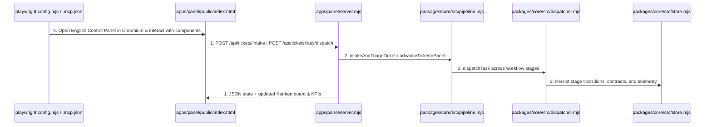
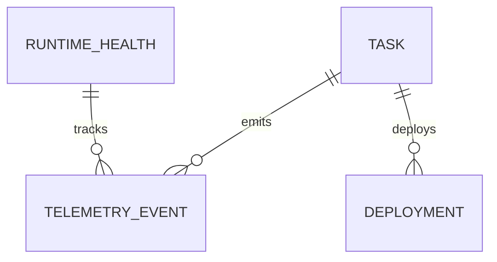

# English Localization, Multi-Ticket Triage Pipeline, and Playwright Visual/Component/E2E Suite

**Approved**: 2026-11-07 - user: "lembre de tudo que for visual ser testado usando o playwright, e tbm criar testes de componente, integracao e E2E onde se aplicar usando o playwright. Os testes tambem podem ser usados o playwright mcp. Lembre que o painel, e tudo do codigo deve ser em ingles, nao em portugues. Para testar tambem, crie tickets diversos para cada tipo que a fabrica consegue fazer a triagem e teste se realmente esta funcionando na pratica, identificando corretamente cada ticket e implementando e passando por cada fase que deveria corretamente"

## Problem

The Control Panel UI (`apps/panel/public/index.html`) and repository templates/documentation still contain Portuguese strings, and the factory lacks automated Playwright visual, component, integration, and end-to-end tests (`@playwright/test` + `@playwright/mcp`) as well as an end-to-end multi-ticket classifier and stage execution pipeline that exercises all 5 ticket types (`feature`, `bug`, `investigation`, `discovery`, `chore`) through every expected workflow stage.

When this ships, 100% of the Control Panel UI and repository templates/docs are in English, `packages/core/src/pipeline.mjs` classifies diverse tickets into all 5 ticket types (`feature`, `bug`, `investigation`, `discovery`, `chore`) and drives each through its exact workflow stages via `POST /api/tickets/intake` and `POST /api/tickets/:key/dispatch`, real GitHub issues for all 5 ticket types are triaged and executed end-to-end, and Playwright (`npx playwright test`) verifies every visual component, API integration, and end-to-end multi-ticket lifecycle in headless Chromium.

## Shape

This feature localizes `apps/panel/public/index.html` and repository docs/templates to English, adds `packages/core/src/pipeline.mjs` (`classifyTicketType`, `intakeAndTriageTicket`, `advanceTicketInPanel`, `createStageContractRunner`), adds `POST /api/tickets/intake` and `POST /api/tickets/:key/dispatch` to `apps/panel/server.mjs`, and adds Playwright visual, component, integration, and E2E tests in `apps/panel/e2e/panel.spec.mjs` plus unit tests in `packages/core/__test__/pipeline.test.mjs`.

1. HTTP request or UI action -> `apps/panel/server.mjs` (exists) - serves the English Control Panel UI (`apps/panel/public/index.html` (exists)) and routes `POST /api/tickets/intake` and `POST /api/tickets/:key/dispatch` (door 1)
2. `apps/panel/server.mjs` (exists) -> `packages/core/src/pipeline.mjs` (new) - classifies ticket type (`feature`, `bug`, `investigation`, `discovery`, `chore`), creates the task at `stage: "triage"`, and executes each stage with deterministic stage contracts (door 1)
3. `packages/core/src/pipeline.mjs` (new) -> `packages/core/src/dispatcher.mjs` (exists) & `packages/core/src/store.mjs` (exists) - advances the task across workflow stages, pauses at human gates, extracts follow-up tickets on `investigation-report`, and completes at `done`
4. `playwright.config.mjs` (new) -> `apps/panel/public/index.html` (exists) & `apps/panel/server.mjs` (exists) - runs Chromium visual, component, integration, and E2E tests and provides `@playwright/mcp` configuration in `.mcp.json` (door 2)

**Changes underneath**

| Front | What changes |
| --- | --- |
| domain | adds `packages/core/src/pipeline.mjs` for 5-type ticket classification and full stage progression, localizes `apps/panel/public/index.html` and repo docs/templates to English, and adds `playwright.config.mjs` + `apps/panel/e2e/panel.spec.mjs` |
| stored data | uses existing `tasks`, `stage_tokens`, `telemetry_events`, `runtime_health`, and `deployments` tables in SQLite (`packages/core/src/store.mjs`) |
| readers | `apps/panel/server.mjs`, `apps/panel/public/index.html`, `packages/core/cli.mjs`, and `apps/panel/e2e/panel.spec.mjs` |

New: nothing - read only on schema structure (uses existing `TASK`, `TELEMETRY_EVENT`, `DEPLOYMENT`, and `RUNTIME_HEALTH` tables).

## Surface

| Route | In | Out | Status | Who |
| --- | --- | --- | --- | --- |
| `POST /api/tickets/intake` | `{ issue_number, repo, title, body, type, labels }` | JSON `{ ok, executionKey, classifiedType, initialStage, task }` | `201`, `400`, `409` | anyone |
| `POST /api/tickets/:key/dispatch` | `{ approveCurrentStage, verdict, impact }` | JSON `{ ok, status, stage, stepsExecuted, task, followUpTickets }` | `200`, `404` | anyone |

## Landing

| One-way door | Literal shape | Alternative rejected |
| --- | --- | --- |
| Door 1: Multi-ticket classification & stage pipeline API | `packages/core/src/pipeline.mjs` (`classifyTicketType`, `intakeAndTriageTicket`, `advanceTicketInPanel`) exposed via `POST /api/tickets/intake` and `POST /api/tickets/:key/dispatch` in `apps/panel/server.mjs` | Hardcoding `stage: "triage"` and `type: "feature"` on intake — rejected because `discovery` starts at `interview` and unlabeled tickets must be classified into `feature`, `bug`, `investigation`, `discovery`, or `chore` |
| Door 2: Playwright visual, component, integration, and E2E test harness + MCP config | `playwright.config.mjs`, `.mcp.json` (`@playwright/mcp`), and `apps/panel/e2e/panel.spec.mjs` running in headless Chromium | Testing HTML only with regex over `fetch('/')` strings — rejected because real browser rendering, DOM component state, tab switching, and E2E user flows require Playwright |

- Nothing else in this change is hard to reverse

## Criteria

### S1: English Localization, Multi-Ticket Pipeline, and Playwright Suite (P1)

Deliver 100% English localization, 5-type ticket classification and full stage progression (`feature`, `bug`, `investigation`, `discovery`, `chore`), and Playwright visual, component, integration, and E2E tests.

**Acceptance Criteria**

1. WHEN the Control Panel (`GET /`) is rendered in Chromium across all 6 navigation tabs (`Overview & Telemetry`, `Board & Needs Human`, `Workflows (Factory as Code)`, `Runtimes, Router & Circuit Breaker`, `Agents & Locked Skills (23)`, `Controls, Deploy & Brain`) THEN the document SHALL have `lang="en"`, display all English headings, labels, tables, and buttons, and contain zero Portuguese UI strings.
   - `html[lang]` → `"en"`; Portuguese UI tokens (`Atualizar Telemetria`, `Precisa de Mim`, `Aprovar com 1 Clique`, `Resetar Disjuntor`) → `0` matches
2. WHEN `classifyTicketType` and `POST /api/tickets/intake` receive diverse tickets for `feature`, `bug`, `investigation`, `discovery`, and `chore` (via explicit `type:*` labels, `[type]` title prefixes, or natural-language problem descriptions) THEN the server SHALL return `201` with the matching `classifiedType` and initial workflow stage (`triage`), `400` when `issue_number` or `title` is missing, and `409` when an active task with the same key already exists.
   - valid intake for each of the 5 ticket types → `201` with matching `classifiedType` and `initialStage: "triage"`; missing `title` → `400`; duplicate active task → `409`
3. WHEN `POST /api/tickets/:key/dispatch` drives each of the 5 ticket types through its workflow (`feature`: `triage -> plan -> checks_and_build -> verify -> review -> merge -> done`; `bug`: `triage -> checks_and_build -> verify -> review -> merge -> done`; `investigation`: `triage -> investigate -> done` with extracted follow-up tickets; `discovery`: `triage -> discover -> done`; `chore`: `triage -> checks_and_build -> review -> merge -> done`) THEN the factory SHALL execute every expected stage in order, pause at human gates until approved, reach `stage: "done"`, and return `404` for an unknown task key.
   - `feature`, `bug`, `investigation`, `discovery`, `chore` full lifecycles → `200` and `stage: "done"`; unknown task key → `404`
4. WHEN the Playwright test suite (`npx playwright test`) runs against the live Control Panel server in headless Chromium THEN all visual component tests, integration tests, and end-to-end multi-ticket lifecycle tests (intaking, triaging, advancing, approving human gates in 1 click, and completing all 5 ticket types in the browser) SHALL pass and save visual screenshots.

## Out of scope

| Excluded | Why |
| --- | --- |
| Multi-user login / OAuth | The factory is a local single-operator control plane bound to `127.0.0.1` |

## Assumptions

| Assumption | Chosen default | Rationale | Confirmed? |
| --- | --- | --- | --- |
| Playwright browser target | Headless Chromium via `@playwright/test` + `@playwright/mcp` configured in `.mcp.json` | Chromium is installed locally and deterministic in both local runs and CI | y |

**Open questions:** none - all resolved or logged above.

## Differences from the source

None - the product matches the source

## Sources

- `AGENTS.md` & `docs/plan.md` - binding - defines the 5 ticket workflows (`feature`, `bug`, `investigation`, `discovery`, `chore`) and Control Panel capabilities
