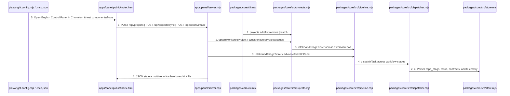
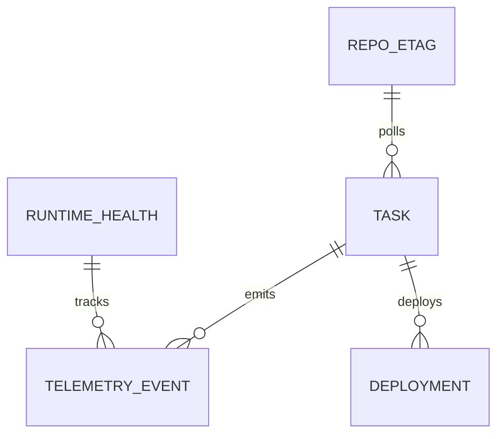

# English Localization, Multi-Repo Issue Monitoring, 5-Type Ticket Pipeline, and Playwright Suite

**Approved**: 2026-11-07 - user: "Eu quero que a gente consiga configurar quais repositórios a gente vai monitorar. Para não depender de ficar criando issues nesse repositório. Eu quero que a gente consiga configurar os repositórios que a gente já tem do GitHub. Pode ser tanto no painel de controle ou de outra forma. A gente tem que ser bastante extensível e não totalmente apegado ao repositório. Ele tem que ser somente uma ferramenta que vai ser utilizada em outros repositórios e vai monitorar os issues deles."

## Problem

The Control Panel UI (`apps/panel/public/index.html`) and repository documentation previously assumed issues had to be created inside `agentic-factory` itself, contained Portuguese strings, and lacked automated Playwright visual, component, integration, and E2E tests as well as a multi-repository registry and multi-ticket classification/execution pipeline.

When this ships, the Agentic Factory operates as a standalone, repository-agnostic tool: operators can configure any number of external GitHub repositories (`owner/repo`) via the Control Panel UI, REST API (`GET/POST/DELETE /api/projects`, `POST /api/projects/sync`), CLI (`cli.mjs projects`, `cli.mjs watch`), or `factory.yaml`; the factory polls open issues directly from every active monitored repository using per-repository `ETag` caching, classifies diverse tickets into all 5 workflows (`feature`, `bug`, `investigation`, `discovery`, `chore`), drives each ticket through its workflow stages, renders 100% in English, and verifies every visual component, multi-repo flow, and 5-ticket lifecycle in Chromium with Playwright (`@playwright/test` + `@playwright/mcp`).

## Shape

This feature localizes `apps/panel/public/index.html` and repository docs/templates to English, adds `packages/core/src/projects.mjs` (multi-repository registry + per-repo ETag polling & sync) and `packages/core/src/pipeline.mjs` (`classifyTicketType`, `intakeAndTriageTicket`, `advanceTicketInPanel`), exposes `GET/POST/DELETE /api/projects`, `POST /api/projects/sync`, `POST /api/tickets/intake`, and `POST /api/tickets/:key/dispatch` in `apps/panel/server.mjs`, and adds Playwright visual, component, integration, and E2E tests in `apps/panel/e2e/panel.spec.mjs` plus unit tests in `packages/core/__test__/pipeline.test.mjs`.

1. HTTP request, CLI command, or UI action -> `apps/panel/server.mjs` (exists) & `packages/core/cli.mjs` (exists) - serves the English Control Panel UI (`apps/panel/public/index.html` (exists)) and routes multi-repo & ticket endpoints (door 1, door 2)
2. `apps/panel/server.mjs` (exists) -> `packages/core/src/projects.mjs` (new) - adds, updates, pauses, removes, and polls external GitHub repositories (`owner/repo`) with per-repository `ETag` state in `packages/core/src/store.mjs` (exists) (door 1)
3. `apps/panel/server.mjs` (exists) & `packages/core/src/projects.mjs` (new) -> `packages/core/src/pipeline.mjs` (new) - classifies ticket type (`feature`, `bug`, `investigation`, `discovery`, `chore`), creates the task at `stage: "triage"` scoped to `<owner/repo>#<issue>`, and executes each stage with deterministic stage contracts (door 2)
4. `packages/core/src/pipeline.mjs` (new) -> `packages/core/src/dispatcher.mjs` (exists) & `packages/core/src/store.mjs` (exists) - advances the task across workflow stages, pauses at human gates, extracts follow-up tickets on `investigation-report`, and completes at `done`
5. `playwright.config.mjs` (new) & `.mcp.json` (new) -> `apps/panel/public/index.html` (exists) & `apps/panel/server.mjs` (exists) - runs Chromium visual, component, integration, and E2E tests (door 3)

**Changes underneath**

| Front | What changes |
| --- | --- |
| domain | adds `packages/core/src/projects.mjs` for multi-repository management and polling, `packages/core/src/pipeline.mjs` for 5-type ticket classification and stage progression, localizes UI/docs to English, and adds `playwright.config.mjs` + `apps/panel/e2e/panel.spec.mjs` |
| stored data | adds `repo_etags` table in SQLite (`packages/core/src/store.mjs`) to store per-repository `ETag` headers and last sync timestamps |
| readers | `apps/panel/server.mjs`, `apps/panel/public/index.html`, `packages/core/cli.mjs`, and `apps/panel/e2e/panel.spec.mjs` |

New: `REPO_ETAG` in SQLite. One-way constraints: `repo` primary key on `REPO_ETAG` (door 1).

## Surface

| Route | In | Out | Status | Who |
| --- | --- | --- | --- | --- |
| `GET /api/projects` | query params (none) | JSON `{ ok, projects, etags }` | `200` | anyone |
| `POST /api/projects` | `{ repo, id, defaultBranch, localPath, paused }` | JSON `{ ok, project, projects }` | `200`, `201`, `400` | anyone |
| `DELETE /api/projects/:repo` | URL param `:repo` | JSON `{ ok, removed, projects }` | `200`, `404` | anyone |
| `POST /api/projects/sync` | `{}` | JSON `{ ok, polledRepos, newTasks, skippedNotModified, results }` | `200` | anyone |
| `POST /api/tickets/intake` | `{ issue_number, repo, title, body, type, labels }` | JSON `{ ok, executionKey, classifiedType, initialStage, task }` | `201`, `400`, `409` | anyone |
| `POST /api/tickets/:key/dispatch` | `{ approveCurrentStage, verdict, impact }` | JSON `{ ok, status, stage, stepsExecuted, task, followUpTickets }` | `200`, `404` | anyone |

## Landing

| One-way door | Literal shape | Alternative rejected |
| --- | --- | --- |
| Door 1: Multi-repository registry & per-repo ETag store | `factory.projects` in `factory.yaml` managed via `packages/core/src/projects.mjs` + `repo_etags(repo TEXT PRIMARY KEY, etag TEXT, updated_at TEXT)` in SQLite, exposed via `/api/projects`, `/api/projects/sync`, and `cli.mjs projects` | Coupling issue polling to a single hardcoded repository — rejected because the factory must act as an extensible standalone tool monitoring any user GitHub repositories |
| Door 2: Multi-ticket classification & stage pipeline API | `packages/core/src/pipeline.mjs` (`classifyTicketType`, `intakeAndTriageTicket`, `advanceTicketInPanel`) exposed via `POST /api/tickets/intake` and `POST /api/tickets/:key/dispatch` | Requiring external repos to install custom issue templates before intake — rejected so external issues with natural-language titles/bodies are classified automatically |
| Door 3: Playwright visual, component, integration, and E2E test harness + MCP config | `playwright.config.mjs`, `.mcp.json` (`@playwright/mcp`), and `apps/panel/e2e/panel.spec.mjs` running in headless Chromium | Testing HTML only with string regex — rejected because real browser rendering, DOM interaction, and E2E flows require Playwright |

- Nothing else in this change is hard to reverse

## Criteria

### S1: English Localization, Multi-Repo Issue Monitoring, 5-Type Ticket Pipeline, and Playwright Suite (P1)

Deliver 100% English localization, multi-repository configuration and issue polling (`projects.mjs`), 5-type ticket classification and full stage progression (`pipeline.mjs`), and Playwright visual, component, integration, and E2E tests.

**Acceptance Criteria**

1. WHEN the Control Panel (`GET /`) is rendered in Chromium across all 6 navigation tabs (`Overview & Telemetry`, `Board & Needs Human`, `Workflows (Factory as Code)`, `Runtimes, Router & Circuit Breaker`, `Agents & Locked Skills (23)`, `Controls, Deploy & Brain`) THEN the document SHALL have `lang="en"`, display all English headings, labels, tables, and buttons, and contain zero Portuguese UI strings.
   - `html[lang]` → `"en"`; Portuguese UI tokens (`Atualizar Telemetria`, `Precisa de Mim`, `Aprovar com 1 Clique`, `Resetar Disjuntor`) → `0` matches
2. WHEN `classifyTicketType` and `POST /api/tickets/intake` receive diverse tickets for `feature`, `bug`, `investigation`, `discovery`, and `chore` across any target repository (`repo: "owner/name"`) THEN the server SHALL return `201` with the matching `classifiedType` and `initialStage: "triage"`, `400` when `issue_number` or `title` is missing, and `409` when an active task with the same `<owner/repo>#<issue>` key already exists.
   - valid intake for each of the 5 ticket types → `201` with matching `classifiedType` and `initialStage: "triage"`; missing `title` → `400`; duplicate active task → `409`
3. WHEN `POST /api/tickets/:key/dispatch` drives each of the 5 ticket types through its workflow (`feature`: `triage -> plan -> checks_and_build -> verify -> review -> merge -> done`; `bug`: `triage -> checks_and_build -> verify -> review -> merge -> done`; `investigation`: `triage -> investigate -> done` with extracted follow-up tickets; `discovery`: `triage -> discover -> done`; `chore`: `triage -> checks_and_build -> review -> merge -> done`) THEN the factory SHALL execute every expected stage in order, pause at human gates until approved, reach `stage: "done"`, and return `404` for an unknown task key.
   - `feature`, `bug`, `investigation`, `discovery`, `chore` full lifecycles → `200` and `stage: "done"`; unknown task key → `404`
4. WHEN external GitHub repositories are managed via `GET /api/projects`, `POST /api/projects`, `DELETE /api/projects/:repo`, and synced via `POST /api/projects/sync` (or `cli.mjs projects`) THEN the factory SHALL persist new repositories (`201`) and updates (`200`) to `factory.yaml`, reject invalid `repo` strings with `400`, remove repositories with `200` (`404` when unknown), and poll all unpaused repositories with per-repo `ETag` caching to intake their open issues into the factory store.
   - add `"brenoacker/external-service"` → `201`; update `paused: true` → `200`; invalid `"not-a-repo"` → `400`; `POST /api/projects/sync` → `200` intaking issues from active repos and skipping `304` or paused repos; delete unknown → `404`
5. WHEN the Playwright test suite (`npx playwright test`) runs against the live Control Panel server in headless Chromium THEN all visual component tests, integration tests (including adding an external GitHub repository and syncing its issues in the UI), and end-to-end multi-ticket lifecycle tests across all 5 ticket types SHALL pass and save visual screenshots.

## Out of scope

| Excluded | Why |
| --- | --- |
| Multi-user login / OAuth | The factory is a local single-operator control plane bound to `127.0.0.1` |

## Assumptions

| Assumption | Chosen default | Rationale | Confirmed? |
| --- | --- | --- | --- |
| Playwright browser target | Headless Chromium via `@playwright/test` + `@playwright/mcp` configured in `.mcp.json` | Chromium is installed locally and deterministic in both local runs and CI | y |

**Open questions:** none - all resolved or logged above.

## Differences from the source

None - the product matches the source

## Sources

- `AGENTS.md` & `docs/plan.md` - binding - defines the 5 ticket workflows (`feature`, `bug`, `investigation`, `discovery`, `chore`), multi-repo target configuration, and Control Panel capabilities
