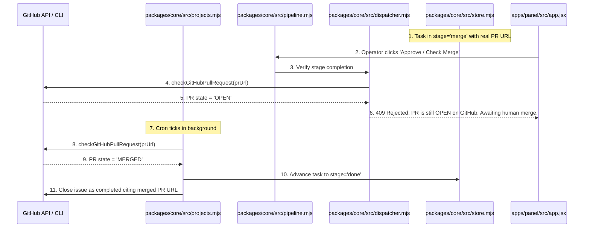
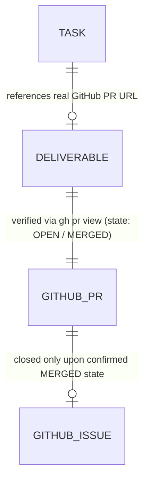

# Pull Request Merge Verification and Real Deliverables

**Approved**: 2026-11-07 - user: "Assim que eu aprovei o plano do ticket 99 do Incident Investigator, ele já passou para a opção de merge aqui, de Aprove e Continue Porém, ainda nem existe a PR com a com o ticket que a gente está implementando. Eu cliquei em Approve and Continue e ele basicamente foi para Dani, mas ele nem foi feito. Não criou a PR, não esperou a PR ser mergeada, não fez um Chrome para verificar se a PR foi mergeada e se a issue foi fechada. Então, dessa forma não dá para seguir, a gente tem que fazer modificações."

## Problem

In the existing Agentic Factory:
1. When code workflow tasks (`feature`, `bug`, `chore`) advance through the pipeline, `advanceTicketInPanel` automatically attached a synthetic, fabricated pull request URL (`pull/${existing.issue_number + 100}`) and hardcoded commit SHA (`64e6a79`) when no deliverable was present, rather than requiring and verifying a real Pull Request created from the task branch.
2. In stage `merge`, clicking "Approve and Continue" or submitting `/api/tasks/:key/approve` immediately moved the task to `done` and closed the source issue on GitHub/Linear, even though no PR existed or the PR was still open and unmerged.
3. The background scheduler lacked a periodic PR merge verification probe to inspect open GitHub pull requests (`gh pr view`) and automatically complete tickets only when the PR has actually been merged by a human on GitHub.
4. Issue closing occurred prematurely without checking whether code was reviewed, merged, or verified in the target repository.

When this ships, the Agentic Factory guarantees:
1. The factory strictly refuses to fabricate synthetic PR URLs; code workflow tasks must link to an actual pull request created from the task branch.
2. A task in stage `merge` cannot transition to `done` via manual approval while its Pull Request remains unmerged on GitHub.
3. The periodic cron scheduler inspects tasks in stage `merge`, checks live GitHub PR state (`gh pr view`), and automatically transitions tasks to `done` only when `state === 'MERGED'`.
4. Issues on GitHub or Linear are closed as completed only after PR merge confirmation, citing the verified PR URL.

## Shape

This feature updates `packages/core/src/github.mjs`, `packages/core/src/projects.mjs`, `packages/core/src/pipeline.mjs`, `packages/core/src/dispatcher.mjs`, `packages/core/src/store.mjs`, `apps/panel/server.mjs`, `apps/panel/src/app.jsx`, `apps/panel/__test__/control-panel.test.mjs`, and `apps/panel/e2e/panel.spec.mjs`.

1. Live GitHub PR status verification -> `packages/core/src/github.mjs` (exists) - queries PR state via `gh pr view` (door 1).
2. Cron-driven PR merge poller -> `packages/core/src/projects.mjs` (exists) - auto-advances merged PRs to `done` and closes issues (door 2).
3. Stage merge completion gate -> `packages/core/src/pipeline.mjs` (exists) & `packages/core/src/dispatcher.mjs` (exists) - rejects premature transition to `done` if PR is still open (door 3).
4. Control Panel UI reflects PR status -> `apps/panel/src/app.jsx` (exists) - provides live "Check PR Merge Status & Sync" action and informs operators when awaiting GitHub merge.

**Changes underneath**

| Front | What changes |
| --- | --- |
| domain | Add `checkGitHubPullRequest` and `createGitHubPullRequest` in `github.mjs`, eliminate synthetic PR URL fabrication in `pipeline.mjs`, enforce PR merge gate before `done`, add `syncMergedPullRequests` in `projects.mjs` |
| stored data | `tasks` table stores verified PR state; `stage` cannot transition from `merge` to `done` without `merged === true` verification |
| UI & API | Control Panel replaces blind approval in stage `merge` with live "Check PR Merge Status & Sync" and displays waiting status |
| readers | `apps/panel/server.mjs`, `apps/panel/src/app.jsx`, `packages/core/src/projects.mjs`, `packages/core/src/store.mjs`, Playwright E2E suite |

New: adds live GitHub PR verification, prevents premature issue closure, and executes automated cron merge synchronization.

## Surface

| Route | In | Out | Status | Who |
| --- | --- | --- | --- | --- |
| `POST /api/tasks/:key/check-pr` | `{}` | JSON `{ ok, state, merged, prNumber, prUrl, advancedToDone }` | `200`, `404`, `422` | anyone |
| `POST /api/tasks/:key/approve` | `{ approver: string, words: string }` | JSON `{ ok, task }` or 409 `{ ok: false, code: 'pr_not_merged', error }` | `200`, `400`, `404`, `409` | anyone |
| `POST /api/scheduler` | `{ runImmediately: boolean }` | JSON `{ ok, autoDispatchedCount, mergedTasksCount }` | `200`, `400` | anyone |

## Landing

| One-way door | Literal shape | Alternative rejected |
| --- | --- | --- |
| Door 1: Live GitHub PR Status Verification | `checkGitHubPullRequest({ repo, prNumberOrUrl })` queries `gh pr view --json state,mergedAt`, requiring `state === 'MERGED'` before done | Trusting user click without checking GitHub — rejected because tasks were marked done without code being merged |
| Door 2: Cron-Driven Merge Polling & Closing | Scheduler periodic cycle executes `syncMergedPullRequests` to auto-advance merged tasks and close issues | Manual-only issue closing — rejected because operators expect autonomous completion once PR is merged on GitHub |
| Door 3: Prohibition of Synthetic Deliverable Fabrication | Complete removal of synthetic `pull/${issue_number + 100}` fallback; deliverable must be created or explicitly attached | Fake PR placeholders — rejected as deceptive simulation of work |

## Criteria

### S1: Live GitHub PR Verification and Deliverable Integrity (P1)

Eliminate synthetic deliverable fabrication and verify live GitHub PR status.

**Acceptance Criteria**

1. WHEN a code workflow task (`feature`, `bug`, `chore`) reaches stage `merge` without a valid Pull Request deliverable THEN the system SHALL NOT fabricate a synthetic URL and SHALL require a real PR deliverable.
2. WHEN `checkGitHubPullRequest` is invoked for an open Pull Request THEN the function SHALL return `{ ok: true, state: 'OPEN', merged: false }`.
3. WHEN `checkGitHubPullRequest` is invoked for a merged Pull Request THEN the function SHALL return `{ ok: true, state: 'MERGED', merged: true }`.

### S2: Stage Merge Completion Gate (P1)

Prevent premature task completion while PR remains open.

**Acceptance Criteria**

4. IF an operator attempts to approve or transition a task from stage `merge` to `done` while its Pull Request remains unmerged (`merged: false`) THEN the server SHALL reject the transition with HTTP 409 (`code: 'pr_not_merged'`) and keep the task in stage `merge`.
5. WHILE a task is in stage `merge` awaiting PR merge on GitHub THEN the Control Panel UI SHALL display the PR link and status indicating that the task is awaiting human merge on GitHub.

### S3: Cron-Driven PR Merge Synchronization (P1)

Automatically detect merged PRs in background cron cycles and close completed issues.

**Acceptance Criteria**

6. WHEN the background scheduler runs a periodic sync cycle THEN `syncMergedPullRequests` SHALL inspect active tasks in stage `merge` and verify PR status via GitHub.
7. WHEN a task's Pull Request is verified as `merged: true` on GitHub THEN the system SHALL automatically advance the task to stage `done`, post a completion comment with the PR URL, and close the issue on GitHub.
8. WHEN an operator clicks `#check-pr-btn-{issueNumber}` on a task in stage `merge` THEN the server SHALL query live PR status and return whether the task was advanced to `done`.

## Out of scope

| Excluded | Why |
| --- | --- |
| Automatically force-merging PRs without human review | Merging to default branch requires human operator review or explicit repository rules |
| Polling closed PRs older than 30 days | Focus is active in-flight tickets |

## Assumptions

| Assumption | Chosen default | Rationale | Confirmed? |
| --- | --- | --- | --- |
| Merge Gate Requirement | PR must have `state === 'MERGED'` before task reaches `done` | User explicitly insisted: ticket only finishes when PR is merged | y |
| No Fake PR Fabrication | Remove all `issue_number + 100` synthetic generation | User complained ticket was marked done without PR being created | y |
| Cron Merge Verification | Periodic scheduler inspects tasks in `merge` stage | User explicitly requested cron to check if PR was merged | y |

**Open questions:** none - all resolved or logged above.

## Differences from the source

None - the product matches the source

## Sources

- User request: "Assim que eu aprovei o plano do ticket 99 do Incident Investigator, ele já passou para a opção de merge aqui, de Aprove e Continue Porém, ainda nem existe a PR com a com o ticket que a gente está implementando. Eu cliquei em Approve and Continue e ele basicamente foi para Dani, mas ele nem foi feito. Não criou a PR, não esperou a PR ser mergeada, não fez um Chrome para verificar se a PR foi mergeada e se a issue foi fechada. Então, dessa forma não dá para seguir, a gente tem que fazer modificações."
