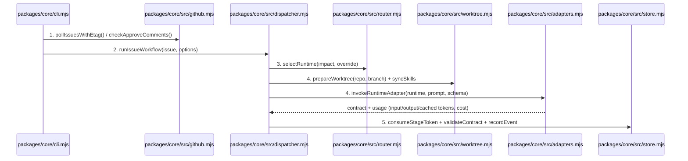
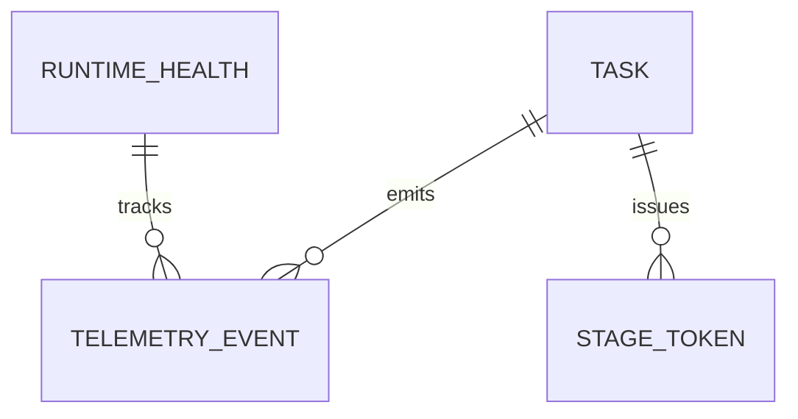

# Runtime Adapters, Router, Dispatcher, and Autonomous Loop

**Approved**: 2026-11-07 - user: "podemos seguir todas as fases de maneira autonoma"

## Problem

The factory has configurations, workflows, contracts, guards, and SQLite storage today, but it cannot execute stages against agent runtimes (`Antigravity`, `Claude Code`, `Codex`), route across runtimes with a circuit breaker, manage isolated `git worktree` checkouts, or poll GitHub issues and `/approve` comments autonomously.

When this ships, `packages/core` provides unified runtime adapters (`agy -p`, `claude -p`, `codex exec`), a quota/health router with a circuit breaker (tripping on timeout, `500`, or `429`), an isolated worktree manager that syncs locked skills and `AGENTS.md`, a stage dispatcher that advances workflows through human gates and 3-round review loops, and `run` / `watch` CLI commands that drive issues end-to-end with telemetry recorded in SQLite.

## Shape

This feature extends `packages/core/src/` with pure/injectable adapters (`adapters.mjs`), router/circuit-breaker (`router.mjs`), worktree manager (`worktree.mjs`), GitHub poller with ETag caching (`github.mjs`), and workflow dispatcher (`dispatcher.mjs`), all wired into `packages/core/cli.mjs` (`run`, `watch`, `approve`). External CLI spawns and GitHub calls accept an injectable runner in tests so every branch (304 ETag hits, circuit breaker trips, `/approve` comments, 3-round review cap) is deterministically proven.

1. CLI command (`run`, `watch`, `approve`) -> `packages/core/cli.mjs` (exists) - parses flags and invokes `packages/core/src/dispatcher.mjs`
2. `packages/core/src/github.mjs` (new) - polls GitHub REST API with ETag header (door 1), parses issue labels/body and approval comments, and updates issue labels
3. `packages/core/src/router.mjs` (new) - selects runtime in manual or automatic mode (highest available quota / fallback order) and enforces the circuit breaker on timeout, HTTP 500, or HTTP 429 (door 2)
4. `packages/core/src/worktree.mjs` + `packages/core/src/adapters.mjs` (new) - prepares isolated worktree + syncs skills, builds the CLI command (door 3), executes the stage with single-use token, and extracts token usage and contract output
5. `packages/core/src/dispatcher.mjs` (new) -> `packages/core/src/store.mjs` (exists) - validates the returned contract, records telemetry events, pauses at human approval gates, loops review up to max rounds (3), and outputs JSON run state

**Changes underneath**

| Front | What changes |
| --- | --- |
| domain | extends `packages/core` with runtime execution, routing, worktree isolation, GitHub ETag polling, and `run`/`watch`/`approve` subcommands |
| stored data | adds `runtime_health` table in SQLite (`packages/core/src/store.mjs`) to persist circuit breaker state and available quota per runtime |
| readers | `packages/core/cli.mjs` and the Phase 4–6 Control Panel |

New: `RUNTIME_HEALTH` in SQLite. One-way constraints: `runtime` primary key on `RUNTIME_HEALTH` (door 2).

## Surface

None - nothing consumed outside (CLI commands and library functions; HTTP API arrives in Phase 4).

## Landing

| One-way door | Literal shape | Alternative rejected |
| --- | --- | --- |
| Door 1: GitHub ETag polling contract | `pollIssuesWithEtag({ repo, etag, runner })` sends `If-None-Match: <etag>` and returns `{ notModified: true, etag, issues: [] }` on HTTP `304`, or `{ notModified: false, etag: "<new>", issues: [...] }` on HTTP `200` | Unconditional polling without ETag — rejected because 1-minute polling without `304` burns GitHub API rate limits |
| Door 2: Runtime router & circuit breaker state | `runtime_health(runtime TEXT PRIMARY KEY, status TEXT, quota_remaining INTEGER, consecutive_failures INTEGER, last_error_code TEXT, tripped_at TEXT)` — status becomes `"open"` (disabled) on `timeout`, `500`, or `429` | Blind retries against a failing or rate-limited runtime — rejected per Felipe's Live 02 post-mortem ("dar retry cego em agente de IA é queimar dinheiro") |
| Door 3: CLI adapter invocation shapes | Antigravity: `agy -p <prompt> --output-format json --mode auto [--model <m>] [--json-schema <path>]`; Claude Code: `claude -p <prompt> --output-format json --dangerously-skip-permissions [--model <m>] [--json-schema <json>]`; Codex: `codex exec --json --full-auto [-m <m>] [--output-schema <path>] <prompt>` | Interactive TUI sessions — rejected because autonomous background execution requires non-interactive JSON output with usage telemetry |

- Nothing else in this change is hard to reverse

## Criteria

### S1: Adapters, Router/Circuit-Breaker, Worktrees, and Autonomous Dispatcher (P1)

Build the 3 runtime CLI adapters, the quota/circuit-breaker router, worktree preparation, ETag poller, and autonomous workflow dispatcher with human approval gates and review loop limits.

**Acceptance Criteria**

1. WHEN `buildAdapterCommand(runtime, options)` constructs a non-interactive invocation for `"antigravity"`, `"claude-code"`, or `"codex"` THEN it SHALL return the exact binary and argument list matching Door 3 (`agy -p ... --output-format json --mode auto`, `claude -p ... --output-format json`, `codex exec --json --full-auto ...`) and `parseAdapterOutput(runtime, stdout)` SHALL extract `{ contract, usage: { inputTokens, outputTokens, cachedTokens, explicitCostUsd } }` from each runtime's JSON output.
2. WHEN `selectRuntime` runs in `"auto"` mode THEN it SHALL pick the enabled healthy runtime with the highest `quota_remaining` (breaking ties by `defaultRuntime`), and IF a runtime returns `timeout`, `500`, or `429` THEN `recordRuntimeFailure` SHALL trip its circuit breaker to `"open"` and remove it from automatic selection until reset.
   - `antigravity` trips on `429` → status `"open"`, router selects next healthy runtime (`claude-code`); manual reset → status `"closed"`
3. WHEN `pollIssuesWithEtag` queries GitHub with a stored ETag and the API responds `304 Not Modified` THEN it SHALL return `{ notModified: true, issues: [] }` without parsing errors, and WHEN `/approve` appears in an issue comment THEN `hasHumanApprovalComment` SHALL return `true` with the approver login and timestamp.
   - HTTP `304` → `notModified: true, issues: []`; HTTP `200` with comment body `"/approve"` → `approved: true`
4. WHEN `prepareWorktree` prepares an isolated workspace for a task THEN it SHALL create or reuse a git worktree directory, copy `AGENTS.md` and `CLAUDE.md`, and synchronize all 23 locked skills into `.agents/skills` and `.claude/skills` inside the worktree.
5. WHEN `dispatchTask` runs a `feature` task in `"gated"` autonomy mode THEN it SHALL execute `triage` (updating impact and model from `modelByImpact`), execute `plan`, and PAUSE at `stage: "plan"` with `needs_human: 1` waiting for human approval; once approved (`approveTask` or `/approve` comment), it SHALL resume through `checks_and_build -> verify -> review` and pause at `merge`.
6. IF the `review` stage returns `verdict: "REQUEST_CHANGES"` THEN `dispatchTask` SHALL loop back to `checks_and_build` incrementing `review_rounds`, and IF `review_rounds` reaches `maxReviewRounds` (3) with `REQUEST_CHANGES` THEN it SHALL stop, set `needs_human: 1`, and refuse a 4th round.
   - `REQUEST_CHANGES` on round 1 → returns to `checks_and_build` (`review_rounds: 1`); `REQUEST_CHANGES` on round 3 → stops with `needs_human: 1` (`max_review_rounds_reached`)

## Out of scope

| Excluded | Why |
| --- | --- |
| Web UI (Vite/React) for the control panel | Arrives in Phase 4 (Panel v1) and Phase 6 (Panel v2) |
| Windows service / VPS daemon wrapper | Arrives in Phase 7 (Autonomia ampliada) |

## Assumptions

| Assumption | Chosen default | Rationale | Confirmed? |
| --- | --- | --- | --- |
| Token usage fallback when a runtime CLI omits `usage` fields in JSON | Estimate tokens deterministically from prompt + output character length (`Math.ceil(chars / 4)`) and flag `estimated: true` in telemetry payload | Ensures cost/token telemetry is always populated even if a CLI build omits usage metadata | y |

**Open questions:** none - all resolved or logged above.

## Differences from the source

None - the product matches the source

## Sources

- `docs/plan.md` (Phase 3: adapters Antigravity/Claude Code/Codex, worktrees, `factory run <issue>` e `factory watch` no nível `gated`, `/approve`) - binding - defines Phase 3 scope
- Live 02 PDF & Transcript (Felipe's router with quota tie-breaker and circuit breaker on timeout/500/429, 3-round review loop limit, ETag polling) - binding - defines router and loop rules
