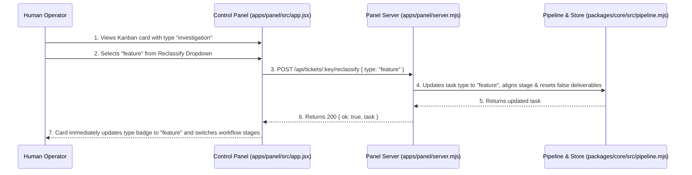
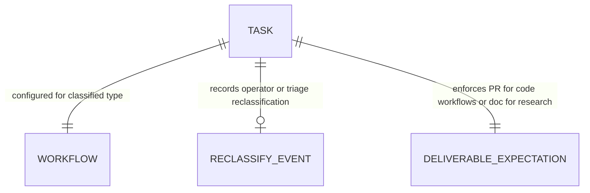

# Semantic Ticket Classification and Dynamic Reclassification Plan

**Approved**: 2026-11-08 - user: "aprovo"

## Problem

In the existing Agentic Factory:
1. **Keyword Collision with Repository Identity**:
   The intake pipeline (`classifyTicketType` in `packages/core/src/pipeline.mjs`) currently classifies tickets using a rigid set of regular expressions over the raw text of the title and body. When an issue belongs to a repository with domain-specific naming (e.g., `brenoacker/incident-investigator`), occurrences of keywords like `investigation` or `investigator` in the title or project name trigger false-positive classification as non-code research tasks (`investigation`), ignoring detailed implementation specifications (`Spec: ...`, user stories, acceptance criteria, vertical slices).
2. **Loss of Code Workflow & Premature Closure**:
   Because `investigation` workflows only contain `triage` -> `investigate` -> `done` and produce only a markdown report without tests or PRs, tasks incorrectly classified as `investigation` skip code generation, build, and verification entirely, prematurely closing tickets on GitHub/Linear without code or PRs when approved.
3. **Rigid Inability to Reclassify from UI or Triage Agent**:
   Operators have no one-click UI control on the Control Panel (Kanban cards or ticket details) to reclassify an existing ticket (e.g., changing `investigation` -> `feature` or `bug` -> `chore`) without modifying raw SQLite database tables.
   The `triage` agent prompt lacks explicit deliverable-oriented intent heuristics (e.g., distinguishing between software engineering work requiring PR deliverables vs. exploratory research producing documentation deliverables).

When this ships, the Agentic Factory guarantees:
1. **Deliverable-Oriented Weighted Scoring**:
   - `classifyTicketType` scores tickets across all 5 workflows (`feature`, `bug`, `chore`, `investigation`, `discovery`) based on structural engineering sections (`## User Stories`, `## Acceptance Criteria`, `## Problem / Solution`, `## Steps to Reproduce`, `Error / Stack trace`), and deliverable intent (code/PR vs. research doc).
   - Repository-name tokens (e.g., `incident`, `investigator`, `factory`) are automatically discounted as repo stop-words during intent evaluation.
   - Explicit prefixes (`Spec:`, `Feature:`, `Bug:`, `Chore:`, `[Spec]`, `[Feature]`) and `ready for implementation` statements have dominant priority.
2. **Interactive 1-Click Workflow Reclassification API & UI**:
   - Exposes `POST /api/tickets/:key/reclassify` accepting `{ type: 'feature' | 'bug' | 'chore' | 'investigation' | 'discovery' }`.
   - Safely transitions the task's workflow definition, resets deliverable expectations to match the new type (e.g., requiring a PR for code workflows), and persists the change in `runs/factory.db`.
   - On the Control Panel Kanban cards (`#kanban-board`) and Waiting for Human list, renders an interactive workflow type dropdown/selector (`data-testid="reclassify-select-${issueNumber}"`) allowing operators to immediately reclassify any active ticket with visual feedback.
3. **Semantic Triager Agent Context & Guidance**:
   - The `triager` agent prompt explicitly guides the LLM to inspect Deliverable Intent, automatically reclassifying tasks that contain code deliverables or specifications to `feature`/`bug` in the `contracts/triage.schema.json` payload, which the pipeline dispatcher dynamically applies.

## Shape

This feature updates `packages/core/src/pipeline.mjs`, `apps/panel/server.mjs`, and `apps/panel/src/app.jsx`.

1. Deliverable-oriented weighted scoring with repository stopwords -> `packages/core/src/pipeline.mjs` (exists) (door 1).
2. Endpoint `POST /api/tickets/:key/reclassify` -> `apps/panel/server.mjs` (exists) (door 2).
3. Cloudscape `<Select>` dropdown on Kanban cards and Waiting for Human cards -> `apps/panel/src/app.jsx` (exists) (door 3).

**Changes underneath**

| Front | What changes |
| --- | --- |
| `packages/core/src/pipeline.mjs` | Replace cascaded regex in `classifyTicketType` with weighted scoring engine, repo stopwords filter, and structural markdown section analyzer |
| `apps/panel/server.mjs` | Add `POST /api/tickets/:key/reclassify` endpoint with validation of allowed types (`feature`, `bug`, `chore`, `investigation`, `discovery`) |
| `packages/core/src/store.mjs` | Add `reclassifyTaskType(executionKey, newType, workflows)` helper updating task type, syncing workflow, and resetting mismatched deliverable flags |
| `apps/panel/src/app.jsx` | Add Cloudscape inline `<Select>` on Kanban cards (`data-testid="reclassify-select-${issueNumber}"`) and Waiting for Human list |
| Verification | Add unit tests for weighted scoring, repo stopword avoidance, reclassification API, and Playwright E2E browser test |

New: RECLASSIFY_EVENT entity records operator and automated workflow reclassifications across the 5 ticket types.

## Surface

| Route / Component | In | Out | Status | Who |
| --- | --- | --- | --- | --- |
| `classifyTicketType(params)` | `{ title, body, type, labels, repo }` | Type string (`feature`, `bug`, `chore`, `investigation`, `discovery`) | `200` | anyone |
| `POST /api/tickets/:key/reclassify` | `{ type: string }` | `{ ok: true, task }` | `200` / `400` / `404` | anyone |
| `reclassify-select-${issueNumber}` | Dropdown selection | Triggers `POST /api/tickets/:key/reclassify` and updates state | `200` | anyone |

## Landing

| One-way door | Literal shape | Alternative rejected |
| --- | --- | --- |
| Door 1: Deliverable-Oriented Weighted Scoring | Score matrix evaluating structural engineering headers (`User Stories`, `Acceptance Criteria`, `Steps to Reproduce`, `Spec`) + discounting repository name tokens | Retaining flat regex list — rejected because keywords collide with repo identity (e.g. `incident-investigator`) |
| Door 2: Dedicated Reclassification Endpoint | `POST /api/tickets/:key/reclassify` accepting valid types and re-aligning workflow stage/deliverable rules | Requiring manual SQLite DB updates or raw task patch — rejected because operator needs safe, validated workflow realignment |
| Door 3: Prominent Kanban Reclassification Control | Dropdown on task card allowing immediate type changes without losing task progress | Forcing ticket recreation or intake deletion — rejected because tickets lose state and audit history |

## Criteria

### S1: Deliverable-Oriented Weighted Classification (P1)

Classify tickets based on structural intent, markdown sections, and repository stop-word exclusion.

**Acceptance Criteria**

1. WHEN an issue title starts with `Spec:`, `[Spec]`, `Feature:`, `[Feature]`, or `Implement:` THEN `classifyTicketType` SHALL return `feature`.
2. WHEN an issue body contains structural engineering sections (such as `## User Stories`, `## Acceptance Criteria`, `## Specification ready for implementation`) THEN `classifyTicketType` SHALL return `feature` even if the word `investigation` appears in the project name or body.
3. WHEN a repository name contains words like `incident-investigator` THEN `classifyTicketType` SHALL discount the tokens `incident` and `investigator` so they do not falsely trigger the `investigation` workflow.
4. WHEN an issue body contains `## Steps to Reproduce`, `Error:`, or stack traces THEN `classifyTicketType` SHALL return `bug`.
5. WHEN an issue asks open exploratory questions without implementation criteria (e.g. `Why does...`, `Options comparison`, `Technical spike`) THEN `classifyTicketType` SHALL return `investigation`.

### S2: Reclassification API Endpoint (P1)

Allow operator to safely change a task's classified type and realign its workflow.

**Acceptance Criteria**

6. WHEN `POST /api/tickets/:key/reclassify` is called with `{ type: 'feature' }` for an existing task THEN the server SHALL return HTTP 200 with `{ ok: true, task }` and the task type in the store SHALL become `feature`.
7. WHEN `POST /api/tickets/:key/reclassify` is called with an invalid type (not in `feature`, `bug`, `chore`, `investigation`, `discovery`) THEN the server SHALL return HTTP 400 with `{ ok: false, error: 'Invalid ticket type' }`.
8. WHEN `POST /api/tickets/:key/reclassify` is called for a non-existent execution key THEN the server SHALL return HTTP 404 with `{ ok: false, error: 'Task not found' }`.
9. WHEN a task previously classified as `investigation` with an attached research document is reclassified to `feature` THEN the task deliverable expectations SHALL reset to require a pull request before reaching `done`.

### S3: Control Panel Kanban Reclassification UI (P1)

Expose workflow reclassification directly on Kanban cards in the browser.

**Acceptance Criteria**

10. WHILE a task card is rendered in `#kanban-board` THEN the card SHALL render a reclassification selector (`data-testid="reclassify-select-${issueNumber}"`).
11. WHEN an operator changes the reclassification selector value on a task card THEN the UI SHALL dispatch `POST /api/tickets/:key/reclassify` and update the visible type badge without page reload.

## Out of scope

| Excluded | Why |
| --- | --- |
| Automatic retrospective code execution on closed historical tasks | Reclassification targets active tasks; completed tasks require an operator alert or reopening |
| Adding new workflow types beyond the 5 supported types | The system contract schemas support `feature`, `bug`, `chore`, `investigation`, and `discovery` |

## Assumptions

| Assumption | Chosen default | Rationale | Confirmed? |
| --- | --- | --- | --- |
| Repo stop-word extraction | Tokens from repo name (e.g. `incident`, `investigator`) are stripped from trigger matching | Prevents domain names from corrupting classification | y |
| Code workflows require PR | Reclassifying to `feature`, `bug`, or `chore` requires verified PR deliverable | Guarantees code integrity and matches delivery loop | y |
| Operator overrides agent | UI selector always updates task type regardless of previous classifier result | Operator has final authority over factory stage and type | y |

**Open questions:** none - all resolved.

## Differences from the source

None - the product matches the source.

## Sources

- User request: "o que podemos fazer para o classificador de tickets ser acertivo? ele deve entender o ticket par aclassificar e nao ser engessado"
- User request: "sim, crie um plano com o spec lean para criarmos esse improvement"
