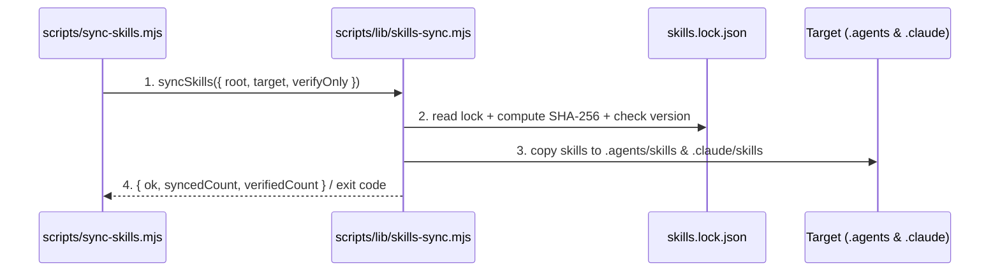
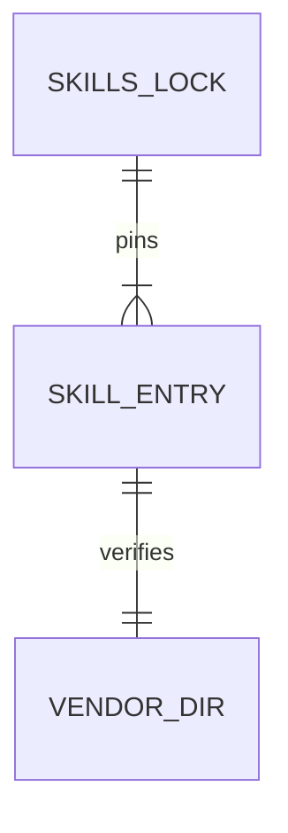

# Skills Synchronization and Vendor Lock

**Approved**: 2026-11-07 - user: "estou de acordo, sobre as metricas que vao ter no painel de controle e como ele vai rodar, como ficou?"

## Problem

Agents executing across Antigravity, Claude Code, and Codex do not share a single deterministic skill directory or version lock in this repository today. Any human or agent running a task risks invoking missing skills, drifting skill versions, or legacy v1 workflows instead of the locked `tlc-spec-lean` v2.2.0 and companion Tech Leads Club skills.

When this ships, a single manifest (`skills.lock.json`) pins every vendored skill's version, upstream commit, and content SHA-256 digest, and one CLI command (`node scripts/sync-skills.mjs`) verifies integrity and populates the native skill discovery directories for Antigravity, Claude Code, and Codex in the factory or any target project.

## Shape

This feature reuses the Node 24 standard library (`node:fs`, `node:path`, `node:crypto`) with zero external dependencies, matching `scripts/setup-labels.mjs`. Integrity verification, frontmatter parsing, and target directory resolution run as pure exported functions in `scripts/lib/skills-sync.mjs` so `node --test` can exercise every rule directly.

1. CLI args (`--verify-only`, `--target <dir>`, `--lock <file>`) -> `scripts/sync-skills.mjs` (new) - parses flags and invokes `scripts/lib/skills-sync.mjs`
2. `scripts/lib/skills-sync.mjs` (new) - reads `skills.lock.json` (door 1), computes deterministic SHA-256 tree digests over `skills/vendor/<name>` and `skills/custom/<name>`, and verifies frontmatter `version` (for `tlc-spec-lean`, requires `>= 2.0.0`)
3. `scripts/lib/skills-sync.mjs` (new) - copies each locked skill into `<target>/.agents/skills/<name>` (Antigravity & Codex) and `<target>/.claude/skills/<name>` (Claude Code) (door 2)
4. out: JSON summary on stdout and exit code `0` on success, or exit code `1` with structured error on stderr if any digest, version, or file is invalid

**Changes underneath**

| Front | What changes |
| --- | --- |
| domain | none - first introduction of `skills.lock.json` and skill sync |
| stored data | nothing to migrate |
| readers | Antigravity (`.agents/skills`), Codex (`.agents/skills`), Claude Code (`.claude/skills`), and CI gate |

New: `SKILLS_LOCK` and `SKILL_ENTRY` in `skills.lock.json`. One-way constraints: `name` unique per `skills.lock.json` (door 1).

## Surface

None - nothing consumed outside (CLI command only; no HTTP routes).

## Landing

| One-way door | Literal shape | Alternative rejected |
| --- | --- | --- |
| Door 1: `skills.lock.json` schema | `{"schemaVersion":1,"upstreamRepo":"https://github.com/tech-leads-club/agent-skills","upstreamCommit":"<40-hex>","skills":[{"name":"tlc-spec-lean","category":"development","source":"vendor","version":"2.2.0","license":"CC-BY-4.0","path":"skills/vendor/tlc-spec-lean","sha256":"<64-hex>"}]}` | Unpinned directory scan without `sha256` or `version` — rejected because silent edits or accidental v1 downgrades would go undetected |
| Door 2: Agent runtime target directories | `<target>/.agents/skills/<name>/SKILL.md` (read by Antigravity and Codex) and `<target>/.claude/skills/<name>/SKILL.md` (read by Claude Code), populated as full file copies | OS symlinks — rejected because Windows requires Developer Mode or elevated privileges for directory symlinks and git worktrees across volumes break relative links |

- Nothing else in this change is hard to reverse

## Criteria

### S1: Vendor Lock & Multi-Runtime Sync (P1)

Pin the core TLC skills (`tlc-spec-lean` v2.2.0 and phase companions) in `skills.lock.json`, verify their integrity and version, and synchronize them to Antigravity, Claude Code, and Codex discovery folders.

**Acceptance Criteria**

1. The `skills.lock.json` manifest SHALL pin `tlc-spec-lean` at version `2.2.0` (commit `8658b6658c762b9e5efd3956ed35a51c41bdf6c3`) alongside the factory's core TLC skills (`tlc-discover`, `tlc-prd`, `the-judge`, `the-fool`, `the-jury`, `codenavi`, `coding-guidelines`, `not-your-babysitter`, `gh-fix-ci`, `gh-address-comments`, `create-adr`, `create-rfc`, `create-technical-design-doc`, `docs-writer`, `mermaid-studio`, `security-best-practices`, `security-threat-model`, `sentry`, `skill-architect`, `subagent-creator`, `harness-eval`, `spec-driven-eval`) with valid 64-character hex `sha256` tree digests.
2. WHEN `node scripts/sync-skills.mjs --verify-only` runs against an intact `skills/` tree THEN the system SHALL exit `0` and output JSON containing `"ok":true` and `"verifiedCount":23`.
3. IF any file inside a locked skill directory is modified, missing, or has a `SKILL.md` version mismatch against `skills.lock.json` THEN `sync-skills.mjs` SHALL exit `1` and print the offending skill name and reason on stderr.
   - `sha256` mismatch on `SKILL.md` → exits `1` naming the skill; missing skill directory → exits `1` naming the skill; intact directory → exits `0`
4. IF `tlc-spec-lean` in `skills.lock.json` or `skills/vendor/tlc-spec-lean/SKILL.md` has a major version lower than `2` THEN `sync-skills.mjs` SHALL exit `1` with error `tlc-spec-lean version must be >= 2.0.0`.
   - version `1.9.0` → exits `1`; version `2.0.0` → exits `0`; version `2.2.0` → exits `0`
5. WHEN `node scripts/sync-skills.mjs --target <dir>` runs THEN the system SHALL copy every locked skill into `<dir>/.agents/skills/<name>` and `<dir>/.claude/skills/<name>` such that `<dir>/.agents/skills/tlc-spec-lean/SKILL.md` and `<dir>/.claude/skills/tlc-spec-lean/SKILL.md` exist and match the source digest.
6. IF an unknown CLI flag is passed to `scripts/sync-skills.mjs` THEN the command SHALL exit `2` without writing any files.
   - `--unknown-flag` → exits `2`; `--verify-only` → exits `0`

## Out of scope

| Excluded | Why |
| --- | --- |
| Fetching skills over the network at runtime | Skills are vendored in git (`AD-001` / user decision) so runs are offline-capable and reproducible |
| Installing `@tech-leads-club/harness-toolkit` global hooks | Separate optional step for Cursor/Claude Code host machines; does not belong to skill directory sync |

## Assumptions

| Assumption | Chosen default | Rationale | Confirmed? |
| --- | --- | --- | --- |
| Sync method across Windows and git worktrees | Full file copy (idempotent overwrite) instead of symlinks | Symlinks on Windows require privileges/Developer Mode and can fail in isolated worktrees | y |
| Antigravity and Codex workspace skill path | `.agents/skills/<name>/SKILL.md` (with `.claude/skills/<name>/SKILL.md` for Claude Code) | Standard workspace skill discovery paths across Antigravity, Codex, and Claude Code | y |

**Open questions:** none - all resolved or logged above.

## Differences from the source

None - the product matches the source

## Sources

- `docs/plan.md` (Phase 1: vendorizar as skills TLC + lock + `sync-skills` para os 3 runtimes) - binding - defines Phase 1 deliverables and target runtimes
- User request: "ok, mas garanta que estamos usando a versao nova do tlc-spec-lean, versao 2, nao a versao anterior" - binding - mandates v2 enforcement
