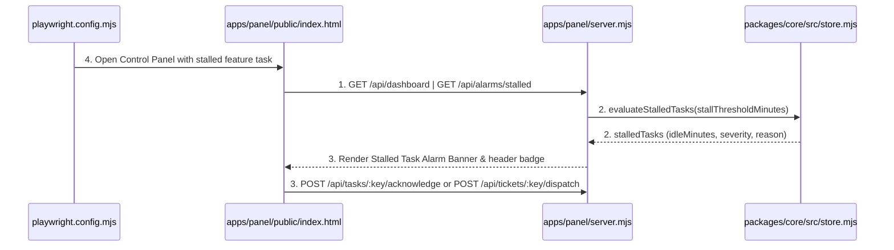
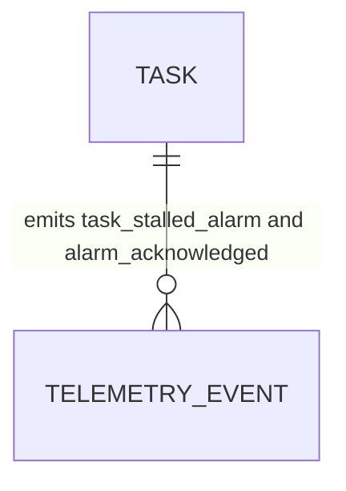

# Stalled Task Alarm and Operator Notification System

**Approved**: 2026-11-07 - user: "Outro ponto que eu também quero colocar na fábrica de software é que se tiver uma feature que está parada por muito tempo, deve me notificar, colocar alguma notificação, algum alarme para eu entender que eu tenho que atuar."

## Problem

When a feature or other task sits idle in a stage or waits at a human gate for longer than expected, the operator currently has no proactive alarm, visual alert banner, or configurable stall threshold to notify them that immediate action is required.

When this ships, the factory continuously evaluates active tasks against `factory.limits.stallThresholdMinutes` (default `30` minutes), surfaces stalled tasks in `GET /api/dashboard` and `GET /api/alarms/stalled`, records deduplicated `task_stalled_alarm` telemetry events, allows acknowledging/snoozing alarms via `POST /api/tasks/:key/acknowledge` or acting immediately via 1-click approval/dispatch, and renders a prominent English **Stalled Task Alarm Banner**, header alarm counter badge, and Kanban card stall badges in the Control Panel (`apps/panel/public/index.html`) verified with Playwright in Chromium.

## Shape

This feature extends `factory.yaml` (`factory.limits.stallThresholdMinutes`), `packages/core/src/store.mjs` (`evaluateStalledTasks`, `acknowledgeTaskAlarm`, and `stalledTasks` in `getStatusSummary`), `apps/panel/server.mjs` (`GET /api/alarms/stalled`, `POST /api/tasks/:key/acknowledge`, and `stallThresholdMinutes` in `POST /api/controls`), and `apps/panel/public/index.html` (top alarm banner, header alarm badge, Kanban stalled badge, Web Notification/Audio alarm toggle, and threshold control).

1. Timer poll or HTTP request -> `apps/panel/server.mjs` (exists) - evaluates active tasks against `stallThresholdMinutes` via `packages/core/src/store.mjs` (exists) and serves `GET /api/alarms/stalled`, `POST /api/tasks/:key/acknowledge`, and `GET /api/dashboard` (door 1)
2. `packages/core/src/store.mjs` (exists) - computes `idleMinutes` from `updated_at`, classifies `severity` (`warning` or `critical`), and records deduplicated `task_stalled_alarm` and `alarm_acknowledged` telemetry events (door 1)
3. `apps/panel/public/index.html` (exists) -> `apps/panel/server.mjs` (exists) - renders the top Stalled Task Alarm Banner, header alarm badge, and Kanban stalled indicators in English, triggers browser Notification / Web Audio alarm, and lets the operator click Act Now or Snooze Alarm via `POST /api/tasks/:key/acknowledge` or `POST /api/tickets/:key/dispatch` (door 2)
4. `playwright.config.mjs` (exists) -> `apps/panel/public/index.html` (exists) & `apps/panel/server.mjs` (exists) - verifies the visual alarm banner, Kanban stall badge, threshold configuration, and 1-click resolution in headless Chromium

**Changes underneath**

| Front | What changes |
| --- | --- |
| domain | adds `evaluateStalledTasks` and `acknowledgeTaskAlarm` in `packages/core/src/store.mjs`, adds `stallThresholdMinutes` in `factory.yaml`, and adds alarm endpoints and banner UI in `apps/panel/` |
| stored data | uses existing `tasks` (`updated_at`) and `telemetry_events` (`task_stalled_alarm`, `alarm_acknowledged`) tables in SQLite (`packages/core/src/store.mjs`) |
| readers | `apps/panel/server.mjs`, `apps/panel/public/index.html`, `packages/core/cli.mjs`, and `apps/panel/e2e/panel.spec.mjs` |

New: nothing - read only on schema structure (uses existing `TASK` and `TELEMETRY_EVENT` tables).

## Surface

| Route | In | Out | Status | Who |
| --- | --- | --- | --- | --- |
| `GET /api/alarms/stalled` | optional query `?thresholdMinutes=<n>` | JSON `{ ok, stallThresholdMinutes, stalledCount, stalledTasks }` | `200`, `400` | anyone |
| `POST /api/tasks/:key/acknowledge` | `{ actor, note }` | JSON `{ ok, task }` (refreshes `updated_at` and clears stall state) | `200`, `404` | anyone |

## Landing

| One-way door | Literal shape | Alternative rejected |
| --- | --- | --- |
| Door 1: Stalled task detection & acknowledgement API | `evaluateStalledTasks({ stallThresholdMinutes, now })` and `acknowledgeTaskAlarm(executionKey)` in `packages/core/src/store.mjs` exposed via `GET /api/alarms/stalled`, `POST /api/tasks/:key/acknowledge`, and `GET /api/dashboard` | External cron-only alerting without dashboard state — rejected so the Control Panel, CLI (`status`), and API share one deterministic stall detector |
| Door 2: Visual & audible Stalled Task Alarm UI | `#stalled-alarm-banner`, `#header-alarm-badge`, and per-card `[data-testid="task-stalled-badge-<issue>"]` in `apps/panel/public/index.html` with 1-click `Act Now` and `Snooze Alarm` buttons | Hiding stalled status inside a secondary tab — rejected because a stalled feature alarm must be visible regardless of which tab is open |

- Nothing else in this change is hard to reverse

## Criteria

### S1: Stalled Task Detector, API Endpoints, and Visual Alarm Banner (P1)

Deliver the configurable stall threshold (`stallThresholdMinutes`), deterministic stalled task detector and telemetry events, acknowledgement/snooze endpoint, and Control Panel alarm banner and Kanban indicators verified with Playwright.

**Acceptance Criteria**

1. WHEN `evaluateStalledTasks` or `GET /api/alarms/stalled` evaluates active tasks (`stage != "done"` and `stage != "aborted"`) against `stallThresholdMinutes` THEN it SHALL return `200` with every task whose elapsed time since `updated_at` is `>= stallThresholdMinutes`, classify `severity` as `"warning"` (`>= threshold`) or `"critical"` (`>= 2 * threshold`), record a deduplicated `task_stalled_alarm` telemetry event per stall episode, ignore completed (`done`) tasks, and return `400` if `thresholdMinutes` is `<= 0` or non-numeric.
   - active feature idle `45` min with threshold `30` min → stalled (`severity: "warning"`); idle `75` min → stalled (`severity: "critical"`); completed task idle `120` min → not stalled; `?thresholdMinutes=-5` → `400`
2. WHEN `POST /api/tasks/:key/acknowledge` is called for a stalled task THEN the server SHALL refresh the task's `updated_at` timestamp, record an `alarm_acknowledged` telemetry event, return `200` with the updated task so it is no longer flagged as stalled, and return `404` when the task key does not exist.
   - existing stalled task → `200` and `stalledCount` drops to `0`; unknown task key → `404`
3. WHEN a feature or task is stalled in the Control Panel (`GET /`) THEN the UI SHALL display the global `#stalled-alarm-banner` at the top of the page, update `#header-alarm-badge` with the active alarm count, render a `STALLED` badge on the task's Kanban card, allow configuring `stallThresholdMinutes` in `Operational Controls`, and clear the alarm when the operator clicks `Act Now` or `Snooze Alarm` (verified in Chromium by Playwright).

## Out of scope

| Excluded | Why |
| --- | --- |
| External SMS/PagerDuty gateway | Local single-operator factory uses the Control Panel alarm banner, browser Notification/Web Audio API, and telemetry log |

## Assumptions

| Assumption | Chosen default | Rationale | Confirmed? |
| --- | --- | --- | --- |
| Default stall threshold | `30` minutes (`factory.limits.stallThresholdMinutes: 30`) | Matches `stageTimeoutMinutes: 30` in `factory.yaml` and is adjustable at runtime from the Control Panel | y |

**Open questions:** none - all resolved or logged above.

## Differences from the source

None - the product matches the source

## Sources

- `AGENTS.md` & `docs/plan.md` - binding - defines Control Panel notifications, human-in-the-loop gates, and operational controls
