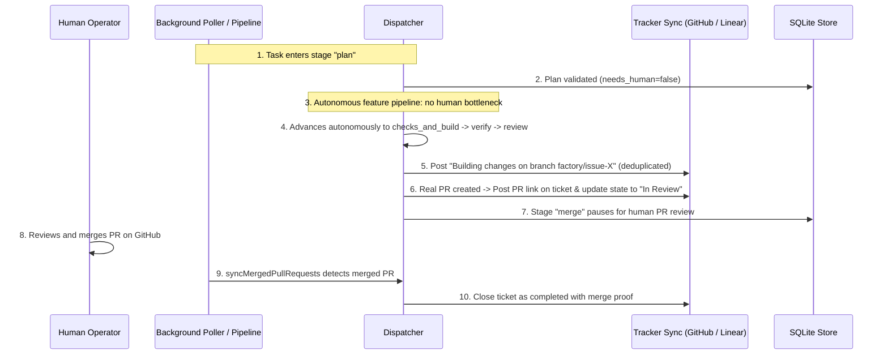
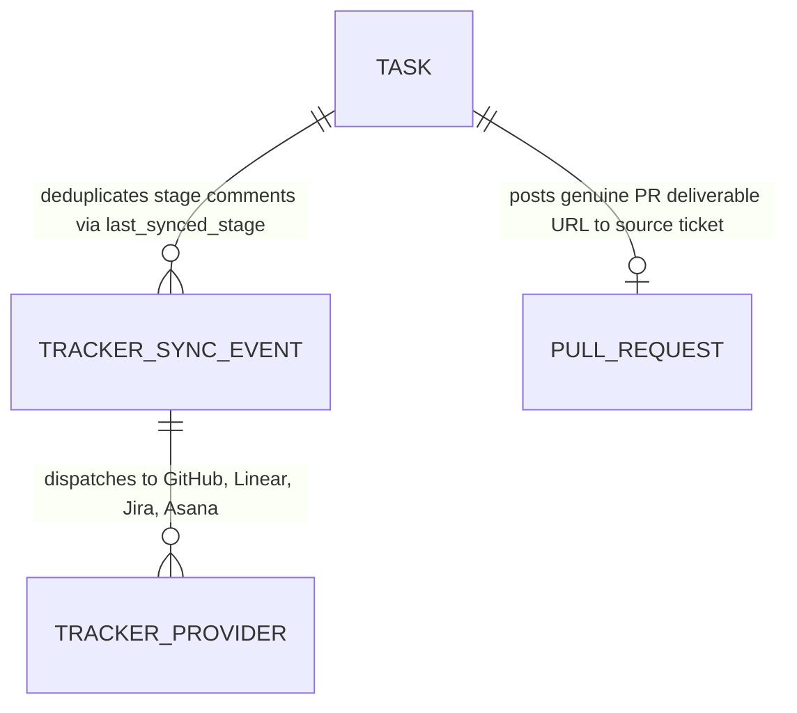

# Tracker Lifecycle Sync and Autonomous Pipeline plan

**Approved**: 2026-11-07 - user: "pode, um ponto que temos tambem que adicionar é que tudo que muda de status do ticket que esta sendo feito deve ser postado onde ele se encontra, como no jira, linear, github issues. Nao devemos ter comentarios duplicados. Quando criamos PR devemos colocar no ticket. Tambem devemos mudar o status do ticket quando estiver esperando alguma revisao de humano como uma PR, mas nao devemos fechar o ticket, só se for tickets que nao precisem da autorizacao do humano como uma pesquisa."

## Problem

In the existing Agentic Factory:
1. When tasks transition across stages (`triage`, `plan`, `checks_and_build`, `verify`, `review`, `merge`, `done`), updates are only reflected inside the local SQLite database and Control Panel. External trackers (GitHub Issues, Linear, Jira, Asana) receive no lifecycle comments or status transitions while the work is in progress. Operators working in Linear or Jira remain blind to what the agents are currently executing.
2. Hardcoded test defaults in `createStageContractRunner` fabricated synthetic PR deliverables (`pr_number: issueNum + 100`, `commit_sha: '64e6a79'`, and broken URLs like `https://github.com/linear://...`). Consequently, tasks jumped directly into stage `merge` pointing to non-existent PRs and commit hashes, causing permanent deadlocks.
3. In `workflows/feature.yaml`, stage `plan` was hardcoded with `"humanApproval": true`, forcing human intervention on every single feature plan even when the ticket was completely well-described, creating an artificial human bottleneck that contradicts the principles of an autonomous agentic factory.
4. When PRs were created, the link was not posted back to the source issue.
5. Periodic polling cycles risked posting duplicate comments on external issues if stage change events were not deduplicated.
6. Non-code tickets (like research/investigation documents) were subjected to the same manual merge gating as code workflows instead of closing automatically upon deliverable completion.

When this ships, the Agentic Factory guarantees:
1. **Autonomous Plan Execution**: In code workflows (`feature`, `bug`), well-described plans with zero blocking questions (`needs_human: false`) advance autonomously from `plan` directly into `checks_and_build` $\rightarrow$ `verify` $\rightarrow$ `review`. The factory only pauses for human input when the planner explicitly identifies missing requirements or ambiguities (`needs_human: true`).
2. **Tracker Lifecycle & PR Syncing**: Every stage transition is posted to the source tracker (GitHub Issues, Linear, Jira, Asana):
   - When a PR is created, its link and summary are posted directly to the source ticket.
   - When a ticket is waiting for human action (e.g. PR review in `merge` or clarifying questions), the tracker status is updated to `In Review` / `Waiting for Human`.
   - The ticket is NEVER closed prematurely for code workflows; only when the PR is merged does it close.
   - Research/investigation tickets without code PRs close automatically upon deliverable attachment.
3. **Deduplication Gate**: All tracker comments and status changes are tracked via `last_synced_stage` in SQLite, ensuring zero duplicate comments even across frequent cron polling loops.
4. **Elimination of Fake PRs and Commits**: No synthetic PR numbers or commit hashes (`64e6a79`) are generated. Tasks only enter `merge` when a genuine Pull Request exists, and corrupted tasks in `runs/factory.db` are cleanly reset.

## Assumptions

1. The factory has API access to the respective trackers: GitHub CLI (`gh`) for GitHub Issues/PRs, `LINEAR_API_KEY` for Linear GraphQL API, and configured mock runners in test environments.
2. In SQLite, the `tasks` table can be safely migrated to include `last_synced_stage` to store the last stage:status:pr signature posted to the tracker.
Open questions: none

## Out of scope

1. Implementing full two-way chat threading inside external ticket comments (operators reply via Control Panel or `/approve` comments).
2. Modifying closed-loop PR review criteria for the independent judge.

## Sources

- User request: "Outro ponto é, se a gente tem um ticket que é uma feature e que está totalmente bem descrita e o agente consegue fazer de ponta a ponta, o humano não precisa aprovar o plano, a gente deve seguir com a skill. Ela não deve ficar esperando o mano para agir, dado que estamos diante de uma fábrica agêntica. Então o humano não deve ser o gargalo. Somente se tiver pontos críticos que precisa da resposta do humano e que não estão nos tickets. Se tiver problema com isso, ou seja, em definições que faltam ser definidas, aí sim deve ser perguntado ao humano. Mas se não, o plano deve ser aprovado e utilizado até o final, até a criação da PR, no qual o humano aí sim vai revisar."
- User request: "pode, um ponto que temos tambem que adicionar é que tudo que muda de status do ticket que esta sendo feito deve ser postado onde ele se encontra, como no jira, linear, github issues. Nao devemos ter comentarios duplicados. Quando criamos PR devemos colocar no ticket. Tambem devemos mudar o status do ticket quando estiver esperando alguma revisao de humano como uma PR, mas nao devemos fechar o ticket, só se for tickets que nao precisem da autorizacao do humano como uma pesquisa."

## Shape

This feature updates `workflows/feature.yaml`, `packages/core/src/store.mjs`, `packages/core/src/trackers.mjs`, `packages/core/src/dispatcher.mjs`, `packages/core/src/pipeline.mjs`, `packages/core/src/projects.mjs`, `apps/panel/__test__/control-panel.test.mjs`, and `apps/panel/e2e/panel.spec.mjs`.

1. Autonomous plan transition & conditional human gating -> `workflows/feature.yaml` & `packages/core/src/dispatcher.mjs` (door 1).
2. Deduplicated tracker lifecycle syncing with PR posting & state updates -> `packages/core/src/trackers.mjs` & `packages/core/src/store.mjs` (door 2).
3. Prohibition of fake PR generation & clean task state -> `packages/core/src/pipeline.mjs` (door 3).

**Changes underneath**

| Front | What changes |
| --- | --- |
| workflow schema | `workflows/feature.yaml` removes hardcoded `humanApproval: true` from `plan`, enabling autonomous progression when plans have `needs_human: false` |
| store schema | `tasks` table adds `last_synced_stage TEXT DEFAULT ''` column; `updateTaskStage` updates `last_synced_stage` to prevent duplicate tracker comments |
| tracker domain | `syncTaskStateToTracker` handles GitHub, Linear, Jira, Asana: posts deduplicated stage notifications, attaches PR URLs to tickets, and updates tracker statuses to In Review or Done |
| pipeline runner | `createStageContractRunner` no longer synthesizes hardcoded fake PR numbers or `64e6a79` hashes; code tasks only advance to `merge` with real PR deliverables |

New: adds deduplicated tracker lifecycle synchronization, autonomous plan execution, and genuine PR attachment.

## Surface

| Route | In | Out | Status | Who |
| --- | --- | --- | --- | --- |
| `POST /api/tickets/:key/dispatch` | `{ approveCurrentStage: boolean }` | JSON `{ ok, stage, task }` | `200`, `404`, `422` | anyone |
| `POST /api/tasks/:key/check-pr` | `{}` | JSON `{ ok, merged, state, advancedToDone, task }` | `200`, `404` | anyone |
| `POST /api/projects/sync` | `{}` | JSON `{ ok, polledRepos, newTasksCount, syncReport }` | `200`, `500` | anyone |

## Landing

| One-way door | Literal shape | Alternative rejected |
| --- | --- | --- |
| Door 1: Autonomous Plan Advancement | `workflows/feature.yaml` sets `humanApproval: false` on `plan`; `dispatcher.mjs` only sets `needs_human: true` if planner flags ambiguities or open questions | Forcing human approval on every single plan — rejected because human bottleneck cripples agentic factory speed when tasks are well-described |
| Door 2: Deduplicated Tracker Lifecycle Syncing | `syncTaskStateToTracker` compares `(stage, needs_human, deliverable_url)` against `task.last_synced_stage` before posting comments or updating status in GitHub/Linear/Jira | Posting on every cron interval — rejected because polling cycles spam dozens of duplicate comments on tickets |
| Door 3: Genuine PR Verification & No Premature Closing | Code workflows in stage `merge` remain open with status `In Review` until PR is merged; only research documents without PRs close automatically upon deliverable completion | Closing code tickets before PR merge or fabricating fake `64e6a79` hashes — rejected because production code requires verified human review and merge |

## Criteria

### S1: Autonomous Plan Execution for Well-Described Tasks (P1)

Enable autonomous progression through plan and build stages when tickets are clear.

**Acceptance Criteria**

1. WHEN a task in a code workflow (`feature`, `bug`) completes stage `plan` with `needs_human: false` THEN the factory SHALL advance autonomously to `checks_and_build` without pausing for human approval.
2. WHEN a task in stage `plan` contains explicit ambiguities, missing requirements, or planner open questions (`needs_human: true`) THEN the factory SHALL pause and flag the task for human clarification with `human_question`.
3. WHILE a code task is executing `checks_and_build` or `verify` without an attached PR deliverable THEN the system SHALL NOT transition the task to stage `merge` or fabricate synthetic PR numbers.

### S2: Deduplicated Tracker Lifecycle Sync & PR Notification (P1)

Synchronize task status, PR links, and stage transitions to external issue trackers without duplicates.

**Acceptance Criteria**

4. WHEN a task transitions to a new stage or requires human input THEN `syncTaskStateToTracker` SHALL update the ticket status and post a stage notification comment to the source tracker (GitHub, Linear, Jira, Asana).
5. WHEN a code task attaches a Pull Request deliverable THEN the system SHALL post the pull request link and branch name directly onto the source ticket in GitHub or Linear.
6. WHEN periodic polling or dispatch loops evaluate an unchanged task THEN `syncTaskStateToTracker` SHALL suppress comment posting to prevent duplicate comments on the external tracker.
7. WHEN a code task enters stage `merge` awaiting review THEN the system SHALL update the tracker status to `In Review` (or add label `waiting-for-human`) and SHALL NOT close the source ticket.

### S3: Automatic Completion for Research and Post-Merge Tasks (P1)

Close non-code workflows upon document delivery and close code workflows upon PR merge.

**Acceptance Criteria**

8. WHEN a research or investigation task (`investigation`, `discovery`) completes with its deliverable document THEN the system SHALL post the document link and close the source ticket as completed.
9. WHEN an external Pull Request is verified as merged on GitHub THEN the cron scheduler SHALL advance the code task to `done`, post merge confirmation, and close the source ticket.
10. WHILE executing regression suites THEN automated Playwright E2E and unit test suites SHALL pass 100% with zero regressions.
