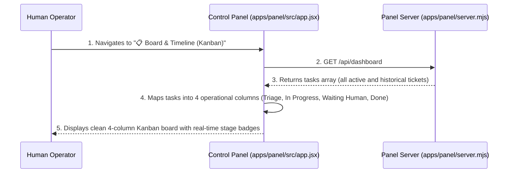
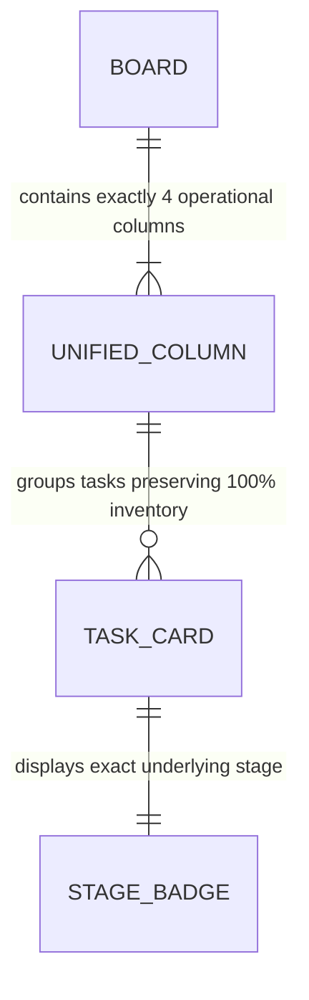

# Unified Kanban Board Columns plan

**Approved**: 2026-11-07 - user: "No board e timeline, Kanban, nós temos várias colunas, as trias de plan, check and builds, entre outras. Só que acho que tem só algumas que a gente precisaria. Quando está em check and builds. Ou seja, ainda a tarefa está em andamento, a gente poderia colocar elas em uma coluna só de tarefas em andamento. Quando ela ainda está na fase de triagem para entender qual é o tipo de issue, ele deve estar na fase de triagem. Quando ela está na fase que está esperando o humano, colocado na fase de esperando o mano. E quando estiver pronta, indo para uma fase de done. Pra gente conseguir colocar menos colunas e... E colocar os tickets em cada uma delas, claro, cada um com a sua fase atual. For exemplo, pode ter uma que está em progresso, mas está em check and build, e a outra está em progresso, mas está na fase de plan. Crie o plano da implementação disso, dado que é uma mudança, e utilize o TLC spec lean para implementar de forma autônoma. Nós devemos manter as tarefas que a gente tem que estão em andamento, completas e etc. no board, não podemos perder nenhuma. É mais uma unificação de colunas."

## Problem

In the existing Agentic Factory Control Panel:
1. The Kanban board on the "Board & Timeline" view renders 9 separate narrow columns matching every technical workflow stage (`triage`, `plan`, `checks_and_build`, `verify`, `review`, `investigate`, `discover`, `merge`, `done`).
2. This fragmentation forces operators to scroll horizontally across 9 cramped columns, obscuring the high-level operational picture of what is currently executing autonomously versus what is blocked awaiting human action.
3. Tasks requiring human intervention in stages like `plan` or `merge` are scattered across multiple disparate columns instead of being aggregated in a clear, unified column dedicated to human bottlenecks.
4. Despite the visual clutter, operators need to see the precise current technical stage of each task (e.g., distinguishing a task in `checks_and_build` from one in `plan`).

When this ships, the Agentic Factory guarantees:
1. The Kanban board consolidates into 4 unified operational columns:
   - **📥 Triage**: Tickets undergoing intake or classification (`stage === 'triage'` and `needs_human === 0`).
   - **⚡ In Progress**: Tasks actively executing in autonomous pipelines without human blockage (`needs_human === 0` and stage is one of `plan`, `checks_and_build`, `verify`, `review`, `investigate`, `discover`, or auto-merge).
   - **🙋 Waiting for Human**: Tasks paused awaiting operator clarification, plan approval, or GitHub PR merge (`needs_human === 1` or `stage === 'merge'`).
   - **✅ Done**: Completed tasks (`stage === 'done'`).
2. Every card in the board visibly displays its specific technical stage (e.g. `Stage: checks_and_build`, `Stage: plan`) with colored badges so operators know exact progress at a glance.
3. Zero task loss guarantee: 100% of tasks in `st.tasks` are accounted for in the board columns without dropping or hiding any active or historical tickets.
4. Existing DOM testids and element IDs (`#kanban-board`, `data-testid="task-card-${issueNumber}"`, `data-testid="kanban-ticket-link-${issueNumber}"`) remain intact, preserving test backward compatibility.

## Shape

This feature updates `apps/panel/src/app.jsx`, `apps/panel/public/bundle.js`, `apps/panel/__test__/control-panel.test.mjs`, and `apps/panel/e2e/panel.spec.mjs`.

1. Unified 4-column definition with stage mapping logic -> `apps/panel/src/app.jsx` (exists) (door 1).
2. Explicit current stage badges and deliverable/PR action buttons per card -> `apps/panel/src/app.jsx` (exists) (door 2).
3. Comprehensive test suite asserting 100% task retention across the 4 unified columns -> `apps/panel/__test__/control-panel.test.mjs` (exists) (door 3).

**Changes underneath**

| Front | What changes |
| --- | --- |
| UI columns | Replace 9-element `STAGES` mapping in `#kanban-board` with `BOARD_COLUMNS` (`triage`, `in_progress`, `waiting_human`, `done`) |
| Task categorization | Filter helper maps each task into its operational column based on `stage` and `needs_human` |
| Card layout | Highlight specific technical stage badge (`plan`, `checks_and_build`, `verify`, etc.) inside the card |
| Verification | Automated tests assert task count integrity, presence of the 4 columns, and correct column placement |

New: consolidates Kanban board into 4 operational columns while displaying underlying stage badges.

## Surface

| Route / Component | In | Out | Status | Who |
| --- | --- | --- | --- | --- |
| `#kanban-board` container | `st.tasks` array | 4 Column Containers (`#kanban-col-triage`, `#kanban-col-in_progress`, `#kanban-col-waiting_human`, `#kanban-col-done`) | `200` | anyone |
| Column Counter | Tasks matching column filter | Header counter string `(N)` | `200` | anyone |
| Task Card Stage Badge | Task `stage` property | Cloudscape `<Badge>` with current stage label | `200` | anyone |

## Landing

| One-way door | Literal shape | Alternative rejected |
| --- | --- | --- |
| Door 1: 4 Operational Kanban Columns | `BOARD_COLUMNS = [{ id: 'triage', label: '📥 Triage' }, { id: 'in_progress', label: '⚡ In Progress' }, { id: 'waiting_human', label: '🙋 Waiting for Human' }, { id: 'done', label: '✅ Done' }]` | Keeping 9 individual columns — rejected due to horizontal cramming and fragmented visibility |
| Door 2: Zero Task Loss Guarantee | Every task in `st.tasks` resolves to a column; tasks with `stage === 'aborted'` map to a dedicated section or `done` with aborted tag | Dropping or hiding unmapped stages — rejected as unacceptable loss of operational visibility |
| Door 3: Prominent Technical Stage Badging | Each card inside `in_progress` and `waiting_human` displays a badge with its exact technical stage (`checks_and_build`, `plan`, `merge`, etc.) | Generic status without stage information — rejected because operators need to know whether code is building or being verified |

## Criteria

### S1: Unified 4-Column Board Layout (P1)

Consolidate Kanban board into Triage, In Progress, Waiting for Human, and Done columns.

**Acceptance Criteria**

1. WHEN an operator views `#kanban-board` THEN the board SHALL render exactly 4 primary column containers with headers `📥 Triage`, `⚡ In Progress`, `🙋 Waiting for Human`, and `✅ Done`.
2. WHEN tasks in `st.tasks` are categorized THEN the sum of tasks displayed across all board columns SHALL equal the total number of tasks in the factory store.
3. WHEN a task has `stage === 'triage'` and `needs_human === 0` THEN the task SHALL appear in column `triage`.
4. WHEN a task has `needs_human === 0` and its stage is one of `plan`, `checks_and_build`, `verify`, `review`, `investigate`, or `discover` THEN the task SHALL appear in column `in_progress`.
5. WHEN a task has `needs_human === 1` OR its stage is `merge` THEN the task SHALL appear in column `waiting_human`.
6. WHEN a task has `stage === 'done'` THEN the task SHALL appear in column `done`.

### S2: Granular Stage Visibility within Cards (P1)

Display exact underlying technical stage badges inside unified column cards.

**Acceptance Criteria**

7. WHILE a task card is rendered in `#kanban-board` THEN the card SHALL render a visible stage badge (`data-testid="task-stage-badge-${issueNumber}"`) displaying the task's current technical stage.
8. WHEN an operator inspects a task in `in_progress` at stage `checks_and_build` and another in `in_progress` at stage `plan` THEN both cards SHALL display their respective distinct stage badges.

## Out of scope

| Excluded | Why |
| --- | --- |
| Drag-and-drop manual stage changes | Transitions are driven deterministically by agent contracts and gates |
| Removing or changing database stage schema | Stored data schema retains fine-grained technical stages |

## Assumptions

| Assumption | Chosen default | Rationale | Confirmed? |
| --- | --- | --- | --- |
| 4-Column Structure | Triage, In Progress, Waiting for Human, Done | Explicitly specified by user | y |
| No Task Loss | Categorization logic covers 100% of task stages | User explicitly insisted "não podemos perder nenhuma" | y |
| Current Stage Badges | Cards display fine-grained stage badges | User requested seeing "cada um com a sua fase atual" | y |

**Open questions:** none - all resolved.

## Differences from the source

None - the product matches the source.

## Sources

- User request: "No board e timeline, Kanban, nós temos várias colunas, as trias de plan, check and builds, entre outras. Só que acho que tem só algumas que a gente precisaria. Quando está em check and builds. Ou seja, ainda a tarefa está em andamento, a gente poderia colocar elas em uma coluna só de tarefas em andamento. Quando ela ainda está na fase de triagem para entender qual é o tipo de issue, ele deve estar na fase de triagem. Quando ela está na fase que está esperando o humano, colocado na fase de esperando o mano. E quando estiver pronta, indo para uma fase de done. Pra gente conseguir colocar menos colunas e... E colocar os tickets em cada uma delas, claro, cada um com a sua fase atual. For exemplo, pode ter uma que está em progresso, mas está em check and build, e a outra está em progresso, mas está na fase de plan. Crie o plano da implementação disso, dado que é uma mudança, e utilize o TLC spec lean para implementar de forma autônoma. Nós devemos manter as tarefas que a gente tem que estão em andamento, completas e etc. no board, não podemos perder nenhuma. É mais uma unificação de colunas."
