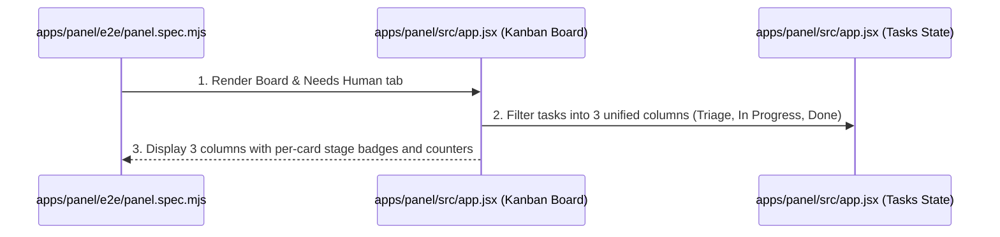
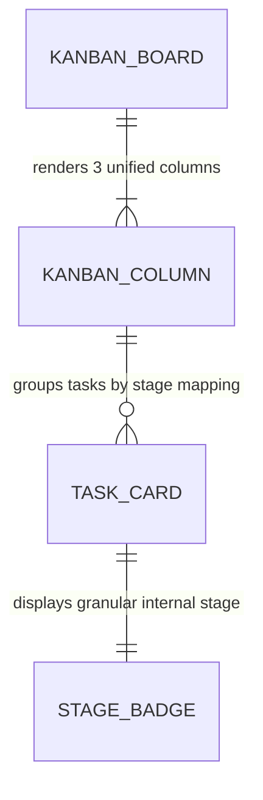

# Unified Kanban Board Columns

**Approved**: 2026-11-08 - user: "sim, quero unificar"

## Problem

The Control Panel Kanban board (`#kanban-board`) currently renders 9 separate, narrow stage columns (`triage`, `plan`, `checks_and_build`, `verify`, `review`, `investigate`, `discover`, `merge`, `done`). On standard monitor viewports, having 9 columns creates severe horizontal clutter, squishing individual task cards, causing awkward wrapping of tags, and dispersing in-flight work across too many parallel buckets.

When this ships:
1. The Kanban board consolidates all workflow stages into 3 high-level columns:
   - **Triage**: contains tasks in the `triage` stage.
   - **In Progress**: contains all active pipeline stages (`plan`, `checks_and_build`, `verify`, `review`, `investigate`, `discover`, `merge`).
   - **Done**: contains tasks in the `done` stage.
2. Each task card continues to display its granular stage badge (`data-testid="task-stage-${issue_number}"`), preserving immediate visibility of whether an in-flight task is currently in `plan`, `checks_and_build`, `verify`, `review`, etc.
3. Each column container exposes a deterministic `data-testid="kanban-col-${col.id}"` and header counter reflecting its aggregated task count.
4. The board layout grid adapts cleanly to 3 columns (`repeat(3, minmax(260px, 1fr))`).
5. Playwright E2E tests in `apps/panel/e2e/panel.spec.mjs` verify the 3 unified columns, card distribution, and stage transitions with visual proof captured.

## Shape

This feature updates `apps/panel/src/app.jsx` to define `KANBAN_COLUMNS` and map `#kanban-board` over the 3 unified columns, builds the panel bundle via `scripts/build-panel.mjs`, and updates `apps/panel/e2e/panel.spec.mjs`.

1. Operator navigates to `Board & Needs Human` tab -> `apps/panel/src/app.jsx` (exists) - renders `#kanban-board` with 3 unified columns (`Triage`, `In Progress`, `Done`) (door 1)
2. Operator views tasks in `In Progress` column -> `apps/panel/src/app.jsx` (exists) - displays task cards across all active stages, each highlighting its granular stage badge (door 1)
3. Task transitions stages (e.g. intake advances from triage to plan, or complete moves to done) -> `apps/panel/src/app.jsx` (exists) - card immediately shifts between unified columns according to stage mapping (door 1)
4. Playwright E2E suite -> `apps/panel/e2e/panel.spec.mjs` (exists) - asserts 3 unified columns, card counters, badge values, and visual screenshot (door 1)

**Changes underneath**

| Front | What changes |
| --- | --- |
| domain | introduces `KANBAN_COLUMNS` mapping stages to 3 consolidated columns (`Triage`, `In Progress`, `Done`), updates `#kanban-board` rendering in `apps/panel/src/app.jsx`, and adjusts grid CSS |
| stored data | none - purely client-side task aggregation and layout refactoring |
| readers | `apps/panel/src/app.jsx`, `apps/panel/public/bundle.js`, and `apps/panel/e2e/panel.spec.mjs` |

New: nothing stored - uses existing tasks array and client-side stage filtering.

## Surface

| Route | In | Out | Status | Who |
| --- | --- | --- | --- | --- |
| `GET /` | - | HTML + `/bundle.js` with unified 3-column Kanban board | `200` | anyone |

## Landing

| One-way door | Literal shape | Alternative rejected |
| --- | --- | --- |
| Door 1: Unified 3-Column Kanban Board | `apps/panel/src/app.jsx` defining `KANBAN_COLUMNS` with 3 columns (`Triage`, `In Progress`, `Done`) and mapping `#kanban-board` over them | Retaining 9 separate stage columns or using collapsible accordions — rejected because user explicitly requested unifying into 3 columns (Triage, In Progress, Done) |

- Nothing else in this change is hard to reverse.

## Criteria

### S1: Unified 3-Column Kanban Board (P1)

Consolidate the Control Panel Kanban board into 3 unified columns (`Triage`, `In Progress`, `Done`) while maintaining granular stage badges on all task cards.

**Acceptance Criteria**

1. The Control Panel Kanban board SHALL render exactly 3 column containers with identifiers `kanban-col-triage`, `kanban-col-in_progress`, and `kanban-col-done`.
2. The `Triage` column SHALL contain all tasks whose stage is `triage`.
3. The `In Progress` column SHALL contain all tasks whose stage is any of `plan`, `checks_and_build`, `verify`, `review`, `investigate`, `discover`, or `merge`.
4. The `Done` column SHALL contain all tasks whose stage is `done`.
5. WHEN task cards are rendered in any column THEN each task card SHALL display its granular internal stage badge (`data-testid="task-stage-${issue_number}"`).
6. WHEN tasks transition between stages THEN the Control Panel SHALL immediately reflect the card placement in the corresponding unified column.
7. The Playwright E2E test suite (`apps/panel/e2e/panel.spec.mjs`) SHALL verify the 3 unified columns, card counts, and stage badges.

## Out of scope

| Excluded | Why |
| --- | --- |
| Changes to underlying factory stages or state machine | Internal stages (`plan`, `verify`, etc.) remain identical; only board presentation is unified |
| Drag-and-drop column manual moves | Factory automation moves stages via dispatches; manual drag-and-drop is not part of factory model |

## Assumptions

| Assumption | Chosen default | Rationale | Confirmed? |
| --- | --- | --- | --- |
| Column structure | 3 columns: `Triage`, `In Progress`, and `Done` | Operator explicitly selected unifying into 3 columns | y |
| In-progress stage aggregation | Group stages `plan`, `checks_and_build`, `verify`, `review`, `investigate`, `discover`, `merge` under `In Progress` | Covers all active non-triage, non-done execution stages | y |
| Granular stage indicators | Retain per-card stage badges | Preserves visibility into exact stage of work without column clutter | y |
| Column test IDs | `kanban-col-triage`, `kanban-col-in_progress`, `kanban-col-done` | Standard test attributes for Playwright assertions | y |

Open questions: none - all requirements and column mappings clarified and confirmed.

## Differences from the source

None - the product matches the source.

## Sources

- User request: non-binding - user: "sim, quero unificar"
- Visual capture:  - non-binding - user: "sim, quero unificar"
- Decision log: `.specs/STATE.md` (AD-004)

