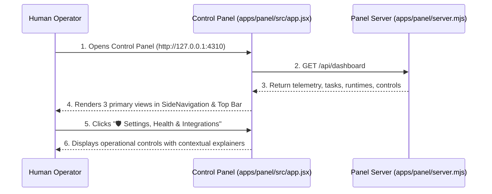
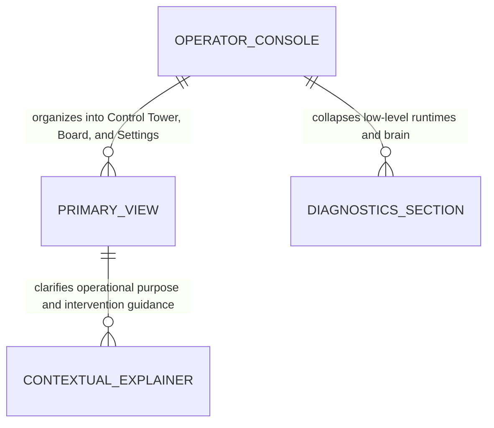

# Unified Menu and Operator Views plan

**Approved**: 2026-11-07 - user: "sim"

## Problem

In the existing Agentic Factory Control Panel:
1. The sidebar and navigation menus expose 6 flat, low-level technical tabs ("Overview & Telemetry", "Board & Needs Human", "Workflows", "Runtimes, Router & Circuit Breaker", "Agents & Locked Skills", "Controls, Deploy & Brain") without clear visual hierarchy. Operators are confronted with obscure infrastructure components like circuit breakers and deploy gates without understanding why they exist, whether they are necessary, or how they impact daily operations.
2. The top bar duplicates navigation controls: operators see three high-level view buttons alongside six raw tab buttons, causing visual noise and clutter.
3. Crucial reliability tools (Circuit Breaker tripping, canary error rollback, and repository memory brain) lack human-readable context explaining what they do, when an operator should intervene, and how they protect token budgets.

When this ships, the Agentic Factory guarantees:
1. The sidebar (`SideNavigation`) is structured into 3 primary operator-centric views:
   - **🕹️ Control Tower (Live Operations & Human Queue)**: Real-time execution slots, backlog queue counter, prioritized human clarification screen with direct issue links, and operational controls.
   - **📋 Board & Timeline (Kanban & Traceability)**: Full end-to-end Kanban board with clickable tracker links, isolated workspace directories, PR deliverables, and visual Mermaid workflow editor.
   - **🛡️ Settings, Health & Integrations**: Multi-provider issue tracker connections (GitHub, Linear, Jira, Asana), operational limits (max concurrent agents, daily budget, stall alarms), runtime health, and costs.
2. Technical deep-dive tools ("Workflows as Code", "Agents Catalog & Skills", "Circuit Breakers", "Factory Brain") are neatly organized in a collapsible "Advanced Telemetry & Diagnostics" section, accessible on demand without cluttering the primary operator workflow.
3. Every reliability component includes an inline plain-language context alert explaining its purpose, safeguard function, and how operators can intervene.
4. All existing test selectors (`#btn-view-operations`, `#btn-view-board`, `#btn-view-health`, `#tabs button[data-tab="..."]`) remain fully operational, ensuring 100% backward compatibility with all unit and E2E test suites.

## Shape

This feature updates `apps/panel/src/app.jsx`, `apps/panel/__test__/control-panel.test.mjs`, and `apps/panel/e2e/panel.spec.mjs`.

1. Reorganized SideNavigation with primary operator views and collapsible diagnostics -> `apps/panel/src/app.jsx` (exists) (door 1).
2. Human-readable context explainers for reliability and governance modules -> `apps/panel/src/app.jsx` (exists) (door 2).
3. Polished top view bar with backward-compatible tab triggers -> `apps/panel/src/app.jsx` (exists) (door 3).

**Changes underneath**

| Front | What changes |
| --- | --- |
| UI navigation | `SideNavigation` consolidates into 3 primary views with collapsible advanced diagnostics; top bar emphasizes primary view pills while retaining testable tab buttons |
| UX documentation | Inline Cloudscape alerts explain Circuit Breakers (rate limiting & budget safeguard), Deploy Canary Gate (automatic rollback), and Factory Brain (persistent cross-run memory) |
| test coverage | E2E and unit tests verify navigation between the 3 primary operator views, presence of contextual explainers, and backward-compatible tab switches |

New: consolidates navigation hierarchy into 3 primary operator views with contextual explanations.

## Assumptions

1. The AWS Cloudscape `SideNavigation` component supports nested items (`type: 'section'` with `items: [...]`) alongside top-level `type: 'link'` items.
2. Preserving `#tabs button[data-tab="..."]` buttons ensures complete compatibility with existing Playwright E2E tests written for legacy tab IDs (`overview`, `board`, `workflows`, `runtimes`, `agents`, `controls`).
Open questions: none

## Out of scope

1. Eliminating underlying telemetry endpoints (`/api/controls`, `/api/deploy/verify`, `/api/alerts/production`).
2. Redesigning Cloudscape dark mode theme variables or core CSS styling.

## Sources

- User request: "nao entendi o valor da parte Runtime Router & Circuit Breaker e a Operational Controls, Deploy & Long-Term Brain par ao usuario, para que servem? sao necessarios? preciso da visibilidade total de como esta a operacao mas com dados que me deem informacoes relevantes e que posso intervir e entender o porque dar coisas"
- User confirmation: "sim" (approved consolidation of menu options)

## Surface

| Route | In | Out | Status | Who |
| --- | --- | --- | --- | --- |
| `GET /api/dashboard` | `{}` | JSON status, tasks, runtimes, controls, brain, deployments | `200` | anyone |
| `POST /api/controls` | `{ autonomy, maxConcurrentAgents, dailyBudgetUsd, stallThresholdMinutes, killSwitch }` | JSON updated controls | `200`, `400` | anyone |
| `POST /api/files/open` | `{ filePath, line, executionKey }` | JSON `{ ok, path, method }` | `200`, `400`, `404` | anyone |

## Landing

| One-way door | Literal shape | Alternative rejected |
| --- | --- | --- |
| Door 1: Tiered SideNavigation Structure with Collapsible Diagnostics | `SideNavigation` groups items into 3 top-level operator links plus a collapsible `Advanced Telemetry & Diagnostics` section | Keeping flat list of 6 raw technical tabs — rejected because operators find low-level infrastructure tabs distracting and disorienting |
| Door 2: Contextual Value Explainers on Reliability Modules | Each reliability card (Circuit Breakers, Canary Deploy Gate, Long-Term Memory Brain) embeds an informative alert detailing its purpose and operator actions | Leaving technical forms unexplained — rejected because operators do not understand what circuit breakers or brain entries do |
| Door 3: Backward-Compatible Dual-Selector Navigation Bar | Top bar renders `#operator-view-switch` with prominent active state badges alongside styled compact `#tabs button[data-tab="..."]` buttons | Removing old tab buttons completely — rejected because existing Playwright test suites rely on `#tabs button[data-tab="..."]` selectors |

## Criteria

### S1: Consolidated 3-Tier Operator Navigation (P1)

Provide intuitive, uncluttered navigation that prioritizes live operations, traceability, and governance.

**Acceptance Criteria**

1. WHEN an operator views the Control Panel sidebar (`SideNavigation`) THEN the navigation SHALL display 3 primary links: `🕹️ Control Tower (Live Operations)`, `📋 Board & Timeline (Kanban & Traceability)`, and `🛡️ Settings, Health & Integrations`.
2. WHEN an operator inspects the sidebar THEN technical modules (`Workflows`, `Agents & Skills`, `Circuit Breaker`, `Brain`) SHALL be grouped inside an expandable `Advanced Telemetry & Diagnostics` section.
3. WHEN an operator clicks any primary view link THEN the panel SHALL activate the corresponding operational view and update the active route indicator.

### S2: Contextual Purpose and Intervention Explainers (P1)

Provide clear, human-readable explanations of reliability and governance mechanisms directly inside the interface.

**Acceptance Criteria**

4. WHEN an operator navigates to the Runtime Router view THEN the section SHALL display an informative alert explaining that circuit breakers protect API rate limits and token budgets by auto-pausing faulty runtimes.
5. WHEN an operator views Operational Controls & Deploy Gate THEN the section SHALL display an explanation of canary error rate monitoring and automatic rollback to `last_good_sha`.
6. WHEN an operator views Factory Brain THEN the container SHALL explain that long-term memory prevents repeating past mistakes across tickets.

### S3: Backward-Compatible Navigation Bar & Regression Safety (P1)

Ensure existing automated test suites and direct tab deep-linking continue functioning seamlessly.

**Acceptance Criteria**

7. WHEN automated tests or operators click `#btn-view-operations`, `#btn-view-board`, or `#btn-view-health` THEN the interface SHALL switch to the corresponding view.
8. WHEN automated tests trigger `#tabs button[data-tab="..."]` THEN the panel SHALL activate the corresponding section without error.
9. WHILE executing regression suites THEN automated Playwright E2E and unit test suites SHALL pass 100% with zero regressions across all unit tests and E2E tests.
