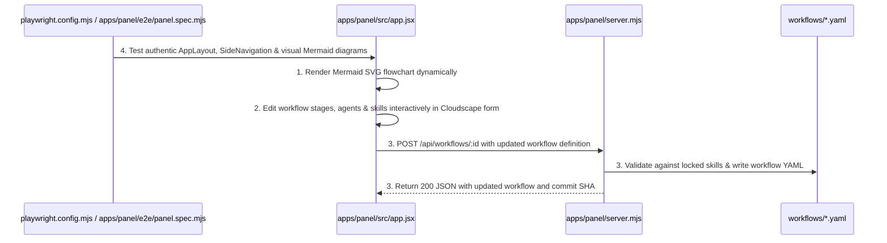
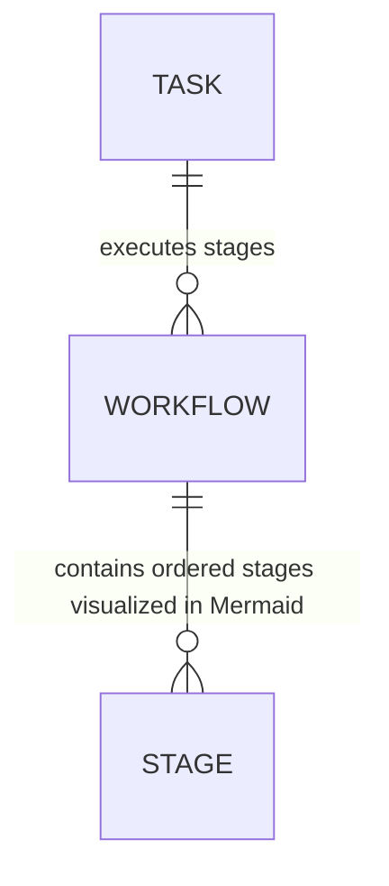

# Visual Mermaid Workflow Designer and Authentic AWS Cloudscape AppLayout

**Approved**: 2026-11-07 - user: "em workflow, quero ter a visao de cada etapa como um workflow tipo mermaid de maneira visual, sera que pelo painel consigo modificar tbm os workflows ou somente direto no codigo ? ia ser bom poder fazer modificacoes. Outro ponto, o cloudscape que voce usou nao me parece exatamente o cloudscape da AWS oficial, tem certeza que usou o oficial?"

## Problem

Operators currently see stages as static text boxes rather than interactive visual Mermaid flowcharts, and editing workflows was limited to typing raw JSON without a visual stage-by-stage builder. Furthermore, while `@cloudscape-design/components` was installed, the Control Panel mixed Cloudscape components with custom HTML `<header>`, raw `<button>`, `<input>`, `<select>`, and custom CSS rather than using the authentic AWS Console layout (`AppLayout` with `SideNavigation`, `TopNavigation`, `ContentLayout`, and 100% native Cloudscape form components).

When this ships, the Control Panel provides:
1. **Interactive Visual Mermaid Workflow Diagram & Live Editor**: renders every workflow (`feature`, `bug`, `investigation`, `discovery`, `chore`) as a visual Mermaid flowchart diagram (`triage --> plan --> checks_and_build --> verify --> review --> merge --> done`) with color-coded human gates and automated stages.
2. **Visual Workflow Customization Builder**: operators can modify workflows directly in the Control Panel (adding/removing stages, toggling humanApproval, changing agent, selecting from locked skills, updating autonomy/limits, with real-time Mermaid preview) and save directly to the workflow YAML file (with optional git commit) via `POST /api/workflows/:id`.
3. **Authentic AWS Console Cloudscape Shell**: adopts the official AWS Console design system layout using `AppLayout` + `SideNavigation` + `TopNavigation` + `ContentLayout` + native Cloudscape `<Button>`, `<Input>`, `<Select>`, `<Table>`, `<Container>`, `<Flashbar>`, `<Badge>`, and `<StatusIndicator>`.

## Shape

This feature updates `apps/panel/src/app.jsx` (incorporating `mermaid`, `AppLayout`, `SideNavigation`, and interactive visual workflow builder), verifies bundle compilation with `scripts/build-panel.mjs`, and tests via Playwright E2E suite (`playwright.config.mjs` and `apps/panel/e2e/panel.spec.mjs`).

1. Operator views Workflows tab -> `apps/panel/src/app.jsx` (exists) - renders authentic AWS Cloudscape `AppLayout` + `SideNavigation` and renders interactive visual Mermaid diagrams (`#wf-mermaid-diagram`) for each workflow stage (door 1, door 2)
2. Operator modifies workflow in UI -> `apps/panel/src/app.jsx` (exists) - updates stages, humanApproval gates, agents, and locked skills with instant live Mermaid diagram re-rendering (door 1)
3. Operator saves workflow -> `apps/panel/server.mjs` (exists) - validates workflow rules via `POST /api/workflows/:id`, saves to disk, and commits to git when requested
4. `playwright.config.mjs` (exists) -> `apps/panel/e2e/panel.spec.mjs` (exists) & `apps/panel/src/app.jsx` (exists) - verifies the authentic Cloudscape `AppLayout`, visual Mermaid rendering (`svg`), and interactive workflow modifications in Chromium with zero regressions (door 1, door 2)

**Changes underneath**

| Front | What changes |
| --- | --- |
| domain | installs `mermaid`, builds authentic AWS Cloudscape `AppLayout` + visual workflow designer in `apps/panel/src/app.jsx` |
| stored data | uses existing workflow YAML files in `workflows/` on disk and `tasks` in SQLite |
| readers | `apps/panel/server.mjs`, `apps/panel/public/index.html`, and `apps/panel/e2e/panel.spec.mjs` |

New: nothing - uses existing workflow YAML structure and SQLite store.

## Surface

| Route | In | Out | Status | Who |
| --- | --- | --- | --- | --- |
| `GET /` | - | HTML + `/bundle.js` + `/bundle.css` with Cloudscape `AppLayout` & `mermaid` | `200` | anyone |
| `POST /api/workflows/:id` | `{ workflow: object, commit: boolean, commitMessage: string }` | JSON `{ ok, workflow, committed, commitSha }` | `200`, `400`, `422` | anyone |

## Landing

| One-way door | Literal shape | Alternative rejected |
| --- | --- | --- |
| Door 1: Visual Mermaid Flowchart & Interactive Workflow Builder | `apps/panel/src/app.jsx` integrating `mermaid.render` dynamically to visualize stage transitions with color-coded human gates and a visual stage modifier form | Text-only JSON editing — rejected because user specifically requested visual Mermaid diagrams and ability to modify workflows directly in the panel |
| Door 2: Full Authentic AWS Console AppLayout | `@cloudscape-design/components` `AppLayout` with `SideNavigation` (with icons, badges, and active state), `ContentLayout`, and 100% native Cloudscape inputs/buttons | Mixing raw HTML headers, buttons, and custom CSS — rejected because user noted it didn't look like the authentic official AWS Cloudscape console |

- Nothing else in this change is hard to reverse

## Criteria

### S1: Authentic AWS Cloudscape AppLayout and Visual Mermaid Workflow Designer (P1)

Deliver the canonical AWS Console `AppLayout` + `SideNavigation` shell and the visual Mermaid workflow builder verified by unit and Playwright E2E tests.

**Acceptance Criteria**

1. WHEN the Workflows tab is rendered in the Control Panel THEN it SHALL render an interactive visual Mermaid diagram (`<svg>` in `#wf-mermaid-diagram`) visualizing the workflow stages and transitions (color-coding human gates vs automated stages), and allow modifying workflow stages, humanApproval, agents, and locked skills directly in the UI, updating the Mermaid visualization in real time and saving to `workflows/` via `POST /api/workflows/:id`.
   - Modifying stage or autonomy in the panel -> live Mermaid SVG re-renders -> click Save -> `200` and saves workflow YAML
2. WHEN the Control Panel is viewed in Chromium THEN it SHALL display the authentic AWS Cloudscape Console shell (`AppLayout` with expandable `SideNavigation` containing active badges, `TopNavigation`, `ContentLayout`, and 100% native Cloudscape `<Button>`, `<Input>`, `<Select>`, `<Table>`, `<Container>`, `<Badge>`, and `<StatusIndicator>`), passing all Playwright E2E tests with zero regressions.

## Out of scope

| Excluded | Why |
| --- | --- |
| Drag-and-drop node graph canvas | A visual stage builder with instant Mermaid SVG rendering and reordering is deterministic, accessible, and works seamlessly with version-controlled YAML |

## Assumptions

| Assumption | Chosen default | Rationale | Confirmed? |
| --- | --- | --- | --- |
| Mermaid theme in Dark Mode | `theme: 'dark'` with custom CSS variables matching AWS Cloudscape dark theme palette | Provides seamless visual integration with `@cloudscape-design/global-styles` dark mode | y |

**Open questions:** none - all resolved or logged above.

## Differences from the source

None - the product matches the source

## Sources

- `AGENTS.md` & `docs/plan.md` - binding - defines workflow schemas and Control Panel capabilities
