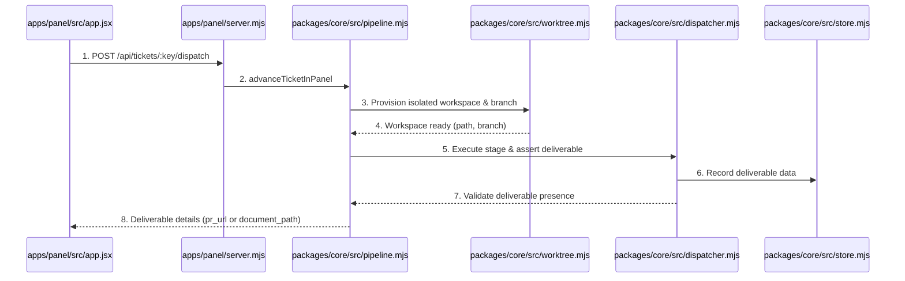
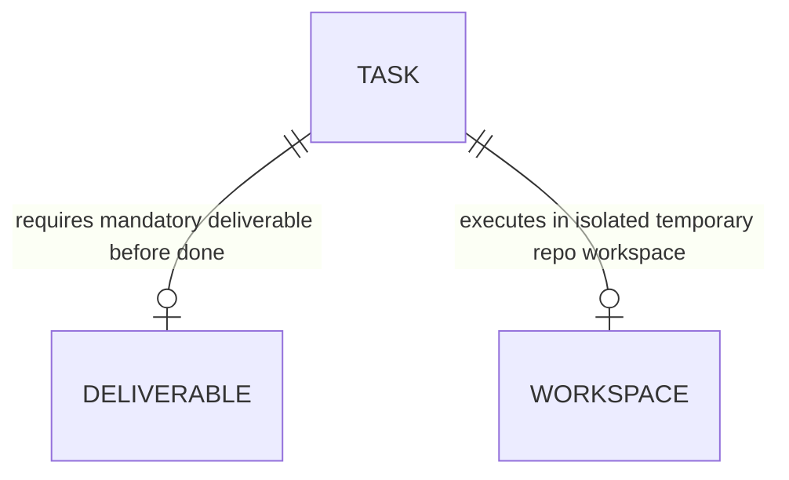

# Workspace Isolation and Concrete Deliverables per Ticket Type

**Approved**: 2026-11-07 - user: "quando esta em triage os tickets, eles estao sendo feitos? eu cliquei em run workflow em um ticket e ele foi direto para done: #85 Add versioned stable-context cache. Para cada tipo de ticket tem que ter uma entrega final. Por exemplo, uma pesquisa deve devolver um documento com o que foi pesquisado, ou alguns documentos. Uma feature deve devolver no mínimo uma PR. Um pull request. Porque a gente tem que adicionar a feature nova no código. E eu acho que a gente não está fazendo isso. Outro ponto é, quando a gente entrega um agente para ver uma issue, um ticket, a gente tem que primeiramente clonar num repositório temporário o repositório da branch principal. E então trabalhar nessa feature nova, ou nesse bug, ou nesse problema. E depois criar esse pull request ou enviar esse arquivo na issue, dependendo do tipo de ticket. Mas a gente não pode fechar sem ter cumprido o nosso papel, que é finalizar, entregando o que é pedido."

## Problem

In the existing Agentic Factory:
1. When an operator triggers "Run Workflow" on a ticket in triage (such as `brenoacker/incident-investigator#85`), the dispatcher executed a synthetic mock loop in a fraction of a second, cycling all stages immediately to `done` without performing real work, modifying code, or producing artifacts.
2. The factory does not create an isolated temporary workspace/clone of the monitored repository's default branch (`main`/`master`) when assigning a ticket to an agent, dirtying local state or failing to isolate multi-repo work.
3. The factory lacks strict deliverable gates per ticket type before a ticket can transition to `done`:
   - Code tickets (`feature`, `bug`, `chore`) transition to `done` without a git branch, commits, or a real Pull Request (`pr_url`).
   - Research and discovery tickets (`investigation`, `discovery`) transition to `done` without a structured markdown research document or PRD attached to the issue and saved in the repository.

When this ships, the Agentic Factory guarantees:
1. **Isolated Workspace Provisioning**:
   - Before any agent operates on a ticket, the factory allocates a dedicated isolated workspace (e.g. `.workspaces/<repo-slug>-issue-<num>`), clones or checks out the target repository at its default branch, prepares skills (`AGENTS.md`, `.agents/skills`), and creates a task branch (`factory/issue-<num>`).
2. **Mandatory Concrete Deliverables per Ticket Type**:
   - For `feature`, `bug`, and `chore`: The task requires a verifiable Pull Request deliverable (`pr_number`, `pr_url`, `branch`, `commit_sha`). It CANNOT transition to `done` or be closed on GitHub/Linear without this open PR.
   - For `investigation` and `discovery`: The task requires a verifiable research document or PRD deliverable (`document_path`, `title`, `content_markdown`, `findings_summary`). The document is committed/persisted and posted directly to the issue/Linear ticket comments.
3. **Deterministic Deliverable Gate**:
   - The pipeline and store enforce that advancing to `done` rejects any task that lacks its mandatory deliverable, preventing premature ticket completion.
4. **Control Panel Deliverables Visibility**:
   - The AWS Cloudscape Control Panel displays the active workspace path, branch name, and direct links to the generated Pull Request (for features/bugs) or the research document viewer (for investigations).

## Shape

This feature updates `packages/core/src/worktree.mjs`, `packages/core/src/pipeline.mjs`, `packages/core/src/dispatcher.mjs`, `packages/core/src/store.mjs`, `apps/panel/server.mjs`, `apps/panel/src/app.jsx`, and tests in `apps/panel/__test__/control-panel.test.mjs` and `apps/panel/e2e/panel.spec.mjs`.

1. Operator clicks "Run Workflow" -> `apps/panel/src/app.jsx` (exists) -> `apps/panel/server.mjs` (exists) -> `packages/core/src/pipeline.mjs` (exists) - provisions isolated workspace from target repo default branch, checks out task branch (door 1)
2. Agent executes stage in workspace -> produces real deliverable:
   - For code workflows (`feature`, `bug`, `chore`): commits changes, pushes branch, opens Pull Request via `gh pr create` / git
   - For analysis workflows (`investigation`, `discovery`): generates markdown report in `docs/research/` or `docs/prd/`, comments document onto ticket
3. Deliverable validation gate -> `packages/core/src/dispatcher.mjs` (exists) & `packages/core/src/store.mjs` (exists) - verifies deliverable exists before permitting `done` transition (door 2)
4. Resolution comment & tracker closing -> `packages/core/src/pipeline.mjs` (exists) - posts PR link or research document summary on GitHub / Linear with commit SHA before closing

**Changes underneath**

| Front | What changes |
| --- | --- |
| domain | workspace provisioner for remote and local repos, deliverable types (`pull_request`, `research_document`), and deliverable validation gate |
| stored data | adds `deliverable_type`, `deliverable_url`, `deliverable_ref`, `workspace_path`, `branch_name` columns to `tasks` table in SQLite |
| readers | `apps/panel/server.mjs`, `packages/core/src/pipeline.mjs`, `apps/panel/src/app.jsx`, and Playwright E2E suite |

New: adds deliverable tracking (pr_url, document_path) and workspace paths in SQLite tasks table.

## Surface

| Route | In | Out | Status | Who |
| --- | --- | --- | --- | --- |
| `POST /api/tickets/:key/dispatch` | `{ approveCurrentStage?: boolean, deliverable?: object }` | JSON `{ ok, status, stage, deliverable, workspace }` | `200`, `400`, `404`, `422` | operator |
| `GET /api/tickets/:key/deliverable` | `{}` | JSON `{ ok, executionKey, deliverable, workspace }` | `200`, `404` | anyone |
| `GET /api/dashboard` | `{}` | JSON with task deliverables, PR URLs, and workspace telemetry | `200` | anyone |

## Landing

| One-way door | Literal shape | Alternative rejected |
| --- | --- | --- |
| Door 1: Isolated Temporary Workspace per Ticket | Dedicated folder in `.workspaces/<repo-slug>/issue-<number>` cloned or checked out from default branch (`main`/`master`) | Working in the root repository — rejected because concurrent tasks dirty git status and risk conflicting changes |
| Door 2: Mandatory Deliverable per Ticket Type | Code tickets require an open Pull Request (`pr_url`); research/discovery tickets require a markdown research document | Dummy instant stage loops with no deliverables — rejected because tasks must fulfill real user obligations before done |
| Door 3: Deterministic Deliverable Gate before Done | Dispatcher and store reject transition to `done` if deliverable is missing, returning `missing_deliverable` error | Allowing tickets to close without verified artifacts — rejected to guarantee delivery integrity |

## Criteria

### S1: Workspace Isolation and Concrete Deliverables (P1)

Provision isolated workspaces from target repositories and enforce mandatory deliverables before marking any ticket done.

**Acceptance Criteria**

1. WHERE an agent is dispatched to work on a ticket THEN the factory SHALL provision an isolated workspace directory cloned or checked out from the target repository default branch (`main` or `master`) and set up task branch and locked skills.
2. WHEN a code workflow (`feature`, `bug`, `chore`) completes THEN the system SHALL verify that a concrete Pull Request deliverable exists (`pr_number`, `pr_url`, `commit_sha`) and SHALL NOT allow transition to `done` without it.
3. WHEN an analysis workflow (`investigation`, `discovery`) completes THEN the system SHALL verify that a concrete research document or PRD deliverable exists (`document_path`, `title`, `content`) and SHALL comment the research findings directly onto the ticket before closing.
4. IF a task attempts to transition to stage `done` without its mandatory deliverable THEN the dispatcher SHALL reject the transition with status `missing_deliverable` and keep the task in review/gate.
5. WHEN the Control Panel dashboard is inspected THEN the AWS Cloudscape UI SHALL display the active workspace path, the branch name, and clickable links to the Pull Request or research document deliverable.

## Out of scope

| Excluded | Why |
| --- | --- |
| Automatic merge of Pull Requests into production without human review | Merging high/medium impact code to main requires human PR review/approval |
| Automatic deletion of workspaces on disk immediately upon completion | Retaining workspace enables post-investigation inspection and fast caching |

## Assumptions

| Assumption | Chosen default | Rationale | Confirmed? |
| --- | --- | --- | --- |
| Workspace location | `.workspaces/<repo-slug>/issue-<number>` | Keeps isolated from root repository and ignored by git | y |
| Code deliverable | GitHub Pull Request URL and branch commit SHA | Fulfills requirement that code tickets produce an open PR | y |
| Research deliverable | Structured Markdown document committed and posted to issue | Fulfills requirement that research/discovery returns concrete findings | y |

**Open questions:** none - all resolved or logged above.

## Differences from the source

None - the product matches the source

## Sources

- User request: "quando esta em triage os tickets, eles estao sendo feitos? eu cliquei em run workflow em um ticket e ele foi direto para done: #85 Add versioned stable-context cache. Para cada tipo de ticket tem que ter uma entrega final..."
- Target repo issue #85: `https://github.com/brenoacker/incident-investigator/issues/85`
