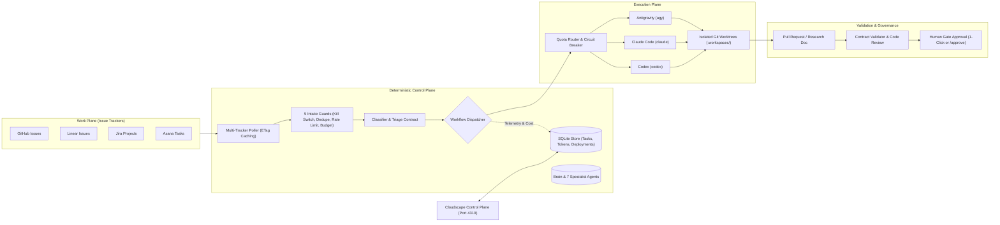

# Agentic Factory

Local, single-operator **Agentic Software Factory**, versioned as code and designed as a **standalone multi-repository orchestrator**.

> **Prose asks. Contracts enforce.** Control stays in the factory, not inside the agent.

---

## Overview

**Agentic Factory** is an autonomous software delivery engine that monitors multiple issue trackers, classifies incoming work into structured pipelines, executes tasks in isolated Git worktrees using pluggable AI runtimes, enforces deterministic stage contracts, and provides a centralized AWS Cloudscape control plane for human governance.



---

## Key Capabilities

- **Multi-Tracker Monitoring & Intake**: Connects directly to **GitHub Issues**, **Linear**, **Jira**, and **Asana**. Supports automated periodic scheduling (`POST /api/scheduler` / `factory watch`) and on-demand sync with per-repository `ETag` caching (`304 Not Modified` consumes zero GitHub rate limit).
- **Customizable Pickup Triggers**: Configures granular intake criteria across providers (stage filters, required flags, excluded blocker flags, custom fields, and assignees).
- **Automatic Classification**: Classifies incoming issues into 5 specialized workflows (`feature`, `bug`, `investigation`, `discovery`, `chore`) via tracker metadata, issue prefixes, or natural language problem descriptions.
- **Isolated Workspaces**: Provisions dedicated `git worktree` checkouts under `.workspaces/issue-<id>/` branched from the target repository's default branch (`factory/issue-<id>`).
- **Pluggable CLI Runtimes**: Out-of-the-box adapters for **Antigravity** (`agy`), **Claude Code** (`claude`), and **Codex** (`codex`), managed by a quota-aware router and an automatic circuit breaker that trips on consecutive failures, timeouts, or HTTP 429/500 errors.
- **Enforced JSON Contracts**: Validates every stage output deterministically using JSON schemas (`contracts/`), rejecting vague root causes, unproven fixes, or commits that do not match the expected HEAD SHA.
- **Mandatory Deliverable Gates**: Requires a verified Pull Request for code workflows and an evidence-backed Research Document for analysis workflows before tasks can transition to `done`.
- **Human Governance & Stalled Task Alarms**: Enforces human approval gates for critical transitions (plan approval, merge approval) with 1-click approvals in the UI or `/approve` comments in issue threads. Automatically flags tasks exceeding `stallThresholdMinutes` with visual warnings and audible alarms.
- **AWS Cloudscape Control Plane**: Web management console (`Agentic Factory Control Plane`) styled with `@cloudscape-design/components` in dark mode, featuring a consolidated side navigation drawer, real-time telemetry, a unified 3-column Kanban board, and a visual Mermaid workflow editor.

---

## Workflows & Pipelines

The factory defines 5 core workflows versioned in `workflows/*.yaml`:

| Workflow | Stages & Gates | Output Deliverable |
| --- | --- | --- |
| **`feature`** | `triage -> plan [human gate] -> checks_and_build -> verify -> review -> merge [human gate] -> done` | Pull Request + Spec plan & checks |
| **`bug`** | `triage -> checks_and_build -> verify -> review -> merge [human gate] -> done` | Pull Request + Regression test |
| **`investigation`** | `triage -> investigate -> human_review [human gate] -> done` | Investigation Report + Follow-up tickets |
| **`discovery`** | `interview [human gate] -> prd_and_design [human gate] -> slice_into_features -> done` | PRD / Technical Design Document + Feature slices |
| **`chore`** | `triage -> checks_and_build -> review -> merge [human gate] -> done` | Pull Request + CI verification |

---

## Agentic Factory Control Plane

The Control Panel runs locally on `http://127.0.0.1:4310` and provides 6 primary views accessible via the `SideNavigation` drawer:

1. **Overview & Telemetry**:
   - Total tickets, completed tickets, active tasks, and human approvals required.
   - Daily USD budget utilization vs. spend and detailed token breakdown (input, output, cache-read).
   - First-round PR approval rate, average review rounds, and cost breakdown by runtime and model.
2. **Board & Needs Human**:
   - **Ticket Intake Form**: Manual or simulated ticket intake with instant heuristic type classification.
   - **Unified 3-Column Kanban Board**: Consolidated columns (`Triage`, `In Progress`, `Done`) with real-time stage transitions, granular internal stage badges (`[plan]`, `[verify]`, `[merge]`), and direct links to generated Pull Requests and Research Docs.
   - **Needs Human Queue**: Dedicated action panel providing 1-click approvals for blocked gates (`Approve & Advance`).
   - **Monitored Trackers & Pickup Triggers**: Multi-repository configuration for GitHub, Linear, Jira, and Asana with combinable pickup triggers.
   - **Stalled Task Alarms**: Real-time alert banner with 1-click acknowledgement when tasks exceed idle thresholds.
3. **Workflows (Factory as Code)**:
   - Interactive visual Mermaid diagram of all 5 stage pipelines with `AUTO` and `HUMAN` indicators.
   - Built-in workflow YAML editor with instant syntax and skill-lock validation.
4. **Runtimes, Router & Circuit Breaker**:
   - Live health status, quota utilization, and error rates for Antigravity, Claude Code, and Codex.
   - Circuit breaker status with 1-click manual reset controls.
5. **Agents & Locked Skills**:
   - Cards for 7 specialist agents (`triager`, `planner`, `builder`, `verifier`, `judge`, `investigator`, `ops`).
   - Verification table auditing SHA-256 integrity digests for all 23 locked skills (`skills.lock.json`).
6. **Controls, Deploy & Brain**:
   - Autonomy modes (`manual`, `triage`, `gated`, `auto-low`), hourly rate limits, daily USD budget caps, and emergency kill switch.
   - Post-deploy verification with automatic rollback to `last_good_sha` on threshold breach.
   - Searchable Brain repository holding persistent factory memory, architecture decision records (ADRs), and lessons learned.

---

## Repository Structure

```
├── AGENTS.md / CLAUDE.md      # Operating constitution and rules for autonomous agents
├── factory.yaml               # Factory configuration (projects, runtimes, limits, autonomy)
├── workflows/                 # Stage definitions for each of the 5 ticket workflows
├── contracts/                 # JSON Schemas governing agent stage outputs
├── skills/                    # Vendored skills (23 locked in skills.lock.json)
├── packages/core/             # Core orchestrator engine (Node 24 + native SQLite)
│   ├── cli.mjs                # Factory command-line interface
│   └── src/                   # Config, store, dispatcher, router, guards, adapters
├── apps/panel/                # AWS Cloudscape web console and server
│   ├── src/app.jsx            # React Cloudscape frontend application
│   ├── server.mjs             # REST API server & static bundle host
│   └── e2e/                   # Comprehensive Playwright E2E and visual test suite
├── agents/                    # 7 specialist agent role definitions
├── brain/                     # Factory memory (ADRs, context, lessons, glossary)
├── docs/                      # Architectural documentation and roadmap
└── test-support/              # Hermetic test helpers and factory clone fixtures
```

---

## Quick Start

### Prerequisites

- **Node.js**: v24.x LTS or higher
- **Python**: v3.10+ (for spec tooling and validation scripts)
- **Git**: 2.40+ (supports worktrees)

### Installation

```bash
# Clone the repository
git clone https://github.com/brenoacker/agentic-factory.git
cd agentic-factory

# Install dependencies
npm ci
```

### Common Commands

```bash
# Validate factory.yaml, workflows, and contract schemas
npm run validate

# Build the Cloudscape Control Panel bundle
npm run build:panel

# Verify locked skills against skills.lock.json
npm run sync-skills

# Run unit tests and Playwright E2E test suites
npm test

# Run full hermetic verification (static checks + unit + E2E)
npm run verify

# Launch the local Control Panel web interface
npm run panel
# Open http://127.0.0.1:4310 in your browser
```

### CLI Operations

```bash
# Add a GitHub repository to monitor
node packages/core/cli.mjs projects --action add --repo owner/my-repo --branch main

# List monitored repositories
node packages/core/cli.mjs projects --action list

# Poll monitored repositories once using ETag caching
node packages/core/cli.mjs watch --once

# Inspect factory status summary
node packages/core/cli.mjs status

# Intake an issue from a JSON payload
node packages/core/cli.mjs intake --file path/to/issue.json

# Dispatch the next stage of an active ticket
node packages/core/cli.mjs run --key "owner/repo#123"

# Approve a human gate from the command line
node packages/core/cli.mjs approve --key "owner/repo#123"
```

---

## Configuration (`factory.yaml`)

The factory is configured via `factory.yaml`:

```yaml
schemaVersion: 1
factory:
  name: "agentic-factory"
  repo: "brenoacker/agentic-factory"
  defaultRuntime: "antigravity"
  autonomy: "gated"            # manual | triage | gated | auto-low
  killSwitch: false
  pollIntervalSeconds: 90
  limits:
    maxTasksPerHour: 10
    maxReviewRounds: 3
    dailyBudgetUsd: 25
    stageTimeoutMinutes: 30
    stallThresholdMinutes: 30
  runtimes:
    antigravity:
      enabled: true
      cli: "agy"
    claude-code:
      enabled: true
      cli: "claude"
    codex:
      enabled: true
      cli: "codex"
  projects:
    - id: "agentic-factory"
      repo: "brenoacker/agentic-factory"
      defaultBranch: "main"
      paused: false
```

---

## Testing & Quality Gates

The factory enforces strict quality and visual standards:
- **Unit & Integration Tests**: 38 test suites exercising config parsing, contract validation, guard chains, quota routing, circuit breaking, and tracker adapters.
- **Playwright E2E & Component Tests**: 12 comprehensive browser test suites (`apps/panel/e2e/panel.spec.mjs`) exercising full user journeys, stage transitions, 1-click approvals, tracker synchronization, and responsive Cloudscape UI components.
- **Hermetic Test Harness**: Runs against local temporary clones (`test-support/factory-clone.mjs`) on dynamic ports (`port 0`), never depending on live external networks or sensitive tokens.

---

## License

This project is open-source. Vendored agent skills are distributed under the CC-BY-4.0 license — see [NOTICE](NOTICE) for details.
