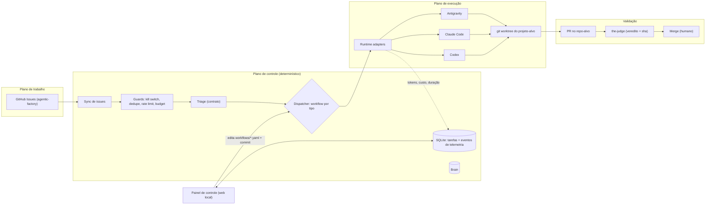
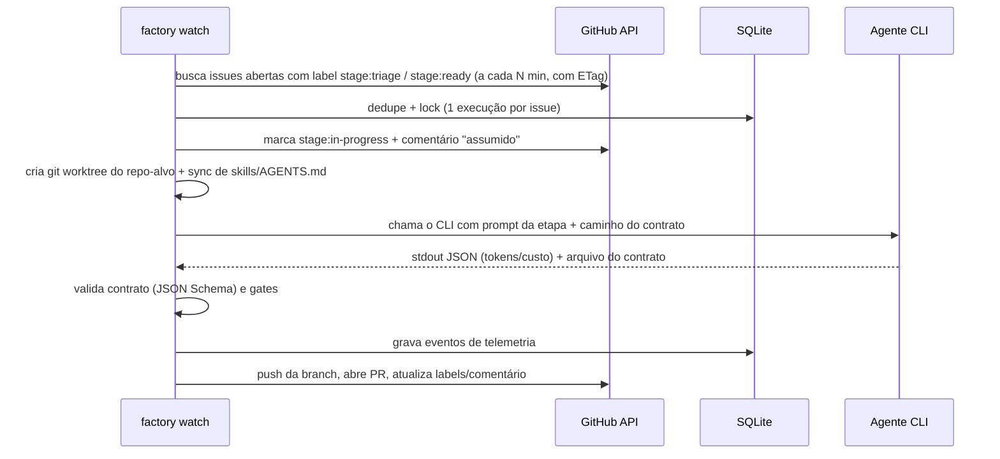

# Plano — Agentic Factory (v2)

> Fontes: Live 02 da TLC (transcrição + PDF) e `tech-leads-club/agent-skills`. A análise das fontes está na v1. Esta versão já traz suas decisões.

## 0. Decisões tomadas

| Tema | Decisão |
| --- | --- |
| Runtime | **Antigravity** como padrão; adaptadores para **Claude Code** e **Codex** |
| System of record | **GitHub Issues do próprio repo `agentic-factory`**. Cada issue aponta para um projeto‑alvo (seus repos) |
| Operação | Solo: sem Slack, sem teammate com identidade própria (dá para adicionar depois) |
| Skills | **Vendorizadas** no repo, fixadas em `skills.lock.json` |
| Repo | `brenoacker/agentic-factory` (privado) |
| Escopo extra | **Tipos de ticket** com workflows próprios e **painel de controle** (o "Lode" da live) |

## 1. Arquitetura



**Princípios da live, aplicados:** as mesmas skills em todo runtime; o controle fica na fábrica (o agente só devolve um contrato JSON validado); sem retry às cegas; no máximo 3 rodadas de review; o agente nunca escreve resultados de provas, merge ou deploy; modelo escolhido por impacto.

## 2. Tipos de ticket → workflows

### Modelo de operação (autonomia)

Você só **cria a issue**. Um processo local da fábrica (`factory watch`) consulta o GitHub a cada N minutos via `gh`, sem precisar de webhook público, e conduz a issue sozinho até o próximo checkpoint humano. A autonomia é configurável por workflow em `factory.yaml`:

| Nível | O que a fábrica faz sozinha | Onde você entra |
| --- | --- | --- |
| `manual` | nada; roda só com `factory run <issue>` | em tudo |
| `triage` | classifica (tipo, impacto, projeto) e pede o que faltar | aciona a execução |
| `gated` *(padrão)* | triage → plano → (**gate**) → build → verify → PR → judge → (**gate**) | aprovar o plano e o merge, pelo painel ou por comentário na issue |
| `auto-low` | igual a `gated`, mas faz merge sozinho quando `impact:low` e o judge aprova com o sha batendo | só em medium/high |

Aprovar = clicar no painel **ou** comentar `/approve` na issue. Isso permite aprovar pelo celular. A fábrica só age enquanto o PC está ligado; para um modo 24/7 como o Willi da live, basta rodar o mesmo `factory watch` numa VPS (opcional, futuro).

### Como a fábrica pega a issue e aciona o agente



- **Consulta**: `gh api` (REST) com ETag. Quando nada mudou, o GitHub responde `304`, que não consome a cota de requisições, então o intervalo de 1 a 2 minutos é seguro.
- **Por que consulta periódica e não webhook**: o webhook exige expor o PC (túnel) ou um runner self‑hosted. Numa VPS no futuro, o webhook entra sem mudar o resto.
- **Como cada runtime é chamado**:

| Runtime | Comando | Uso de tokens |
| --- | --- | --- |
| Claude Code | `claude -p "<prompt>" --output-format json` | no JSON (`usage`, `total_cost_usd`) |
| Codex | `codex exec --json "<prompt>"` | nos eventos JSON |
| Antigravity | `agy` em modo headless ou Python SDK | **a confirmar no spike da Fase 3** |

- **O agente recebe** só a etapa, as skills, o caminho do worktree e o arquivo de contrato a preencher; ele não conhece o fluxo inteiro.
- **Só a fábrica** faz push, abre PR, mexe em labels e comentários e faz merge. O agente apenas commita localmente (de acordo com a regra 8 do `tlc-spec-lean`).
- **Sem retry às cegas**: cada etapa tem timeout. Se estourar ou o contrato vier inválido, a issue recebe `needs-human` e a fábrica não tenta de novo.

Cada tipo vira um arquivo `workflows/<tipo>.yaml`, com etapas, skill, agente, gates e checkpoints humanos.

| Tipo (label) | Etapas | Skills | Saída |
| --- | --- | --- | --- |
| `type:feature` | triage → plan (**gate humano**) → checks → build → verify → PR → review → merge (**humano**) | `tlc-spec-lean`, `coding-guidelines`, `the-judge` | PR + `.specs/` |
| `type:bug` | triage (reproduzir) → checks (teste de regressão primeiro) → build → verify → PR → review | `codenavi`, `tlc-spec-lean` (modo pequeno, só `checks.md`), `the-judge`, `gh-fix-ci` | PR |
| `type:investigation` | triage → investigar → relatório → **revisão humana** → tickets de follow‑up | `codenavi`, `not-your-babysitter`, `sentry` (opcional), `the-fool` | relatório em contrato + issues novas |
| `type:discovery` | interview → PRD/design doc → **aprovação humana** → quebra em features | `tlc-prd`, `tlc-discover`, `create-technical-design-doc`, `create-adr`, `the-jury` | doc + issues `type:feature` |
| `type:chore` | triage → build → PR | `gh-fix-ci`, `docs-writer`, `coding-guidelines` | PR |

Labels de apoio: `project:<repo>`, `stage:<etapa>`, `impact:low|medium|high` (posto pela triage com a régua da TLC), `needs-human`, `runtime:<agy|claude|codex>` (override opcional).

## 3. Painel de controle

Um web app local (`apps/panel`) que lê o SQLite da fábrica e o `factory.yaml`/`workflows/`.

| Tela | Conteúdo |
| --- | --- |
| **Overview** | Tarefas concluídas por semana, lead time, cycle time por etapa, custo total e por tipo/projeto, tokens (entrada, saída, cache), % de PRs aprovados na 1ª rodada, média de rodadas de review, taxa de falha/abort, intervenções humanas |
| **Board** | Kanban por etapa (triage → done), com cards mostrando tipo, projeto, runtime/modelo e custo acumulado; fila **"precisa de mim"** |
| **Detalhe do ticket** | Timeline da execução: etapas, agente, runtime, modelo, duração, tokens, custo, gates passados/falhados, veredito; links para `plan.md`, `checks.md`, `verification.md`, PR e logs |
| **Workflows** | Diagrama de cada workflow (etapas, skills, gates, checkpoints humanos, modelo por impacto). A edição valida o schema e grava o YAML com commit, mantendo a fábrica como código |
| **Controles** | Kill switch global e pausa por projeto, limite por hora, concorrência, orçamento diário (USD/tokens), runtime padrão |
| **Runtimes & modelos** | Uso e custo por Antigravity, Claude Code e Codex, e por modelo |
| **Skills** | Skills vendorizadas, versões, uso por etapa, lessons |
| **Agentes** *(live)* | Catálogo de agentes especialistas (triage, planner, builder, verifier, judge, QA, ops): a responsabilidade de cada um, as etapas onde atua, as skills, o runtime e o modelo |
| **Integrações** *(live)* | Conectores da fábrica: GitHub (issues/PRs/CI), Sentry, PostHog e outros. Mostra o status de cada um e quais eventos ele injeta no fluxo |
| **Execução e roteamento** *(Felipe)* | Ambiente por etapa (worktree local, sandbox, cloud); roteador **manual ou automático** (no automático, vence quem tem mais cota livre); **circuit breaker** por runtime (timeout, 500 ou 429 tiram o executor da fila) |
| **Deploy e medição** *(Felipe/Lode)* | Etapa de deploy configurável, hash do deploy, medição pós‑deploy contra limiares, rollback, "último commit bom" |
| **Memória** *(Q&A da live)* | Memória da própria fábrica: decisões, lessons e o que cada execução aprendeu |

**Ações dentro do painel** *(demo do William)*:
- **Aprovar ou desbloquear um gate com um clique**: aprovar o plano, aprovar o PR para merge e responder a um `needs-human`.
- **Loop de volta**: um sinal de produção (ex.: Sentry) reabre a issue em `triage` e isso fica visível no board.
- **Notificação do progresso de cada etapa** (opcional para quem só observa; o observador não pode alterar entrada, roteamento ou contrato).
- **Visual do fluxo inteiro** destacando, por etapa, o que é **automático** e o que exige **humano**.

**Métricas que vêm da live**: custo por feature/tarefa, agente por etapa, % de PRs aprovados sem humano (referência Monday: 56%), rodadas de review (limite de 3), modelo por impacto, tarefas devolvidas para triage, rollbacks. *Lead time, cycle time e orçamento são acréscimos meus.*

**Telemetria**: um log de eventos append‑only (`run_started`, `stage_entered`, `agent_invoked`, `usage`, `gate_result`, `verdict`, `pr_opened`, `human_needed`, `merged`, `aborted`). O custo vem de `tokens × config/prices.yaml`; quando o runtime informa o custo, usamos o valor dele.

| Runtime | Como capturar uso |
| --- | --- |
| Claude Code | `claude -p --output-format json` traz `usage` e `total_cost_usd` |
| Codex | `codex exec --json` emite eventos com `usage` de tokens |
| Antigravity | `agy` CLI / Python SDK. **Spike na Fase 3** para confirmar os campos de uso; se não houver, estimar a partir do transcript |

## 4. Estrutura do repositório

```
agentic-factory/
├── AGENTS.md / CLAUDE.md        # constituição (Antigravity e Codex leem AGENTS.md; CLAUDE.md importa AGENTS.md)
├── factory.yaml                 # projetos-alvo, runtime padrão, modelo por impacto, limites, orçamento
├── workflows/                   # feature.yaml, bug.yaml, investigation.yaml, discovery.yaml, chore.yaml
├── contracts/                   # JSON Schemas (task, triage, investigation-report, review) + exemplos
├── skills/vendor/ skills/custom/ skills.lock.json
├── config/prices.yaml
├── packages/core/               # orquestrador TS: sync GitHub, guards, dispatcher, adapters, event store
├── apps/panel/                  # painel (Vite + React) + API local
├── brain/                       # contexto, ADRs, lessons
├── scripts/                     # vendor-skills, sync-skills (→ .agents/skills, .claude/skills, .codex), doctor
├── docs/                        # plano, arquitetura, ADRs da fábrica
└── .github/                     # issue templates por tipo, CI
```

Stack: **TypeScript + Node 24**, com SQLite nativo (`node:sqlite`). Uma linguagem só para o core e o painel. As skills TLC continuam usando os scripts Python delas.

## 5. Roadmap

| Fase | Entrega | Pronto quando |
| --- | --- | --- |
| **0. Bootstrap** *(agora)* | repo no GitHub, README, AGENTS.md, docs, issue templates por tipo, labels | repo publicado, issue de teste criada pelo template |
| **1. Skills** | vendorizar as skills TLC + lock + `sync-skills` para os 3 runtimes | `tlc-spec-lean` disponível no Antigravity, no Claude Code e no Codex |
| **2. Core** | `factory.yaml`, `workflows/`, contratos, `factory validate`, sync de issues → SQLite, guards | CI verde; `factory status` lista as issues |
| **3. Runtimes + 1º loop autônomo** | adapters (Antigravity primeiro), worktrees, `factory run <issue>` **e `factory watch`** no nível `gated`, `/approve` | criar uma issue real → a fábrica pega sozinha → PR + veredito, com telemetria gravada |
| **4. Painel v1** | Overview, Board, Detalhe, Runtimes (somente leitura) | métricas e custo da Fase 3 visíveis |
| **5. Investigation, Discovery e Brain** | os workflows restantes + `brain/` | relatório de investigação gera issues de follow‑up |
| **6. Painel v2 (controle)** | controles, orçamento, editor de workflows com commit | editar um gate no painel gera um commit válido |
| **7. Autonomia ampliada** | nível `auto-low`, agendamento como serviço do Windows, opção de VPS 24/7 | issue `impact:low` vai de criada a mergeada sem intervenção |

## 6. Verificação

CI valida o schema de `factory.yaml`, `workflows/` e contratos, o lock das skills e os testes do core e do painel. Cada fase fecha com um piloto num dos seus repos, e o próprio desenvolvimento da fábrica usa `tlc-spec-lean`.

## 7. Em aberto

- Quais repos seus entram primeiro em `factory.yaml` (Fase 3)?
- Licença do repo (deixei sem licença por enquanto; as skills TLC são CC‑BY‑4.0 e ficam com atribuição em `NOTICE`).
