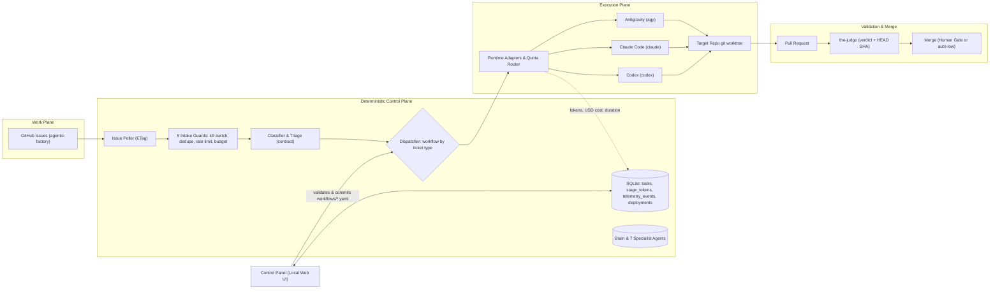

# Architecture & Roadmap — Agentic Factory (v2)

> Sources: Tech Leads Club Live 02 (transcript + summary PDF) and `tech-leads-club/agent-skills`.

## 0. Architectural Decisions

| Topic | Decision |
| --- | --- |
| Default Runtime | **Antigravity (`agy`)** by default; first-class adapters for **Claude Code (`claude`)** and **Codex (`codex`)** |
| System of Record | **GitHub Issues in `brenoacker/agentic-factory`**. Each issue targets a repository configured in `factory.yaml` |
| Operation Mode | Single-operator local control plane (`127.0.0.1`) with optional 1-click panel approvals or `/approve` issue comments |
| Skills | **23 TLC skills vendored** in `skills/vendor/` and SHA-256 locked in `skills.lock.json` (`tlc-spec-lean` v2.2.0) |
| Repository | `brenoacker/agentic-factory` (private) |
| Workflows & UI | **5 ticket workflows** (`feature`, `bug`, `investigation`, `discovery`, `chore`) + **Control Panel** (`apps/panel`) verified with **Playwright** |

## 1. Architecture

## 2. Ticket Types & Workflows

| Ticket Type | Workflow Stages | Primary Skills | Output |
| --- | --- | --- | --- |
| `feature` | `triage -> plan (human gate) -> checks_and_build -> verify -> review -> merge (human gate) -> done` | `codenavi`, `tlc-spec-lean` v2.2.0, `coding-guidelines`, `the-judge` | PR + `.specs/` |
| `bug` | `triage -> checks_and_build -> verify -> review -> merge (human gate) -> done` | `codenavi`, `tlc-spec-lean` v2.2.0, `the-judge`, `gh-fix-ci` | PR + regression test |
| `investigation` | `triage -> investigate -> human_review (human gate) -> done` | `codenavi`, `not-your-babysitter`, `the-fool` | `investigation-report` + follow-up tickets |
| `discovery` | `interview (human gate) -> prd_and_design (human gate) -> slice_into_features -> done` | `tlc-prd`, `tlc-discover`, `create-technical-design-doc`, `create-adr`, `the-jury` | PRD/TDD + feature slices |
| `chore` | `triage -> checks_and_build -> review -> merge (human gate) -> done` | `codenavi`, `gh-fix-ci`, `docs-writer`, `mermaid-studio`, `the-judge` | PR |

## 3. Control Panel & Playwright Verification

The local Control Panel (`apps/panel/server.mjs` + `apps/panel/public/index.html`) is 100% English and provides:
- **Overview & Telemetry**: Total tickets, completed tickets, USD spend vs daily budget, token breakdown (input/output/cached), first-round PR approval rate, average review rounds, and usage tables by runtime and model.
- **Board & Needs Human**: Live Ticket Intake & Classifier form, Kanban columns across workflow stages, per-ticket stage advancement (`Dispatch Next Stage`), 1-click Human Gate Approval, and Sentry production alert loop-back to `triage`.
- **Workflows (Factory as Code)**: Visual stage pipeline for all 5 workflows (`AUTO` vs `HUMAN` badges) plus interactive JSON/YAML workflow editor that validates locked skills and commits changes to Git.
- **Runtimes, Router & Circuit Breaker**: Quota-aware router status, consecutive failures, last error code, and 1-click circuit breaker reset.
- **Agents & Locked Skills (23)**: 7 specialist agent cards (`triager`, `planner`, `builder`, `verifier`, `judge`, `investigator`, `ops`) and SHA-256 verification table for all 23 vendored skills.
- **Controls, Deploy & Brain**: Autonomy selector (`manual`, `triage`, `gated`, `auto-low`), rate limit, daily USD budget, global kill switch, post-deploy verification with automatic rollback to `last_good_sha`, and Brain viewer.

Every visual component, API integration, and end-to-end 5-ticket workflow is verified by Playwright (`npx playwright test` in `apps/panel/e2e/panel.spec.mjs`).
